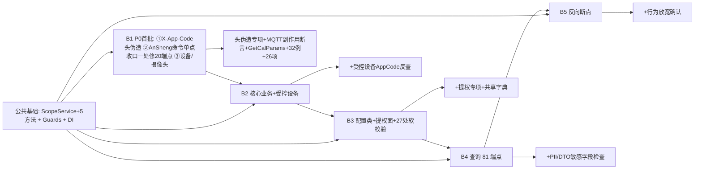

# 多客户授权模型遗留缺口统一修复方案

> 文档状态：**仅供用户评估，确认后才施工**。本轮不写任何业务代码、不执行 git 写操作、不启停服务、不执行 `dotnet run`。
> 架构师：高见远（Bob / auth-gap-architect）
> 上游输入：任务 #128 `recon-auth-gaps` + 任务 #130 `recon-query-gaps` 全仓只读侦察及后续 4 轮补充判定（写侧 12 个"需确认"端点已 12/12 逐项落定）
> 参考基线：`multi-customer-auth-design.md`（原模型设计，D1–D9 为本文公理）、`multi-customer-auth-m09-handoff.md`
> **规模（定稿口径）：写端点 101 + 查询端点 81 = 182 个缺口**（早期口径作废）。另有约 10 个"反向功能断点"非缺口但需一并处理。全部修，其他模块同类缺口一并纳入。

---

## 0. 定稿修订摘要（相对初版）

| 项 | 初版 | 定稿 | 触发原因 |
|---|---|---|---|
| 缺口总数 | 早期口径 | **182** | 写侧：初版 84 → +5（Attachments/Contracts）→ +12（剩余需确认全判 B）= 101；查询侧 81；合计 182 |
| 修复模式 | 8 | **11** | 新增 M9 请求头归属伪造、M10 提权面、M11 名义 GET 实际写 |
| 最高优先级 | 设备命令 | **X-App-Code 请求头伪造**（不受角色限制，任何持上传权限者可越权） | 侦察实证 `X-App-Code` 完全前端可控且原样落库 |
| 批次 | 5 | **5**（B1 内含 X-App-Code P0-0 与 AnSheng 单点收口） | P0-0 不单列批次，作为 B1 内最高优先子项先合入 |
| 命令族修法 | 19 个 Controller 各加 Guard | **`AnShengCommandService.SendCommandAsync` 单点收口，一处覆盖 20 端点（含 GetCalParams）** | 侦察确认共享统一入口 |
| 估算文件数 | 75 | **≈ 96** | 新增 Service 层双保险、提权面、头伪造相关文件 |
| 最高危项处置 | 未列 | **B1 内 X-App-Code 头伪造（P0-0）+ AnSheng 单点收口（一处修 20 端点）** | 头伪造不受角色限制；命令族共享 SendCommandAsync 统一入口 |

---

## 1. 方案总览

### 1.1 一句话思路

**把散落在 182 个端点里的"单 AppCode / 客户端可控归属"鉴权，统一替换为"以 `ICustomerScopeService` 为唯一事实来源的服务端派生范围判定"，固化为 11 种标准模式，Controller 解析范围、Service 用新增 scope 重载下推过滤并在关键单点（命令服务、文件服务、仓储）做二次收口；旧签名原样保留给下级与内部调用路径。**

### 1.2 核心原则（不可妥协）

| 原则 | 含义 | 违反后果 |
|---|---|---|
| **A. 统一走 ICustomerScopeService** | 所有越权判定只经 `ResolveAsync` / `CanAccessCustomerAsync` / `GetAppCodesAsync`，不再出现第二套判据 | 判据漂移，修一处漏一处 |
| **B. fail-closed（默认拒绝）** | admin 的 `appCode=null` 不再是"跳过校验"的信号，而是"必须走集合校验"的信号；任何拿不到归属的写/详情操作一律 403 | 软校验恒假 = 全仓洞 |
| **C. 不依赖两层过滤器** | `AppDbContext.ConfigureGlobalQueryFilters:174-207` 空 AppCode 即 `return` 且 `Expression.Constant` 启动期冻结；`Repository.ApplyFilters:168-189` 同样 appCode 空则零过滤。**两层都不能兜底**，过滤必须业务层显式 `Contains` | 依赖即失效 |
| **D. 下级（Single）零回归** | 下级路径的 claim、DTO、Service 旧签名、取数过滤**逐字不改**；新增能力一律走重载 | 破坏 G3，1104 全量回归炸 |
| **E. 超管（All）全量不变** | `CustomerScopeMode.All` 的空集合表示"不过滤"，**绝不按集合空否分支** | 超管看不到全量 |
| **F. 模式化批量修** | 182 个缺口归为 11 种模式，每种一个代码模板 + 正面范式；写专用 Guard 与 Service 单点收口收敛重复代码 | 工期爆炸、质量不齐 |
| **G. 越权无副作用** | 403 判定必须在任何 EF 写库、任何 MQTT 下发、任何摄像头控制、任何物理文件删除**之前**完成 | 越权成功但返回 403 |
| **H. 归属只从服务端派生（新增，最高优先）** | **禁止采信任何客户端可控的归属来源**：`Request.Headers["X-App-Code"]`、请求体 `appCode`（未经校验）、`tenantContext`（admin 为 null）。AppCode 一律由"已授权的目标 CustomerId"反查 | 头伪造可绕过一切角色模型，任何角色可越权 |
| **I. 按行为判定权限，不按 HTTP 方法（新增）** | 名义 `GET` 若底层 Service 下发命令/改数据，必须按写操作鉴权（`GetCalParams` 为范例） | 查询侧漏掉实际写操作 |

### 1.3 修复效果预期

| 角色 | 修复前 | 修复后 |
|---|---|---|
| 超管 `super_admin`（All） | 全量 | 全量（零改动；但**不再能通过头伪造绕过**——归属仍需显式指定） |
| admin / manager（Multi `[1,2,3]`） | 182 处软校验跳过 → 可读写任意租户、跨租户控制物理设备、造平台级角色提权 | 集合内 200，集合外 403；权限不可越权授予 |
| 下级 `operator/user`（Single） | 正常（但**上传端点可被头伪造越权**） | 正常（claim 单值零回归）+ 头伪造被堵 |
| **任意持上传权限者**（含下级） | 伪造 `X-App-Code` 即写任意租户附件 | 头不再被采信，归属由服务端派生 |
| 共享 system 字典 | 任意租户可读 | 可读；写/删仅超管（见 §3.5 决策点 2） |

---

## 2. 根因与统一修法：11 种修复模式

### 2.0 根因复盘

admin 的 JWT 只签 `ManagedCustomerIds="1,2,3"`、**不签单值 `AppCode`/`CustomerId`**（D7）；而全仓鉴权代码仍是"单 AppCode"语法，叠加一类与角色模型无关的"客户端可控归属"缺陷，五类失效同时发生：

```csharp
// ① 软校验恒假 —— appCode 为 null，整段条件短路跳过（Service 层 27 处）
if (!string.IsNullOrEmpty(appCode) && entity.AppCode != appCode) throw new ForbiddenException();

// ② 归属回退直接采信请求体 —— admin 的 TenantAppCode=null，request.AppCode 长驱直入
var effectiveAppCode = TenantAppCode ?? request.AppCode;
entity.AppCode = appCode ?? request.AppCode;

// ③ 双层过滤器皆空转
if (string.IsNullOrEmpty(appCode)) return;                    // AppDbContext:174-207，且 Expression.Constant 启动期冻结
// Repository.ApplyFilters:168-189 —— appCode 空则零过滤

// ④ 【P0-0，与角色无关】请求头伪造归属 —— AttachmentsController:76-77,130-131
var appCode = Request.Headers["X-App-Code"].FirstOrDefault() ?? _tenantContext.AppCode;
// FileStorageService.cs:142 —— AppCode = appCode 原样落库，零校验
// → 任何持上传权限的调用者伪造该头即可把附件写到任意租户名下

// ⑤ 【提权面】CreateRole —— RoleService:121-135 + PermissionService:204-214
// appCode=null → resolvedAppCode=null → 建成"AppCode=null 平台级角色"；
// request.Permissions 原样序列化无白名单降级 → GetEffectivePermissionsAsync 按 Code 读该 JSON → 赋给自己用户提权
```

**统一修法**：Controller 先用范围服务把"身份 → 授权客户集合"解析出来，再按端点类型套用下面 11 种模式之一；所有"拿归属"的动作都用 `IgnoreQueryFilters()` 点查（铁律 5），**任何归属值必须来自服务端派生**。

### 2.1 模式总表

| 模式 | 名称 | 适用缺口 | 正面范式 / 反面实证 | 批次 |
|---|---|---|---|---|
| **M1** | 带 `CustomerId` 的创建 | Users / Projects / WorkOrders / Alerts / Archives / ETL 等 create | `UsersController.CreateUser:89-108`（正面） | B2/B3 |
| **M2** | 带 `AppCode` 的创建 + 归属回退修复 | ProtocolConfigs / Dictionaries / DataRules / ETL / Settings create | `ProtocolConfigsController:98`（反面） | B3 |
| **M3** | 按 id 改删 + 防租户劫持 | 全部 PUT/DELETE/{id}；含受控设备、网关、隧道 | `CustomersController.Update/Delete:357-362,428-433` | B2/B3 |
| **M4** | 间接归属 `deviceId`/`areaId`/`projectId`/`commandId` | AnSheng 命令族 19 + GetCalParams + DeviceCommands 4 + 网关/隧道 8 | `DevicesController.GetDevicesByArea:127-161` | B1 |
| **M5** | 列表查询范围下推 | GET 列表约 40 个（含 UserService / ProtocolConfigService） | `AreaService.GetAreasAsync(..., customerIds)` | B4 |
| **M6** | 详情归属校验 | GET /{id} 详情约 41 个（含密码哈希/密钥/指令 P1） | `CustomersController.GetCustomer:198-205` | B4 |
| **M7** | Ezviz 摄像头特殊 | EzvizController 8 个写端点 + 列表 | `EzvizService.cs:279-289`（反面） | B1 |
| **M8** | 反向功能断点三分支改写 | admin 改自己客户的区域/用户/角色反而永远 403 | `CustomersController` scope 三分支 | B5 |
| **M9** | **请求头/请求体归属伪造（P0-0）** | Attachments Upload/UploadBatch/Delete、Contracts UploadContract/DeleteContract（5） | `AttachmentsController:76-87` + `FileStorageService:142`（反面） | **B1（批内最高优先子项）** |
| **M10** | **提权面** | `RolesController.CreateRole` | `RoleService:121-135` + `PermissionService:204-214`（反面） | B3 |
| **M11** | **名义 GET 实际写（按行为鉴权）** | `AnShengEnergyController.GetCalParams:212-230` | `AnShengCommandService:107-109`（反面） | B1 |

---

### 2.2 M1 — 带 CustomerId 的创建

**触发条件**：请求体含 `CustomerId`，写库时把该 `CustomerId`/`AppCode` 落到实体上。

**标准模板**（首选模板，直接抄 `UsersController.CreateUser`）：

```csharp
[HttpPost]
[PermissionAuthorize(Permissions.CREATE_XXX)]
public async Task<ActionResult<ApiResponse<XxxDto>>> CreateXxx([FromBody] CreateXxxRequest request)
{
    try
    {
        // 【M1】admin 必须带 CustomerId 且必须在授权集合内；校验在任何写库之前。
        if (Roles.ADMIN == User.FindFirst(ClaimTypes.Role)?.Value)
        {
            if (!request.CustomerId.HasValue)
                return Ok(ApiResponse<XxxDto>.BadRequest("租户管理员必须在授权客户下创建。"));
            if (!await _customerScope.CanAccessCustomerAsync(User, request.CustomerId.Value))
                return Ok(ApiResponse<XxxDto>.Forbidden("无权在该客户下创建"));

            // customerScopeVerified=true：Service 层二次防御的凭据（见 §3.4）
            var appCode = await _customerScope.ResolveAppCodeByCustomerIdAsync(request.CustomerId.Value);
            var result = await _xxxService.CreateAsync(request, appCode, customerScopeVerified: true);
            return ApiResponse<XxxDto>.Success(result, "创建成功");
        }
        // 超管 / 下级：原路径逐字不改
        return ApiResponse<XxxDto>.Success(await _xxxService.CreateAsync(request));
    }
    catch (InvalidOperationException ex) { return Ok(ApiResponse.BadRequest(ex.Message)); }
    catch (Exception ex) { return Ok(ApiResponse.Error(ex.Message)); }
}
```

**Service 二次防御**：新增 `CreateAsync(request, appCode, bool customerScopeVerified)` 重载；范本 `UserService.CreateUserAsync:139-154`。

**覆盖端点**：Projects CreateProject（`:129-146` 现状零校验直接 EF 写）、WorkOrders create、Alerts create、Archives create、ETL create 等。

---

### 2.3 M2 — 带 AppCode 的创建 + 归属回退修复

**触发条件**：请求体带 `AppCode`，现状是 `TenantAppCode ?? request.AppCode` / `appCode ?? request.AppCode`。

**标准模板**：

```csharp
private async Task<(bool ok, string? appCode)> ResolveWriteAppCodeAsync(string? requestAppCode, long? customerId)
{
    var role = User.FindFirst(ClaimTypes.Role)?.Value;
    if (Roles.IsSuperAdmin(role))
        return (true, customerId.HasValue
            ? await _customerScope.ResolveAppCodeByCustomerIdAsync(customerId.Value)
            : requestAppCode);   // 超管代租户创建，归属仍从目标客户派生

    if (role == Roles.ADMIN)
    {
        // 【关键】不再 `?? request.AppCode`；请求体 AppCode 只是"待校验目标"，不是授权凭据。
        var targetId = customerId ?? (string.IsNullOrWhiteSpace(requestAppCode) ? (long?)null
            : await _customerScope.ResolveCustomerIdByAppCodeAsync(requestAppCode));
        if (!targetId.HasValue || !await _customerScope.CanAccessCustomerAsync(User, targetId.Value))
            return (false, null);
        return (true, await _customerScope.ResolveAppCodeByCustomerIdAsync(targetId.Value));
    }

    return (true, User.FindFirst("AppCode")?.Value);   // 下级：claim 单值，零回归
}
```

**覆盖**：`ProtocolConfigsController.CreateProtocolConfig:98`、Dictionaries/DataRules/ETL/Settings create 等约 22 个写端点。

---

### 2.4 M3 — 按 id 改删 + 防租户劫持

**三个子型**：M3a 实体有 `CustomerId` 列直接比对；M3b 只有 `AppCode` 列则点查反推；M3c 请求体可改写归属 → 非超管**冻结归属**（`request.AppCode = entity.AppCode`，或不一致即 403）。

**标准模板**：

```csharp
var entity = await _db.Xxxes.AsNoTracking().IgnoreQueryFilters()
    .Where(x => x.Id == id).Select(x => new { x.CustomerId, x.AppCode }).FirstOrDefaultAsync();
if (entity == null) return Ok(ApiResponse<XxxDto>.BadRequest("记录不存在"));

var scope = await _customerScope.ResolveAsync(User);
bool allowed = scope.Mode switch
{
    CustomerScopeMode.All => true,
    CustomerScopeMode.Multi => entity.CustomerId.HasValue && scope.CustomerIds.Contains(entity.CustomerId.Value),
    _ => !string.IsNullOrEmpty(User.FindFirst("AppCode")?.Value)
         && User.FindFirst("AppCode")?.Value == entity.AppCode
};
if (!allowed) return Ok(ApiResponse<XxxDto>.Forbidden("无权修改该记录"));

if (scope.Mode != CustomerScopeMode.All)
{
    request.CustomerId = entity.CustomerId;  // M3c：冻结归属，禁止改到别的租户
    request.AppCode = entity.AppCode;
}
```

**正面范式**：`CustomersController.Update/Delete:357-362, 428-433`。

**本批需特别注意的 M3 变体**：

| 端点 | 现状 | 修法要点 |
|---|---|---|
| `ControlledDevicesController.UnregisterDevice:93-95` / `UpdateDevice:169-171` / `ToggleFavorite:193-195` | 软校验对 null 跳过（`ControlledDeviceService:100-105/120-125/209-214`）→ 删/改/收藏任意租户受控设备 | M3 + **删除/收藏后不得残留跨租户缓存** |
| `GatewaysController.StartGateway:153-157` / `StopGateway:180-184` | `GetQueryable(null)` 零过滤 → 启停任意租户网关，破坏采集链路（`GatewayService:115-135/137-153`） | 先点查网关归属 → CanAccess → 再启停；副作用断言"越权不触发启停" |
| `TunnelsController.ConnectTunnel:153-157` / `DisconnectTunnel:180-184` | `Query(null)` 零过滤（`TunnelService:115-135/137-152`） | 同上 |
| `DeviceCommandsController.CancelCommand:182-183` | appCode=null 软校验跳过（`DeviceCommandService:292-300`） | Command → CustomerId 点查 → CanAccess → 取消 |
| `DeviceCommandsController.RetryCommand:202-206` | **Controller 完全不传 appCode**，Service 按 commandId 裸查（`DeviceCommandService:392-396`）→ 可重试任意租户指令（重新下发到设备，风险更高） | Controller 必须传 scope；与 CancelCommand **同批处理** |

---

### 2.5 M4 — 间接归属 `deviceId`/`areaId`/`projectId`/`commandId`

**触发条件**：路由参数或实体关联 ID 本身无 `CustomerId`，需先查设备/区域/项目/指令归属。

#### 2.5.1 【核心工程杠杆】AnSheng 命令族单点收口

侦察确认：`AnShengSwitchController`(4) + `AnShengScheduleController`(2) + `AnShengEnergyController`(6) + `AnShengWaterFlowController`(4) + `AnShengController`(3) 共约 **19 个写端点**，加上名义 GET 的 `GetCalParams`，**全部汇聚到同一个入口**：

```
Controllers/{AnSheng*Controller}  ≈20 端点
        ↓
Services/AnShengCommandService.cs:107-109  SendCommandAsync(...)   ← 仅按 deviceId 查设备，无归属校验
        ↓
MQTT / 物理设备
```

**决策：不在 19 个 Controller 逐个加校验，在 `SendCommandAsync` 一处收口。** 一处修复覆盖全部（含 M11 的 GetCalParams），最经济且不会漏。

```csharp
// Services/AnShengCommandService.cs —— 新增带 principal 的重载；旧签名保留给内部/调度路径
public Task<CommandResult> SendCommandAsync(long deviceId, CommandRequest cmd, CancellationToken ct)
    => SendCommandAsync(deviceId, cmd, principal: null, ct);   // 仅内部系统路径调用，显式标注

public async Task<CommandResult> SendCommandAsync(long deviceId, CommandRequest cmd,
    ClaimsPrincipal? principal, CancellationToken ct)
{
    // 【M4 单点收口】任何经 Controller 进来的命令都必须带 principal 并校验归属。
    if (principal == null)
        throw new UnauthorizedAccessException("系统内部命令通道，禁止外部调用");

    await _deviceGuard.EnsureCanOperateAsync(principal, deviceId, ct);  // 越权在此抛出，MQTT 之前

    var device = await _db.Devices.AsNoTracking().IgnoreQueryFilters()
        .Where(d => d.Id == deviceId).Select(d => new { d.CustomerId, d.AppCode }).FirstOrDefaultAsync(ct);
    if (device == null) throw new NotFoundException("设备不存在");
    ...
}
```

**Controller 侧**：把原来的 `SendCommandAsync(deviceId, cmd)` 调用改为传 `User`（纯机械替换，19 处 + 1 处 GetCalParams）。

> ⚠️ 与既有 `Services/AnShengCommandGuard.cs`（MQTT 协议/状态守卫）区分：本文的 `IDeviceAccessGuard` **只做租户归属判定**，两者职责不同，不要合并。

#### 2.5.2 DeviceAccessGuard（其余端点）

```csharp
public interface IDeviceAccessGuard
{
    Task EnsureCanOperateAsync(ClaimsPrincipal principal, long deviceId, CancellationToken ct = default);
    Task EnsureCanOperateAsync(ClaimsPrincipal principal, IReadOnlyCollection<long> deviceIds, CancellationToken ct = default); // 批量，避免 N+1
    Task EnsureAreaAccessAsync(ClaimsPrincipal principal, long areaId, CancellationToken ct = default);
    Task EnsureProjectAccessAsync(ClaimsPrincipal principal, long projectId, CancellationToken ct = default); // Contracts 上传用
}
```

**Guard 实现骨架**：

```csharp
var owner = await _db.Devices.AsNoTracking().IgnoreQueryFilters()
    .Where(d => d.Id == deviceId).Select(d => new { d.CustomerId, d.AppCode }).FirstOrDefaultAsync(ct);
if (owner == null) throw new NotFoundException("设备不存在");
if (!owner.CustomerId.HasValue || !await _scope.CanAccessCustomerAsync(principal, owner.CustomerId.Value))
    throw new ForbiddenAccessException("无权操作该设备");
```

**正面范式**：`DevicesController.GetDevicesByArea:127-161`（areaId → CustomerId 点查 → `CanAccessCustomerAsync`）。

**覆盖**：AnSheng 族 20（单点收口）、DeviceCommands send/batch/cancel/retry 4、Gateways/Tunnels 启停连接 8、`ContractsController.UploadContract` 的 ProjectId。

---

### 2.6 M5 — 列表查询范围下推

**触发条件**：GET 列表，现状 Controller 传 `appCode=null`（admin）→ Service/Repository 不加过滤 → 全量。**实证**：`UserService.cs:41-48` GetUsersAsync、`ProtocolConfigService.cs:191-197` 无参 `GetQueryable()`。

**标准模板**（查询侧最佳范本：`AreasController` + `AreaService`）：

```csharp
private async Task<(string? appCode, IReadOnlyList<long>? customerIds)> ResolveListScopeAsync()
{
    var scope = await _customerScope.ResolveAsync(User);
    if (scope.Mode == CustomerScopeMode.All)  return (null, null);
    if (scope.Mode == CustomerScopeMode.Multi) return (null, scope.CustomerIds);
    return (User.FindFirst("AppCode")?.Value, null);       // 下级：零回归
}
var (appCode, customerIds) = await ResolveListScopeAsync();
var result = await _xxxService.GetListAsync(/*原参数*/, appCode, customerIds);
```

```csharp
// Service：新增重载，旧签名委托（下级/内部路径零改动）
public Task<PagedResponse<XxxDto>> GetListAsync(..., string? appCode)
    => GetListAsync(..., appCode, null);
public async Task<PagedResponse<XxxDto>> GetListAsync(..., string? appCode, IReadOnlyCollection<long>? customerIds)
{
    var query = _db.Xxxes.AsQueryable();
    if (customerIds != null) { var ids = customerIds.Distinct().ToList();
        query = query.Where(x => x.CustomerId != null && ids.Contains(x.CustomerId.Value)); }
    else if (!string.IsNullOrEmpty(appCode)) query = query.Where(x => x.AppCode == appCode);
    // All：两者皆 null → 不加 Where
    ...
}
```

**Repository 层**：`Repository.ApplyFilters:168-189` 同样加 `customerIds` 重载；**明确不把它当兜底**（appCode 空即零过滤是根因之一）。

**覆盖**：约 40 个列表 GET，重点 `UserService.GetUsersAsync:41-48`、`ProtocolConfigService:191-197`、devices/projects/work-orders/alerts/dictionaries/archives/data-rules/etl/settings/gateways/tunnels/logs/analytics。

---

### 2.7 M6 — 详情归属校验

**触发条件**：GET /{id} 详情，尤其能读到**密码哈希 / 密钥 / 设备控制指令**的 P1 端点。**实证**：`UserService.GetUserAsync:106-112` → `GetUserDetailsAsync(id, null)` → `ApplyFilters` 不过滤 → **任意用户详情（含 PII）**。

```csharp
var scope = await _customerScope.ResolveAsync(User);
if (scope.Mode == CustomerScopeMode.Multi && !scope.CustomerIds.Contains(entity.CustomerId ?? 0))
    return Ok(ApiResponse<XxxDto>.Fail(403, "无权访问该记录"));
if (scope.Mode == CustomerScopeMode.Single && entity.AppCode != TenantAppCode())
    return Ok(ApiResponse<XxxDto>.Fail(403, "无权访问该记录"));
// All：放行
```

**⚠️ PII 专项**：`UsersController` 详情/列表 DTO 投影必须确认**不返回 `PasswordHash`**；若泄露则本批顺带裁剪。

**覆盖**：约 41 个详情 GET（含 `GetUserAsync`、`GetCalParams` 除外的 AnSheng 查询）。

---

### 2.8 M7 — Ezviz 摄像头特殊

**为什么特殊**：`EzvizController:34` 把 `AppCode=null` 传给 `:67` 列表与 `:183` 绑定；**Service 层更严重**——`EzvizService.cs:279-289` 的 `ResolveTenantCameraAsync` 无 AppCode 条件，`:344/405/432/484/512/549/580/602` 的 `!IsSuperAdmin()` 守卫因 cam 非空对 admin 全部失效 → **8 个写端点全失守**。

**修法（Service 层为主，Controller 为辅）**：

```csharp
// EzvizService：所有以摄像头为目标的读写，改用 scope.AppCodes 显式过滤
public async Task<Camera?> ResolveTenantCameraAsync(string serial, IReadOnlyList<string> allowedAppCodes, bool isSuperAdmin, ...)
{
    var query = _db.Cameras.IgnoreQueryFilters().Where(c => c.Serial == serial);
    if (!isSuperAdmin)
    {
        if (allowedAppCodes == null || allowedAppCodes.Count == 0) return null;   // fail-closed
        query = query.Where(c => allowedAppCodes.Contains(c.AppCode));           // 不再依赖 cam!=null
    }
    return await query.FirstOrDefaultAsync();
}
```

```csharp
// Controller：列表用 scope.AppCodes；绑定/操控先过 device guard
var scope = await _customerScope.ResolveAsync(User);
if (scope.Mode == CustomerScopeMode.Multi)
    result = await _ezviz.GetDevicesAsync(..., scope.AppCodes, includeUnbound: false, ct);
else if (scope.Mode == CustomerScopeMode.All)
    result = await _ezviz.GetDevicesAsync(..., null, includeUnbound, ct);       // 原行为
else
    result = await _ezviz.GetDevicesAsync(..., AppCode, includeUnbound, ct);     // 下级零回归

await _deviceGuard.EnsureCanOperateAsync(User, request.DeviceId);                 // 目标设备归属
```

**覆盖**：EzvizController 8 写端点 + 列表/详情；`EzvizService` 上述 9 处。

---

### 2.9 M8 — 反向功能断点三分支改写

**性质**：安全上**不是缺口**（admin 改不了别人的数据），但**功能断了**——admin 改不了**自己授权客户**的区域/用户/角色。根因 `role != SUPER_ADMIN && entity.AppCode != appCode` 的 `appCode=null` 恒真 → 永远 403。

**标准模板**：照 `CustomersController` 三分支（同 M3 的 `allowed` switch），把"!= 超管即比单值"改为"按 scope.Mode 分支"。

**覆盖**：AreasController / UsersController / RolesController 约 10 个改删端点。

---

### 2.10 M9 — 请求头/请求体归属伪造（P0-0，最高优先）

**性质**：**与 admin 角色模型无关**——任何持上传权限的调用者（含下级）伪造请求头即可越权写附件。严重度高于一般 admin 越权。

**实证**：

```csharp
// Controllers/AttachmentsController.cs:76-77, 130-131
var appCode = Request.Headers["X-App-Code"].FirstOrDefault() ?? _tenantContext.AppCode;
// Services/FileStorageService.cs:142 —— AppCode = appCode 原样落库，零校验
```

**五端点清单**：

| 端点 | 现状 | 修法 |
|---|---|---|
| `AttachmentsController.Upload` (POST upload) | 头取 AppCode，原样落库 | 删除对 `X-App-Code` 的采信，服务端派生 |
| `AttachmentsController.UploadBatch` (POST upload/batch) | 同上，批量放大 | 同上，且每批一次校验 |
| `AttachmentsController.Delete:251` | `FileStorageService.DeleteAttachmentAsync(id)` 只按 id 直删，无归属校验 | Service 加 scope：先查 attachment.AppCode/CustomerId → CanAccess → 通过后才删物理文件 + DB 记录 |
| `ContractsController.UploadContract:57-81` | ProjectId 只做存在性检查；appCode 取 tenantContext（admin 为 null）→ AppCode=null 落库 + 可挂任意租户项目 | `:57` 之后补 `_deviceGuard.EnsureProjectAccessAsync(User, request.ProjectId)`；AppCode 从项目归属反查 |
| `ContractsController.DeleteContract:185` | 同附件删除，只按 id 直删 | 同 `DeleteAttachmentAsync` 修法，含关联附件的归属校验 |

**标准模板**：

```csharp
[HttpPost("upload")]
public async Task<ActionResult<ApiResponse<AttachmentDto>>> Upload([FromBody] UploadRequest request, IFormFile file)
{
    // 【M9-P0-0】彻底删除 Request.Headers["X-App-Code"]；归属只能服务端派生。
    var scope = await _customerScope.ResolveAsync(User);
    string? appCode;

    switch (scope.Mode)
    {
        case CustomerScopeMode.All:
            // 超管：必须显式给出目标客户，从 CustomerId 反查；不得用 header/隐式 null
            if (!request.CustomerId.HasValue)
                return Ok(ApiResponse<AttachmentDto>.BadRequest("请指定目标客户"));
            appCode = await _customerScope.ResolveAppCodeByCustomerIdAsync(request.CustomerId.Value);
            break;
        case CustomerScopeMode.Multi:
            if (!request.CustomerId.HasValue ||
                !await _customerScope.CanAccessCustomerAsync(User, request.CustomerId.Value))
                return Ok(ApiResponse<AttachmentDto>.Forbidden("无权在该客户下上传"));
            appCode = await _customerScope.ResolveAppCodeByCustomerIdAsync(request.CustomerId.Value);
            break;
        default:
            appCode = User.FindFirst("AppCode")?.Value;    // 下级：claim 单值零回归，且不读 header
            if (string.IsNullOrEmpty(appCode))
                return Ok(ApiResponse<AttachmentDto>.Forbidden("缺少客户归属"));
            break;
    }

    var result = await _fileStorage.UploadAsync(file, appCode, /*原参数*/);
    return ApiResponse<AttachmentDto>.Success(result);
}
```

**FileStorageService 删除修法**：

```csharp
// 旧签名保留给内部调用；新签名带 scope
public Task DeleteAttachmentAsync(long id) => DeleteAttachmentAsync(id, null, null);

public async Task DeleteAttachmentAsync(long id, string? appCode, IReadOnlyCollection<long>? customerIds)
{
    var record = await _db.Attachments.AsNoTracking().IgnoreQueryFilters()
        .FirstOrDefaultAsync(a => a.Id == id);
    if (record == null) throw new NotFoundException();

    if (customerIds != null) { /* Contains(record.CustomerId) 校验 */ }
    else if (!string.IsNullOrEmpty(appCode)) { if (record.AppCode != appCode) throw new ForbiddenException(); }
    else throw new ForbiddenException();   // 无归属上下文 = fail-closed（超管走独立分支）

    // 校验通过后才删物理文件 + DB 记录
    _fileStorage.Delete(record.Path);
    _db.Attachments.Remove(record);
    await _db.SaveChangesAsync();
}
```

**验收专项**：三个角色 + 匿名构造 `X-App-Code: customer_999` 请求，断言落库 `AppCode` 与 header 无关、越权 403 且**物理文件未被删除**。

---

### 2.11 M10 — 提权面（CreateRole）

**实证链路**：

```
RolesController.CreateRole:82-88
  → appCode=null → resolvedAppCode=null（RoleService:121-135）
  → request.CustomerId 仅超管生效 → 建成 AppCode=null 的"平台级角色"
  → request.Permissions 原样序列化、无白名单降级（PermissionService:204-214）
  → GetEffectivePermissionsAsync 按 Code 读该 JSON
  → admin 把含超管权限的角色赋给自己用户 → 提权
```

**标准模板**：

```csharp
[HttpPost]
[PermissionAuthorize(Permissions.CREATE_ROLES)]
public async Task<ActionResult<ApiResponse<RoleDto>>> CreateRole([FromBody] CreateRoleRequest request)
{
    if (Roles.ADMIN == User.FindFirst(ClaimTypes.Role)?.Value)
    {
        // ① 目标客户必须授权；request.CustomerId 对 admin 不再"仅超管生效"
        if (!request.CustomerId.HasValue ||
            !await _customerScope.CanAccessCustomerAsync(User, request.CustomerId.Value))
            return Ok(ApiResponse<RoleDto>.Forbidden("无权在该客户下建角色"));

        // resolvedAppCode 强制取授权客户的 AppCode，严禁为 null（不许建平台级角色）
        var resolvedAppCode = await _customerScope.ResolveAppCodeByCustomerIdAsync(request.CustomerId.Value);
        if (string.IsNullOrEmpty(resolvedAppCode))
            return Ok(ApiResponse<RoleDto>.BadRequest("目标客户缺少 AppCode"));

        // ② 权限白名单降级：request.Permissions ⊆ 调用方有效权限
        var callerPermissions = await _permissionService.GetEffectivePermissionsAsync(User);
        var illegal = request.Permissions.Except(callerPermissions).ToList();
        if (illegal.Count > 0)
            return Ok(ApiResponse<RoleDto>.Forbidden(
                "不能授予超出自身权限的权限：" + string.Join(",", illegal)));

        var result = await _roleService.CreateRoleAsync(request, resolvedAppCode,
            customerScopeVerified: true);
        return ApiResponse<RoleDto>.Success(result);
    }
    return ApiResponse<RoleDto>.Success(await _roleService.CreateRoleAsync(request)); // 超管/下级原路径
}
```

**额外要求（数据面）**：需**审计存量 `AppCode=NULL` 且 `Permissions` 含超管权限的角色**，评估是否已发生提权并清理——这属于上线前的运维核查，不在本轮代码施工内，但需列入 §7 风险。

**覆盖**：`RolesController.CreateRole` 1 个端点（P2 但提权后果严重，按 P1 对待）。

---

### 2.12 M11 — 名义 GET 实际写（按行为鉴权）

**判定原则**：**权限不能只看 HTTP 方法，要看 Service 是否下发命令/改数据。**

**范例链路（已实证）**：

```
AnShengEnergyController.GetCalParams:212-230  （名义 [HttpGet]）
  → AnShengEnergyService.GetCalParamsAsync:175-178
  → AnShengCommandService.SendCommandAsync:107-109  （下发读取校准参数命令并返回参数）
```

判定 **B 类**：admin/任意租户可对其它租户设备下发命令并回收校准参数。修复落点与 M4 的 AnSheng 单点收口**完全一致**——`SendCommandAsync` 注入归属校验后，连这个 GET 一并覆盖。

**额外审计规则**（施工前执行，只读 grep）：遍历所有 `[HttpGet]`，筛出方法体调用了 `*CommandService` / `SendCommandAsync` / MQTT publish / `SaveChanges` / `Update(` 的端点，全部按写操作鉴权，不纳入"查询侧零改"豁免。

**查询侧统计不变**：99 个 GET 端点 A=9 / B=81 / C=9（GetCalParams 已计入 B=81）。

---

## 3. Service 层策略

### 3.1 结论先行

| 决策 | 结论 |
|---|---|
| 是否把 `string? appCode` 直接升级为 `IReadOnlyList<string> allowedAppCodes`？ | **否**，不批量替换现有签名 |
| 是否引入 scope 值对象？ | **是**，新增以 `CustomerScope` 为入参的重载；列表类可简化为 `IReadOnlyCollection<long>? customerIds`（沿用已交付的 AreaService 范式） |
| 兼容方案 | 旧签名保留，内部委托到新重载并传 `null` → 走原单值/全量路径；下级与内部调用（HostedService、MQTT 回调）零改动 |
| 软校验改 fail-closed 如何不误伤 system 共享数据 | 引入"共享行判定" + 读写分策（见 §3.5） |
| Service 层是否也要做双保险？ | **是**，侦察已定位 27 处软校验失效点，必须在 Service 层一并改 fail-closed（见 §3.3） |
| 单点收口优先于逐端点？ | **是**，`AnShengCommandService.SendCommandAsync` 与 `FileStorageService` 是两大杠杆 |

**为什么不用 `IReadOnlyList<string> allowedAppCodes` 替换单值**：
1. 丢失 `Mode` 信息——`All` 的空集合（不过滤）与 `Multi` 的空集合（授权为空=空结果）语义相反，只传 list 无法区分。
2. 全仓 100+ 调用点，大量是内部/后台路径，签名替换会造成编译雪崩，且违反原则 D。
3. `CustomerScope` 已存在且被 `ResolveAsync` 返回，复用成本最低。

### 3.2 接口签名变更清单

**A. `ICustomerScopeService`（最小扩展，5 个新方法）**

```csharp
public interface ICustomerScopeService
{
    // ── 已交付，签名不变 ─────────────────────────────
    Task<CustomerScope> ResolveAsync(ClaimsPrincipal principal, CancellationToken ct = default);
    Task<bool> CanAccessCustomerAsync(ClaimsPrincipal principal, long customerId, CancellationToken ct = default);
    Task<IReadOnlyList<string>> GetAppCodesAsync(ClaimsPrincipal principal, CancellationToken ct = default);

    // ── 本次新增 ────────────────────────────────────
    Task<long?> ResolveCustomerIdByAppCodeAsync(string appCode, CancellationToken ct = default);
    Task<string?> ResolveAppCodeByCustomerIdAsync(long customerId, CancellationToken ct = default); // M1/M2/M9/M10
    Task<long?> ResolveCustomerIdByDeviceIdAsync(long deviceId, CancellationToken ct = default);
    Task<long?> ResolveCustomerIdByProjectIdAsync(long projectId, CancellationToken ct = default);  // M9 契约上传
    bool IsSharedSystemRow(string? appCode, bool? isSystem);
}
```

> 若用户希望**完全不动**该接口，退路是新增 `IScopeResolutionService`——但两个范围服务并存违反原则 A，**不推荐**。

**B. 新增 Guard / 异常（收敛重复代码，核心工程杠杆）**

```
Services/Guards/IDeviceAccessGuard.cs       （M4：4 方法，含 EnsureProjectAccessAsync）
Services/Guards/DeviceAccessGuard.cs
Services/Guards/IEzvizScopeGuard.cs         （M7）
Services/Guards/EzvizScopeGuard.cs
Services/Guards/CustomerScopeGuard.cs       （§3.3 统一判据）
Services/Guards/ForbiddenAccessException.cs
Services/Guards/NotFoundException.cs
```

**C. Service 接口重载（按模块批量加，旧签名保留）**

| 接口 | 新增重载 | 旧签名处理 |
|---|---|---|
| `IProjectService` | `GetListAsync(..., customerIds)`；`CreateAsync(req, appCode, bool scopeVerified)` | 保留 |
| `IWorkOrderService` | 同上 + `ProcessAsync(id, req, bool scopeVerified)` | 保留 |
| `IAlertService` | `GetAlertsAsync(..., customerIds)`；`ProcessAlertAsync(..., bool scopeVerified)` | 保留 |
| `IProtocolConfigService` | `CreateAsync(req, appCode, bool scopeVerified)`；`GetListAsync(..., customerIds)` | 保留 |
| `IDictionaryService`/`IArchiveService`/`IDataRuleService`/`IETLTaskService`/`ISettingsService` | 列表 `customerIds` 重载 + 写 `scopeVerified` 参数 | 保留 |
| `IUserService` | `GetUsersAsync(..., customerIds)`；`GetUserAsync(id, appCode, customerIds)` | 保留（PII 专项） |
| **`IAnShengCommandService`** | `SendCommandAsync(..., ClaimsPrincipal? principal, ct)` | 旧签名保留给内部系统路径 |
| **`IFileStorageService`** | `UploadAsync(..., appCode)`（禁 header）；`DeleteAttachmentAsync(id, appCode, customerIds)`；`DeleteContractAsync(...)` | 保留 |
| `IRoleService` / `IPermissionService` | `CreateRoleAsync(req, resolvedAppCode, bool scopeVerified)`；`GetEffectivePermissionsAsync(principal)` | 保留 |
| `IEzvizService` | `GetDevicesAsync(..., IReadOnlyList<string>? allowedAppCodes, ...)`；`ResolveTenantCameraAsync(serial, allowedAppCodes, isSuperAdmin, ...)` | 保留 |
| `IAreaService` | **已交付** `customerIds` 重载，本轮不动 | 原样 |
| `IDeviceService` / `IGatewayService` / `ITunnelService` / `IControlledDeviceService` / `IDeviceCommandService` | **签名不改**，用 Guard 在 Controller/Service 前置 | 零改动 |

### 3.3 Service 层软校验 fail-closed 双保险（27 处）

侦察定位的失效软校验点（**全部改为 fail-closed**：`appCode` 为空且非超管、非共享行时拒绝）：

| Service | 行号 |
|---|---|
| `ProtocolConfigService` | 351 / 420 / 465 / 600 |
| `WorkOrderService` | 278 / 308 / 340 / 370 / 402 / 438 |
| `ETLTaskService` | 171 / 219 / 246 / 273 |
| `DictionaryService` | 143 / 183 / 315 / 356 |
| `ArchiveService` | 195 / 247 / 268 |
| `DataRuleService` | 206 / 259 |
| `SettingsService` | 168 / 208 |

**统一改造**（Service 方法接收 Controller 下推的 `CustomerScope?`，不自己解析 principal）：

```csharp
private void AssertScope(CustomerScope? scope, long? entityCustomerId, string? entityAppCode, bool? isShared)
{
    if (scope?.Mode == CustomerScopeMode.All) return;                  // 超管
    if (IsSharedSystemRow(entityAppCode, isShared)) return;            // 共享行（读放行；写见 §3.5）
    if (scope == null) throw new ForbiddenException();                  // 无范围上下文 = fail-closed
    if (scope.Mode == CustomerScopeMode.Multi)
    {
        if (!entityCustomerId.HasValue || !scope.CustomerIds.Contains(entityCustomerId.Value))
            throw new ForbiddenException();
    }
    else // Single
    {
        var appCode = scope.AppCodes.FirstOrDefault();
        if (string.IsNullOrEmpty(appCode) || appCode != entityAppCode) throw new ForbiddenException();
    }
}
```

> 这样 Controller 侧与 Service 侧形成**双保险**：即使某 Controller 漏改，Service 仍会拒绝；但两者判据都来自同一 `CustomerScope`，不会漂移。

### 3.4 统一判据函数（Controller 复用）

```csharp
public async Task<bool> CanAccessEntityAsync(ClaimsPrincipal principal,
    long? customerId, string? entityAppCode, bool? isShared)
{
    var scope = await _scope.ResolveAsync(principal);
    if (scope.Mode == CustomerScopeMode.All) return true;
    if (IsSharedSystemRow(entityAppCode, isShared)) return true;
    if (scope.Mode == CustomerScopeMode.Multi)
        return customerId.HasValue && scope.CustomerIds.Contains(customerId.Value);
    var appCode = principal.FindFirst("AppCode")?.Value;
    return !string.IsNullOrEmpty(appCode) && appCode == entityAppCode;
}
```

**关键点**：把 `if (!string.IsNullOrEmpty(appCode) && ...)` 的"空 appCode 跳过"语义，改为"空 appCode 时**按角色走另一条判据**，拿不到归属就拒绝"。

### 3.5 system 共享字典/配置的处理（决策点 2）

现状（任务 #33 已交付）：字典是"共享只读 + 租户自建隔离"，共享行 `AppCode=null` 或 `IsSystem=true`。

| 操作 | 共享 system 行 | 租户自建行 |
|---|---|---|
| 读（列表/详情） | 所有角色可见（含下级/admin），fail-open | 按归属过滤 |
| 写/删 | **仅超管**；admin/下级 403 | admin 按集合判定；下级按 appCode |
| 超管 | 可读写 | 可读写 |

> **注意与 M9/M10 区分**：共享字典是"有意的平台级共享"，允许 AppCode=null；而附件、角色、受控设备的 AppCode=null 是**缺陷**（无归属），必须 fail-closed。`IsSharedSystemRow` 只对字典/配置类实体返回 true，绝不可泛化。

### 3.6 确认无需修复（C 类，实证）

| 模块 | 结论 |
|---|---|
| `DeviceAuthorizationsController.Grant/Scan/Revoke`（`:73/:95/:114`） | 已做 `IsSuperAdmin` 硬校验，C 类不动 |
| `DatabaseConfigsController` / `PluginsController` 全写端点 | 无 AppCode 归属字段，平台级全局配置，无"授权客户集合"语义，C 类不动 |
| `AreasController` / `CustomersController` / `UserService.CreateUser` 已修路径 | 复测不回退，不改 |

---

## 4. feature flag / 分批策略

### 4.1 是否用开关灰度：建议**不用代码 feature flag，按批次提交 + QA 门禁上线**

1. 这是安全修复，**fail-closed 不能有关闭态**——开关关掉等于漏洞继续开着，且开关本身成为新攻击面。
2. 开关会让每条路径多出"开/关 × 三角色 × 182 端点"的组合，测试量翻倍。
3. 5 个批次本身已提供天然灰度：每批独立 build / test / QA / 提交，前一批通过才进下一批。
4. 若用户坚持线上可回退，建议**反向代理层按路由 canary**，代码里不留关闭分支。

> 决策点 1（见 §7.2）。

### 4.2 批次划分（按风险从高到低，5 批）

| 批次 | 主题 | 端点数 | 主要落点 | 验收标准 |
|---|---|---|---|---|
| **B1** | **P0 首批：X-App-Code 头伪造（P0-0）+ 物理设备 + 摄像头 + 命令单点收口** | ≈ 45 | **① 头伪造 5 端点**：`AttachmentsController`(Upload/UploadBatch:76-87, Delete:251)、`ContractsController`(UploadContract:57-81/DeleteContract:185)、`FileStorageService`(142)；**② AnSheng 单点收口**：`AnShengCommandService.SendCommandAsync:107-109` **一处修 20 端点**（Energy 6 + Switch 4 + Schedule 2 + WaterFlow 4 + AnShengController 3 + GetCalParams 1）；**③** `DeviceCommandsController`(4)、`EzvizController`(8)/`EzvizService`(9 处)、`GatewaysController`/`TunnelsController` 启停连接 8 | **头伪造专项**：构造 `X-App-Code: customer_999`，三角色 + 无头场景均**不采信**，越权 403 且物理文件未删，落库 AppCode 服务端派生；**命令专项**：跨租户 deviceId 100% 403 且**无 MQTT publish**（mock 断言）；GetCalParams 由同一收口覆盖；摄像头跨租户查看/绑定/操控 403；网关/隧道越权启停 0 次副作用 |
| **B2** | 核心业务 + 受控设备（P1） | ≈ 27 | `WorkOrdersController`、`AlertsController`、`ProjectsController`（含 CreateProject:129-146 零校验）、`ControlledDevicesController`(7，含 AppCode=null 落库污染修复) | 越权改删 403 无写库；受控设备注册 AppCode 从设备反查真实值（非 null）；工单日志/附件 4 端点（#28 已修）不回退 |
| **B3** | 配置类 + 提权面（P1/P2） | ≈ 29 | `ProtocolConfigsController`、`DictionariesController`、`ArchivesController`、`DataRulesController`、`ETLTasksController`、`SettingsController` + **`RolesController.CreateRole`(M10)** + 27 处 Service 软校验 fail-closed | 协议配置改 AppCode 租户劫持 403；共享字典读 200/写 403/超管写 200；**admin 建角色不得为 AppCode=null，权限 `⊄` 自身即 403**；M09 工作台 26 项回归通过 |
| **B4** | 查询端点（列表下推 + 详情校验 + PII） | 81 | 全部含 GET 的 Controller（约 25 个）；重点 `UserService:41-48/106-112`、`ProtocolConfigService:191-197` | `appCode=null` 不再全量；用户列表/详情越权 403；密码哈希/密钥/指令字段不泄露；`CustomersController`/`AreasController` 已修范式不回退；GetCalParams 已由 B1 覆盖不重复修 |
| **B5** | 反向功能断点（非缺口，行为放宽） | ≈ 10 | `AreasController`、`UsersController`、`RolesController` | manager 能改 C1/C2/C3 内区域/用户/角色（原 403→200）；**不能**改集合外客户（403）；下级零回归 |

> 写侧 B1+B2+B3 ≈ 101（与侦察口径一致：B1≈45 含头伪造 5、B2≈27、B3≈29）；B4 为查询侧 81；B5 为额外功能修复，不计入 182。**B1 内部顺序：X-App-Code 头伪造子项最先合入，其次 AnSheng 单点收口，再其余设备端点。**

### 4.3 每批固定验收动作

1. `dotnet build -c Debug`（0 error）
2. 单元测试全套（基线 1104，6 条水流量 Catalog 存量失败，不得增加）
3. multi-auth 32 例 + M09 QA 26 项 + 跨客户三身份真机复验（super_admin All / manager Multi[1,2,3] / operator Single C2）
4. 本批新增模式测试（§5.2）
5. 单独 commit（不 push），便于按批回退

---

## 5. 回归防护：下级零回归 + 超管全量

### 5.1 每批必跑的现有测试清单

| 测试集 | 数量 | 来源 | 关注点 |
|---|---|---|---|
| multi-auth 授权单测/集成 | 32 例 | #116/#117 `multi-auth-qa` | 三分支、集合解析、下级零 DB、claim 快照不参与判定 |
| M09 工作台 QA | 26 项 | #119 `m09-qa` | 工作台 UI 四块按 scope 展示；配置页行为 |
| 跨客户真机复验 | — | #127 `cross-tenant-qa` | manager 三客户建数据/隔离；下级 operator002 严格隔离 |
| 全量单元/集成 | 1104（6 存量失败） | #124/#117 基线 | 不得新增失败项 |
| 清理后四账号登录 | 4 账号 | #124 `cleanup-qa` | chef/staff 已删，operator/user 仍可登录 |
| 头伪造专项（新增，B1 起每批跑） | ≥3 | 本方案 | `X-App-Code` 头不影响任何落库归属 |

### 5.2 新增测试用例模式（每个修复模式至少 3 例）

对 M1–M11 每个模式，至少写：

| 用例类型 | 断言 | 说明 |
|---|---|---|
| **越权 403** | admin 用集合外客户 id/deviceId/AppCode → `Code=403` + **无副作用**（DB 无变更、MQTT 无 publish、摄像头无动作、物理文件未删） | 核心安全断言 |
| **授权内 200** | admin 用集合内客户 → `Code=200` + 归属落库正确（AppCode 由服务端派生，非 request/header） | 功能可用 |
| **下级零回归** | operator/user（Single）走原路径 → 与修复前逐字段一致（含 DTO、分页、过滤） | G3 铁律 |
| **超管全量** | super_admin（All）→ 不过滤，返回全量（含 shared/NULL 行） | G2 铁律 |
| **租户劫持专项**（M2/M3/M9/M10） | 改 body 的 `AppCode`/`CustomerId` / 伪造 `X-App-Code` / 请求超管权限 → 403 或归属被冻结 | 防写越权与提权 |
| **命令副作用专项**（M4/M7/M11） | mock MQTT/萤石/网关客户端，断言越权时调用次数 = 0 | 只测 403 不足以证明"没控制设备" |

**测试基建**：

```
tests/IoTPlatform.AnSheng.Tests/Authorization/
  ScopePrincipals.cs            // All() / Multi(1,2,3) / Single(c2,"customer_002") / ForgedHeader(...)
  AuthorizationPatternTestBase.cs
  PatternM1_CreateWithCustomerIdTests.cs
  PatternM2_CreateWithAppCodeTests.cs
  PatternM3_UpdateDeleteTests.cs
  PatternM4_DeviceOwnershipTests.cs      // 含 AnSheng 单点收口、GetCalParams
  PatternM5_ListScopeTests.cs            // 含 UserService / ProtocolConfigService
  PatternM6_DetailOwnershipTests.cs      // 含 PII
  PatternM7_EvizizTests.cs
  PatternM8_ReverseBreakTests.cs
  PatternM9_HeaderForgeryTests.cs        // P0-0
  PatternM10_PrivilegeEscalationTests.cs
  PatternM11_NominalGetWriteTests.cs
```

---

## 6. 改动文件清单（按批次分组）

> 以下为**预估**，实施前以侦察报告的逐端点清单为准（侦察结论已在 team-lead 上下文，本文采信）。

### 6.1 公共基础（前置，≈ 8 个）

| 文件 | 类型 | 说明 |
|---|---|---|
| `Services/ICustomerScopeService.cs` | 修改 | +5 方法（§3.2 A） |
| `Services/CustomerScopeService.cs` | 修改 | 实现 5 方法，`IgnoreQueryFilters()` 点查 |
| `Services/Guards/IDeviceAccessGuard.cs` / `DeviceAccessGuard.cs` | 新增×2 | M4 收敛 |
| `Services/Guards/IEzvizScopeGuard.cs` / `EzvizScopeGuard.cs` | 新增×2 | M7 |
| `Services/Guards/CustomerScopeGuard.cs` | 新增 | §3.4 统一判据 |
| `Services/Guards/ForbiddenAccessException.cs` / `NotFoundException.cs` | 新增×2 | 统一异常 |
| `Program.cs` | 修改 | DI 注册 Guard |

### 6.2 B1 P0 首批：头伪造 + 物理/隐私/命令收口（≈ 23 个）

**先合入（P0-0 头伪造，7 个）**：`Controllers/AttachmentsController.cs`、`Controllers/ContractsController.cs`、`Services/FileStorageService.cs`、`Services/Interfaces/IFileStorageService.cs`、`Services/Guards/IDeviceAccessGuard.cs`（`EnsureProjectAccessAsync` 在此引入）+ `tests/.../PatternM9_HeaderForgeryTests.cs`、`tests/.../ScopePrincipals.cs`

**随后（物理/隐私/命令收口，16 个）**

`Services/AnShengCommandService.cs` + `Services/Interfaces/IAnShengCommandService.cs`（**单点收口**）、`Controllers/AnShengSwitchController.cs`、`AnShengScheduleController.cs`、`AnShengEnergyController.cs`、`AnShengWaterFlowController.cs`、`AnShengController.cs`（5）+ `Controllers/DeviceCommandsController.cs` + `Services/DeviceCommandService.cs` + `Controllers/EzvizController.cs` + `Services/EzvizService.cs` + `Services/Interfaces/IEzvizService.cs` + `Controllers/GatewaysController.cs` + `Services/GatewayService.cs` + `Controllers/TunnelsController.cs` + `Services/TunnelService.cs` + `tests/.../PatternM4+M7+M11 测试`

### 6.4 B2 核心业务 + 受控设备（≈ 13 个）

`Controllers/WorkOrdersController.cs`、`AlertsController.cs`、`ProjectsController.cs`、`ControlledDevicesController.cs` + `Services/WorkOrderService.cs`、`AlertService.cs`、`ProjectService.cs`、`ControlledDeviceService.cs` + 对应 4 个 `Services/Interfaces/*.cs` + `tests/.../PatternM1+M3 测试`

### 6.5 B3 配置类 + 提权面 + 软校验（≈ 22 个）

`Controllers/ProtocolConfigsController.cs`、`DictionariesController.cs`、`ArchivesController.cs`、`DataRulesController.cs`、`ETLTasksController.cs`、`SettingsController.cs`、`RolesController.cs`（7）+ 对应 `Services/*.cs`（7）+ `Services/PermissionService.cs` + 对应 `Services/Interfaces/*.cs`（6）+ `tests/.../PatternM2+M3+M10 测试`（1）

### 6.6 B4 查询端点（≈ 42 个）

约 25 个含 GET 的 Controller（重点 `DevicesController.cs`、`UsersController.cs`、`LogsController.cs`、`AnalyticsController.cs`、`MonitoringController.cs`、`AttachmentsController.cs`、`ContractsController.cs`、`PermissionsController.cs` 等）+ `Services/UserService.cs`、`ProtocolConfigService.cs`、`Repository.cs` 等约 13 个 Service/Repository + 4 个测试文件（M5/M6 + PII + DTO 裁剪）

### 6.7 B5 反向断点（≈ 5 个）

`Controllers/AreasController.cs`、`Controllers/UsersController.cs`、`Controllers/RolesController.cs` + `tests/.../PatternM8_ReverseBreakTests.cs` + `tests/.../ScopePrincipals.cs`（复用）

### 6.8 汇总

| 类别 | 预估数量 |
|---|---|
| Controller | ≈ 32 |
| Service 实现 | ≈ 22 |
| Service/Repository 接口 | ≈ 16 |
| Guard / 异常 / 公共 | ≈ 8（新增） |
| 测试（新增+修改） | ≈ 12 |
| **总计** | **≈ 96 个文件**（新增约 16，修改约 80） |

> 注：B1 因 AnSheng 单点收口，19 个 Controller 仅做"传 User"机械替换，实际代码量远小于文件数；真正复杂改动集中在 `AnShengCommandService`、`EzvizService`、`FileStorageService`、`RoleService`。

---

## 7. 风险与待明确

### 7.1 工程风险

| 风险 | 缓释 |
|---|---|
| **Worker 并行写冲突** | 按 Controller 分工并行**可行**；但**共享文件必须串行**：`ICustomerScopeService.cs`/`CustomerScopeService.cs`、`Guards/*`、`Program.cs` 由**同一人先做**（前置批次）；**`AnShengCommandService` 只能由 1 人改**（19 个 Controller 依赖它），`FileStorageService` 同理；同一 Service 接口由**唯一 owner** 统一加重载 |
| **B1 内头伪造子项必须最先合入** | 头伪造与角色模型无关、危害最大；B1 的 X-App-Code 子项未合入前不应启动 B2–B5，避免"修了 admin 却仍可被头伪造"；同一批内按子项分 commit |
| **构造函数注入变更导致单测编译失败** | 当前仅 4 个测试文件、7 处 `new XxxController(...)`（`MultiCustomerIsolationTests.cs:76,80,90` 等）。策略：不用可选参数 null 糊弄（生产不能有 null-scope 路径），显式更新这 7 处，用 `ScopePrincipals` 工厂传 mock/真实 scope 服务 |
| **DI 多构造函数陷阱** | 铁律：Controller **绝不能留多个可满足 DI 的构造函数**。新增依赖一律加到现有唯一构造函数 |
| **双层过滤器误用回归** | 所有归属点查统一 `.IgnoreQueryFilters()`；单测注入 `ThrowingUserCustomerRepository` 证明下级路径不碰 `user_customers` |
| **DTO 泄露敏感字段** | B4 专项 grep `PasswordHash`/`EncryptionCode`/`CommandPayload`，顺带裁剪 |
| **越权"返回 403 但已下发/已删文件"** | M4/M7/M9/M11 强制"guard 在动作之前"，mock 断言副作用调用次数为 0 |
| **提权存量数据** | M10 上线前须审计 `AppCode=NULL` 且含超管权限的角色，必要时清理并强制相关用户改密；纯运维动作，不在代码施工内 |
| **AnSheng 内部调度路径误伤** | `SendCommandAsync` 旧签名保留给 HostedService/调度器；新重载要求 principal 非 null，内部路径需显式标注系统通道，避免把自动采集/延时任务打断 |

### 7.2 需要用户拍板的决策点

1. **是否用运行时 feature flag 灰度？**
   建议：**不用代码开关**，按 B1→B5 分批提交 + QA 门禁（§4.1），B1 内头伪造子项先合入。要线上回退用反向代理路由 canary，代码保持 fail-closed。
   → 若坚持要开关，请指定粒度（全仓/按批/按 Controller）与关闭态语义。

2. **system 共享字典/配置的读写口径？**
   建议：**读全角色放行、写仅超管**（§3.5），与 #33 已交付语义一致。注意与"AppCode=null 即缺陷"的附件/角色/设备严格区分。
   → 若希望 admin 也能维护共享字典，需明确"影响全部租户"的业务授权。

3. **admin 反向功能断点（M8 / B5）是否同批修？**
   建议：**排最后一批 B5**，与前 5 批 fail-closed 改动隔离；且这是**行为放宽**（403→200），需产品确认 manager 应能管 C1/C2/C3 的区域/用户/角色。
   → 若视为独立需求，可拆出本方案，仅修 182 个缺口。

4. **CreateRole 权限白名单的处置策略？**（新增）
   建议：**严格要求 `request.Permissions ⊆ 调用方有效权限`，超出即 403**（而非静默降级）。静默降级会让前端误以为授予成功，且留下审计歧义。
   → 若希望"自动裁剪到交集并返回实际权限"，需产品确认交互与审计口径。

### 7.3 其他待明确（不阻塞评估，实施时确认）

- `EzvizScopeGuard` 中"摄像头序列号 → 归属客户"关联字段需 B1 实施时读源码确认。
- M3c 冻结归属时，前端是否有依赖"改 AppCode 迁租户"的功能（预计无，超管走单独接口）。
- `X-App-Code` 头是否有合法内部调用方（如采集网关）依赖？若有，需改为服务端签发的短期令牌而非明文 AppCode，B1 实施前确认。
- 81 个查询端点中，Analytics/Monitoring 聚合的归属列可能需回退到设备/区域维度，按 M5/M6 逐端点判定。
- 施工前先出**逐端点到模式的映射表**（由侦察报告直接转换），作为工程师领任务依据，避免模式套错。

---

## 8. 附：任务依赖与批次顺序（Mermaid）



---

## 9. 结语

本方案把 **182 个**看似零散的缺口（外加 10 个反向断点），收敛为 **11 种模式 + 2 大单点收口（命令服务、文件服务）+ 5 个批次**；核心不是"逐个补 182 个 if"，而是**把判定权收归 `ICustomerScopeService`、把归属来源收归服务端派生、让 Service 层以重载方式接受范围**。B1 首批内先修 X-App-Code 头伪造（P0-0，不受角色限制），再以 `AnShengCommandService.SendCommandAsync` 单点一处覆盖 20 个命令端点。这样既堵住 admin `appCode=null` 造成的系统性失效，也堵住与角色无关的 `X-App-Code` 头伪造与建角色提权，同时下级与超管两条既有路径一行不改。请重点确认 §7.2 的四个决策点，确认后即可按 B1→B5 组织工程师并行施工（B1 内头伪造子项必须最先合入）。
