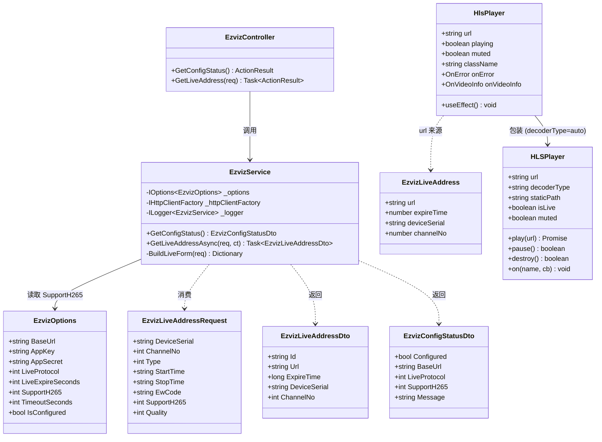
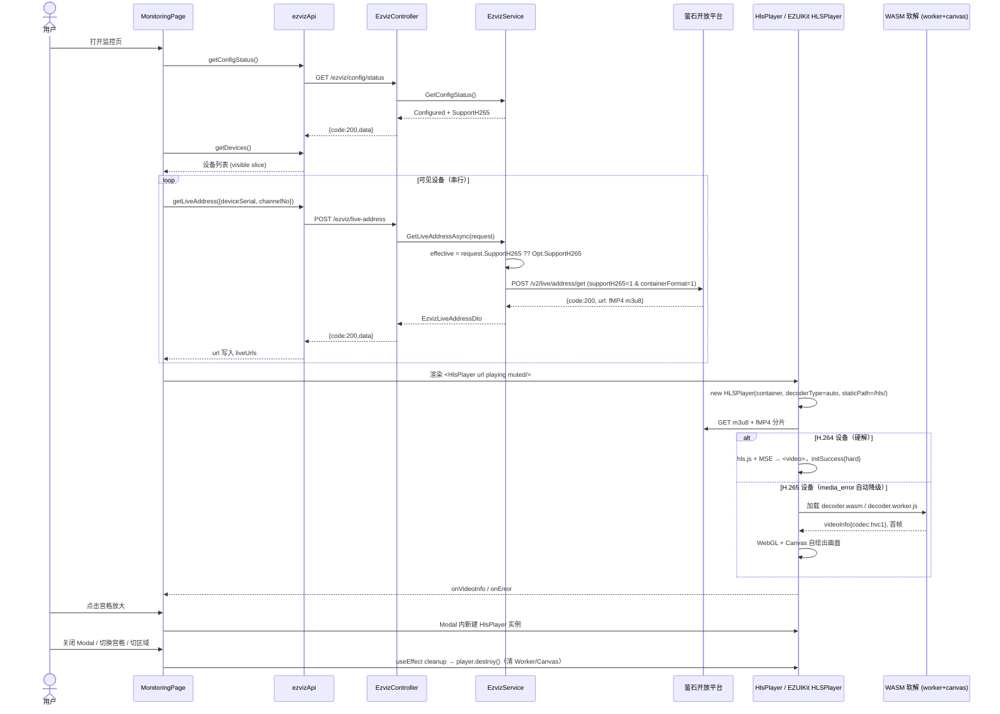
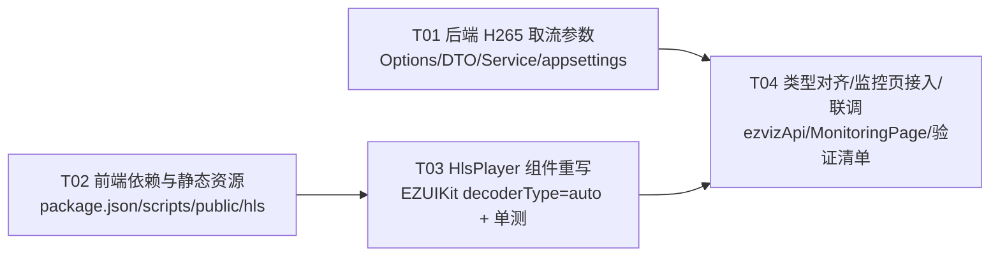

# 视频监控 H265 设备出画面 —— 增量架构设计与任务分解

| 项 | 内容 |
|---|---|
| 文档类型 | 增量架构设计（在现有 IoTPlatform 上的最小改造） |
| 后端 | `H:/IoTPlatform`（.NET 8，萤石开放平台代理） |
| 前端 | `H:/IoTPlatform/Web`（React 18 + Vite 6 + TS + Tailwind 4） |
| 已拍板方案 | 萤石软解播放器（保留 HLS 链路，引入 `@ezuikit/player-hls` 软解 H265） |
| 需求边界 | **只修 H265 设备出画面**；现有宫格 + 点击放大即实时直播，不新建大屏、不做轮巡 |
| 设计约束 | 本文档不含业务代码改动；给出精确到 `文件:行号` 的实现规格 |

---

## 0. 背景与已确认事实（不再复述质疑）

| # | 事实 | 证据 |
|---|---|---|
| F1 | 根因：`GetLiveAddressAsync` 取流未传 `supportH265`，萤石默认 0 → 推"视频编码类型非 H264，请修改为 H264"的**错误图片**，不是真 H265 流 | `Services/EzvizService.cs:347-355`；文档 L10619-10627 |
| F2 | `supportH265`（1=需要H265 / 0=不要求）、`containerFormat`（仅 HLS+supportH265=1 生效；0=ts / **1=fMP4**，H265 需 fMP4） | 文档 L10619-10627 |
| F3 | 当前传参仅 accessToken/deviceSerial/channelNo/protocol/expireTime/type/code/startTime/stopTime；**未传** supportH265/containerFormat/quality/mute/diserr | `EzvizService.cs:347-365` |
| F4 | 设备 BK7161797 为 H265（错误图原文确认）；新 AppKey 下能拿到 code=200 的 m3u8 URL | 主理人真机侦察 |
| F5 | `HlsPlayer.tsx` 用 hls.js 1.7.4；hls.js 可解封装 HEVC，但主流浏览器 MSE 不支持 H265-in-MP4 → 播不了 | `Web/src/app/components/HlsPlayer.tsx:2,40-71` |
| F6 | 萤石官方 help/1760：HLS+H265 的解法是集成其软解 Web 播放器 | 官方资料 |
| F7 | **npm 实测（本次设计已核实）**：`@ezuikit/player-hls` **v2.0.0**，内置 `decoderType: "auto"/"hard"/"soft"`，auto = hls.js 硬解优先 + `MEDIA_ERROR` 时 **WASM 软解自动降级**；支持 TS/fMP4/LL-HLS | npm 官方包页（见 §12 参考） |
| F8 | 项目未安装任何 ezuikit 包 | `Web/package.json:11-72` |

> **F7 是本次设计的关键杠杆**：既然播放器自带"H264 硬解 / H265 自动软解兜底"的 auto 模式，就**不需要**提前识别设备编码、也不需要双轨播放器 —— 一套组件同时覆盖两种设备，H264 设备零软解开销。

---

## Part A · 系统设计

## 1. 实现方案（Implementation Approach）

### 1.1 核心难点

| 难点 | 说明 | 破解思路 |
|---|---|---|
| D1 服务端能力开关语义 | `supportH265` 是**取流时声明客户端解码能力**，不是让设备转码。传 0 时萤石用错误图挡住非 H264 流 | 后端加**全局配置开关 + 请求级覆盖**，默认 0 保持既有行为；目标环境显式打开 |
| D2 容器格式联动 | HLS + supportH265=1 时只认 fMP4（containerFormat=1），TS 承载不了 H265 | **硬联动**：只要 effective supportH265=1 且 protocol=2，后端强制写 `containerFormat=1`，不另开配置项 |
| D3 浏览器解不了 H265 | MSE 不支持 H265-in-MP4，hls.js 无能为力 | 换成 `@ezuikit/player-hls`，`decoderType:'auto'`，H265 自动走 WASM+Canvas 软解 |
| D4 软解资源与多实例 | 每个软解实例 = 独立 WASM + Worker + Canvas；宫格最多 16 路 + 放大 1 路 | auto 模式让 H264 保持硬解；宫格维持现有"只取可见设备 + 串行取流"；预留 `quality=2` 子码流降级开关 |
| D5 最小改动 | `MonitoringPage` 已有两处 `<HlsPlayer>` 调用 | **保持组件名与 props 接口完全不变**，只替换 `HlsPlayer.tsx` 内部实现 → 监控页 0 行播放器调用改动 |

### 1.2 技术选型与理由

| 层 | 选型 | 理由 |
|---|---|---|
| 后端 | .NET 8 `IOptions<EzvizOptions>` + 现有 `PostFormRawAsync` | 零新依赖；配置天然支持 `Ezviz__SupportH265` 环境变量覆盖；表单字典加两个键即可 |
| 前端播放器 | **`@ezuikit/player-hls@^2.0.0`（全量替换 hls.js）** | 官方包；auto 模式一套 API 覆盖 H264 硬解 / H265 软解；内置萤石地址处理（`isEzviz`）、fMP4/LL-HLS、事件上报 `videoInfo.codec`（正好做验证判据）；自带 TS 类型 |
| 样式 | `@ezuikit/player-hls/dist/style/css.js` | 2.x 主题皮肤（`@ezuikit/player-theme`）；代价是引入其控件 UI，`scaleMode` 可调 |
| 静态资源 | `Web/public/hls/{decoder.wasm,decoder.worker.js}` + `staticPath:'/hls/'` | Vite 会把 `public/` 原样拷到 `dist/`，dev/build 一致；官方明确无 CDN，必须自托管且两文件同目录 |
| 不留双轨 | 移除直接依赖 `hls.js` | 全仓仅 `HlsPlayer.tsx:2` 一处 import（已核实）；EZUIKit v2 硬解引擎内部自带 hls.js，保留会重复打包且版本易漂移 |

### 1.3 架构模式

- 后端：`Options 配置 + Service 代理 + Controller 出网信封`，沿用现有分层，不新增抽象。
- 前端：`容器组件（MonitoringPage 管状态/取流） + 受控播放组件（HlsPlayer 管生命周期）`，props 驱动、副作用在 `useEffect` 内闭环清理。
- 关键不变量：**effectiveSupportH265 = request.SupportH265 ?? Opt.SupportH265**；**containerFormat=1 ⟺ effectiveSupportH265=1 ∧ protocol=2**。

---

## 2. 文件清单（File List）

| # | 路径 | 动作 | 说明 |
|---|---|---|---|
| 1 | `Configuration/EzvizOptions.cs` | 修改 | 新增 `SupportH265`（默认 0） |
| 2 | `DTOs/Responses/EzvizResponse.cs` | 修改 | `EzvizLiveAddressRequest` 加 `SupportH265?`/`Quality?`；`EzvizConfigStatusDto` 加 `SupportH265` |
| 3 | `Services/EzvizService.cs` | 修改 | `GetLiveAddressAsync` 构造表单时联动写入；`GetConfigStatus` 回显；加日志 |
| 4 | `appsettings.json` | 修改 | `Ezviz` 节加 `"SupportH265": 0`（默认关，靠 env 打开） |
| 5 | `Web/package.json` | 修改 | +`@ezuikit/player-hls@^2.0.0`，−`hls.js`；+`postinstall` 脚本 |
| 6 | `Web/scripts/copy-decoder.mjs` | 新建 | postinstall：把 wasm/worker 从 node_modules 拷到 `Web/public/hls/` |
| 7 | `Web/public/hls/.gitkeep` | 新建 | 占位；两个二进制由 #6 生成（提交或按团队约定处理） |
| 8 | `Web/src/app/components/HlsPlayer.tsx` | **重写** | hls.js → EZUIKit `HLSPlayer`，props/组件名不变 |
| 9 | `Web/src/app/components/hlsPlayerOptions.ts` | 新建 | `staticPath` 等集中配置 |
| 10 | `Web/src/app/components/HlsPlayer.test.tsx` | 新建 | Vitest：挂载/换源/卸载销毁/props 同步（mock 包） |
| 11 | `Web/src/app/services/api/ezvizApi.ts` | 修改 | `EzvizConfigStatus` 接口加 `supportH265?: number`（`ezvizApi.ts:13-18`） |
| 12 | `Web/src/app/pages/MonitoringPage.tsx` | 微改 | 仅 `:749` 文案 "HLS (m3u8) / hls.js" → "HLS / 萤石软解播放器"；播放器调用 0 改动 |
| 13 | `Web/vite.config.ts` | **不改** | `public/` 自动拷贝，无需插件 |

---

## 3. 必答点 ① — 后端改动详设

### 3.1 决策：全局开关 + 请求级覆盖（推荐），containerFormat 硬联动

**问题**：supportH265=1 全局开，H264 设备会不会被"硬当 H265 推"出错？

**结论与依据**：从"传 0 → 推错误图"的实测行为看，该参数是**客户端解码能力声明 / 放行开关**，不是转码指令：设备仍推自身原生编码，H264 设备继续推 H264（只是装进 fMP4 容器，hls.js 与 EZUIKit 都支持 fMP4-H264）。因此**全局打开在语义上是安全的**，但为避免无法回滚的单点风险，采用三层防护：

| 层 | 机制 | 作用 |
|---|---|---|
| L1 全局开关 | `EzvizOptions.SupportH265`（默认 **0**），env `Ezviz__SupportH265=1` 覆盖 | 目标环境一键打开；默认零行为变更 |
| L2 请求级覆盖 | `EzvizLiveAddressRequest.SupportH265`（`int?`） | 万一某 H264 设备回归，前端/联调可对该设备单独传 0 关掉，无需重启服务 |
| L3 容器联动 | effective=1 ∧ protocol=2 ⟹ `containerFormat=1`；effective=0 时**不传该键** | 消除"传了 supportH265 却忘改 fMP4"的必现错误 |

> 上线顺序：先保持 `SupportH265=0` 发布代码 → 真机确认基线 → 目标环境设 `Ezviz__SupportH265=1` → 验证 BK7161797 出画面 + 抽验 H264 设备不回归。L2 作为逃生舱保留。

### 3.2 精确改法

**(a) `Configuration/EzvizOptions.cs`** — 在 `:26` `LiveProtocol` 之后插入：

```csharp
/// <summary>
/// 取流时是否声明客户端支持 H265：0=不要求（默认，保持既有行为），1=需要/支持 H265。
/// 当 LiveProtocol=2(HLS) 且本值为 1 时，GetLiveAddressAsync 会自动附带 containerFormat=1(fMP4)。
/// 可由环境变量 Ezviz__SupportH265 覆盖。
/// </summary>
public int SupportH265 { get; set; } = 0;
```

**(b) `DTOs/Responses/EzvizResponse.cs`**

- `EzvizLiveAddressRequest`（`:143-153`）在 `:148` 之后插入：

```csharp
/// <summary>按请求覆盖 H265 开关；null=沿用 EzvizOptions.SupportH265 全局配置。任意非0视为1。</summary>
public int? SupportH265 { get; set; }

/// <summary>码流质量：1=主码流、2=子码流；null=萤石默认。宫格高路数软解负载过高时可传 2。</summary>
public int? Quality { get; set; }
```

- `EzvizConfigStatusDto`（`:9-15`）在 `:13` 之后插入（供前端日志/验证判据）：

```csharp
/// <summary>当前 H265 取流开关（供前端联调确认后端已生效）</summary>
public int SupportH265 { get; set; }
```

**(c) `Services/EzvizService.cs` — `GetLiveAddressAsync`（:337-378）**

在现有 `form` 字典初始化之后（**`:355` 之后、`:356` 加密处理之前**）插入：

```csharp
// ── H265 支持开关（全局配置 + 请求级覆盖）─────────────────────────────
var supportH265 = (request.SupportH265 ?? Opt.SupportH265) != 0 ? 1 : 0;
if (supportH265 == 1)
{
    form["supportH265"] = "1";
    // HLS + supportH265=1 时萤石只接受 fMP4(1)；TS 无法承载 H265。硬联动，不另开配置项。
    if (Opt.LiveProtocol == 2) form["containerFormat"] = "1";
}
if (request.Quality is int q && (q == 1 || q == 2))
    form["quality"] = q.ToString(CultureInfo.InvariantCulture);

_logger.LogInformation(
    "EZVIZ 取流 device={Device} ch={Ch} protocol={Proto} supportH265={H265} containerFormat={Cf} quality={Q}",
    request.DeviceSerial, Math.Max(1, request.ChannelNo), Opt.LiveProtocol, supportH265,
    form.TryGetValue("containerFormat", out var cf) ? cf : "0",
    request.Quality?.ToString() ?? "default");
```

> 不变部分：`:339-345` 所有权校验、`:356-364` 加密码/时间参数、`:366-377` 调用与 DTO 映射全部保持。
> `EzvizLiveAddressDto`（`:98-105`）**保持字段不变** —— 萤石该接口不返回编码字段，编码识别靠播放器 `videoInfo` 事件（见 §4.4）。

**(d) `Services/EzvizService.cs` — `GetConfigStatus()`（:58-70）** 在 `:65` `LiveProtocol` 之后插入：

```csharp
SupportH265 = Opt.SupportH265,
```

**(e) `appsettings.json`** `Ezviz` 节（`:84-91`）在 `:89` 之后插入：

```json
"SupportH265": 0,
```

### 3.3 后端参数矩阵（实现后可直接对照验证）

| protocol | 全局 SupportH265 | 请求 SupportH265 | effective | 发出的额外键 |
|---|---|---|---|---|
| 2 (HLS) | 0 | null | 0 | 无（既有行为，TS） |
| 2 | 1 | null | 1 | `supportH265=1`, `containerFormat=1` |
| 2 | 1 | 0 | 0 | 无（逃生舱：该设备关掉） |
| 2 | 0 | 1 | 1 | `supportH265=1`, `containerFormat=1`（单设备灰度） |
| 1 / 3 | 1 | null | 1 | 仅 `supportH265=1`（containerFormat 只对 HLS 有意义） |

---

## 4. 必答点 ② — 前端播放器接入详设

### 4.1 npm 包实测信息（已核实，来源见 §12）

```bash
# 安装（项目含 pnpm overrides，按团队实际包管理器二选一）
pnpm add @ezuikit/player-hls@^2.0.0
# 或 npm i @ezuikit/player-hls@^2.0.0
```

| 项 | 值 |
|---|---|
| 包名 | `@ezuikit/player-hls` **2.0.0**（Public，含内置 TS 声明） |
| 引入 | `import HLSPlayer from '@ezuikit/player-hls';` + `import '@ezuikit/player-hls/dist/style/css.js';` |
| 构造 | `new HLSPlayer({ container, url, decoderType:'auto', isLive:true, autoPlay:true, muted:true, staticPath:'/hls/', isEzviz:true, lowLatencyMode:true, enableFrameChasing:true, scaleMode:1, disableCollect:true })` |
| 关键配置 | `decoderType`: `auto`(默认，硬解失败自动软解) / `hard`(hls.js+MSE) / `soft`(WASM+WebGL+Canvas)；`container` 优先于 `id`；`staticPath` 指向与 `decoder.wasm`+`decoder.worker.js` 同目录 |
| 方法 | `play(url?:string):Promise`、`pause():boolean`、`destroy():boolean`、`resize`、`setScaleMode`、`screenshot` |
| 属性 | `muted`（可写）、`volume`、`duration`、`currentTime` |
| 事件 | `player.on(name, cb)`；`initSuccess`→`{decoderType}`；`videoInfo`→`{codec,width,height}`；`error`/`network_error`/`media_error`/`wasm_loaded`/`wasm_failed`；常量 `HLSPlayer.HLSEVENTS` |
| 静态资源 | `node_modules/@ezuikit/player-hls/dist/decoder.wasm` 与 `decoder.worker.js` **必须同目录**、自托管（无 CDN） |
| 注意 | `autoPlay` 不等于立即出画面，需等 wasm 加载 + 首帧；直播 `seek` 不支持；回放 seek 才需 `accessToken` |

> ⚠️ 实现前用 `npm view @ezuikit/player-hls version` 复核最新版；事件常量键名以包内 `src/constant/event.ts` / 类型声明为准，若 `HLSEVENTS.VIDEO_INFO` 不存在则直接用字符串 `'videoInfo'`（官方两种都支持）。

### 4.2 决策：完全替换 `HlsPlayer` 内部实现，保留组件名与 props（推荐）

| 方案 | 评价 |
|---|---|
| A. 新增 H265 播放器组件 + 按设备分流 | ✗ 萤石取流返回 **无编码字段**（`EzvizLiveAddressDto` 只有 id/url/expireTime/serial/channel），无法提前分流；靠试探/配置表引入额外状态与误判 |
| **B. 替换 `HlsPlayer` 内部为 EZUIKit `decoderType:'auto'`** | ✓ 一套组件通吃；H264 走硬解（`initSuccess` 报 `hard`），H265 触发 `media_error` 自动降级软解（报 `soft`）；`MonitoringPage` 两处调用 `:473`、`:829` **零改动**；顺带移除 hls.js 直接依赖 |

> 用户选"萤石软解播放器"单项，B 完全符合：H265 设备确实由萤石 WASM 软解出画面；H264 设备仍享受硬解低开销（这正是 auto 模式的价值），不是"双轨接入两个 SDK"。

### 4.3 `HlsPlayer.tsx` 重写骨架（保持 props 接口）

```tsx
import { useEffect, useRef, useState } from 'react';
import HLSPlayer, { HLSEVENTS } from '@ezuikit/player-hls';
import '@ezuikit/player-hls/dist/style/css.js';
import { EZUIKIT_PLAYER_OPTIONS } from './hlsPlayerOptions';

export interface HlsPlayerProps {
  url: string;              // 不变：v2/live/address/get 返回的 m3u8
  playing?: boolean;        // 不变
  muted?: boolean;          // 不变
  className?: string;       // 不变
  onError?: (message: string) => void;  // 不变
  /** 新增可选：拿到真实编码用于埋点/验证；不改现有调用即向后兼容 */
  onVideoInfo?: (info: { codec?: string; width?: number; height?: number }) => void;
}

export function HlsPlayer({ url, playing = true, muted = true,
                            className = '', onError, onVideoInfo }: HlsPlayerProps) {
  const containerRef = useRef<HTMLDivElement | null>(null);
  const playerRef = useRef<HLSPlayer | null>(null);
  const [error, setError] = useState<string | null>(null);

  useEffect(() => {
    const container = containerRef.current;
    if (!container || !url) return;
    let disposed = false;
    setError(null);

    const player = new HLSPlayer({
      container,                                  // 用 DOM ref，避免多实例 id 冲突
      url,
      decoderType: 'auto',                        // H264 硬解 / H265 自动降级软解
      isLive: true,
      autoPlay: playing,
      muted,
      staticPath: EZUIKIT_PLAYER_OPTIONS.staticPath, // '/hls/'
      isEzviz: true, lowLatencyMode: true,
      enableFrameChasing: true, scaleMode: 1, disableCollect: true,
    });
    playerRef.current = player;

    player.on(HLSEVENTS?.INIT_SUCCESS ?? 'initSuccess', ({ decoderType }) => {
      if (!disposed) console.debug('[EZUIKit] decoderType=', decoderType);
    });
    player.on(HLSEVENTS?.VIDEO_INFO ?? 'videoInfo', (info) => {
      if (!disposed) onVideoInfo?.(info);
    });
    const fail = (msg: string) => { if (!disposed) { setError(msg); onError?.(msg); } };
    player.on(HLSEVENTS?.ERROR ?? 'error', (e) => fail('播放器错误：' + (e?.detail ?? '未知')));
    player.on(HLSEVENTS?.NETWORK_ERROR ?? 'network_error', () => fail('直播网络异常，正在重试'));
    player.on(HLSEVENTS?.WASM_FAILED ?? 'wasm_failed',
      () => fail('软解资源加载失败，请检查 /hls/ 下的 decoder.wasm 与 decoder.worker.js'));

    return () => {                                // 换源 / 卸载：彻底销毁，杜绝 Worker/Canvas 泄漏
      disposed = true;
      try { player.destroy(); } catch { /* 重复销毁忽略 */ }
      if (playerRef.current === player) playerRef.current = null;
    };
  }, [url]);  // 依赖 url；playing/muted 走下方 Effect，避免无关重连

  useEffect(() => {
    const p = playerRef.current;
    if (!p || !url) return;
    if (playing) { const r = p.play(); (r as Promise<unknown>)?.catch?.(() => {}); }
    else p.pause();
  }, [playing, url]);

  useEffect(() => { const p = playerRef.current; if (p) p.muted = muted; }, [muted]);

  return (
    <div className={`relative w-full h-full bg-black ${className}`}>
      <div ref={containerRef} className="w-full h-full" />
      {error && (
        <div className="absolute inset-0 flex items-center justify-center px-2 text-center"
             style={{ background: 'rgba(0,0,0,0.75)' }}>
          <span className="text-[10px]" style={{ color: '#ffaa00' }}>{error}</span>
        </div>
      )}
    </div>
  );
}
```

**React 集成要点**
1. `container` 用 ref 而非固定 `id` —— 宫格 16 路 + 放大 1 路同时存在，固定 id 会冲突。
2. `url` 变化触发销毁重建（与现实现 `HlsPlayer.tsx:86` 的 `[url]` 依赖语义一致）。
3. `playing`/`muted` 用独立 Effect 同步（`play`/`pause`/`muted` setter），不触发重建。
4. `destroy()` 会清掉它自己在 container 内创建的 DOM；外层 wrapper 保留，错误浮层正常。
5. `HlsPlayerProps` 原 5 个字段一字不改 → `MonitoringPage.tsx:473`、`:829` 无需修改。

### 4.4 编码识别来源（回答"能否提前分流"）

- 萤石 `v2/live/address/get` 的 `data` 字段（见 `EzvizService.cs:370-377`）**不含 codec** → 服务端无法提前分流。
- 唯一可靠来源是**播放器运行时事件** `videoInfo` → `{ codec, width, height }`（`codec` 为 `hvc1`/`hev1` 即 H265，`avc1` 即 H264）。用途：
  - ✅ 验证判据（见 §9）与埋点日志；
  - ❌ 不作为取流前分流依据（拿到时已在播放中）。
- 因此选择 auto 模式"事后自动降级"而非"事前识别分流"。

### 4.5 静态资源脚本 `Web/scripts/copy-decoder.mjs`

```js
import { cpSync, mkdirSync, existsSync } from 'node:fs';
import { dirname, resolve } from 'node:path';
import { fileURLToPath } from 'node:url';

const root = resolve(dirname(fileURLToPath(import.meta.url)), '..');
const src = resolve(root, 'node_modules/@ezuikit/player-hls/dist');
const dst = resolve(root, 'public/hls');
const files = ['decoder.wasm', 'decoder.worker.js'];
if (!existsSync(src)) { console.warn('[h265] ezuikit dist not found, skip'); process.exit(0); }
mkdirSync(dst, { recursive: true });
for (const f of files) cpSync(resolve(src, f), resolve(dst, f));
console.log('[h265] decoder assets ready at public/hls/');
```

`package.json`：`"postinstall": "node scripts/copy-decoder.mjs"`，并删除 `"hls.js": "^1.7.4"`（`:49`），新增 `"@ezuikit/player-hls": "^2.0.0"`。

`Web/src/app/components/hlsPlayerOptions.ts`：
```ts
export const EZUIKIT_PLAYER_OPTIONS = {
  /** 与 decoder.wasm / decoder.worker.js 同目录；Vite 会原样发布 public/ 到 dist/ */
  staticPath: '/hls/',
} as const;
```

---

## 5. 必答点 ③ — 性能与风险

| 风险 | 影响 | 缓解 / 决策 |
|---|---|---|
| 软解 CPU/内存 | 单路 WASM 解码约持续占 CPU；16 路全 H265 软解会明显吃资源 | auto 模式确保 H264 走硬解；宫格沿用"只取可见设备 + 串行取流"（`MonitoringPage.tsx:155-180`）；高负载时请求级 `quality=2` 走子码流（后端已留 pass-through） |
| 多实例并存 | 宫格 16 + 放大 1 同时运行，放大Modal是**新实例**不是复用 | 依赖 `destroy()` 在卸载时清 Worker/Canvas；放大视图打开期间宫格实例仍在 —— 真机用 DevTools 观察 Workers/Memory；必要时后续做"放大时暂停宫格实例"的增强（本次不做） |
| 组件泄漏 | 切区域/关Modal/换源若漏销毁 → Worker 堆积、无限重连 | `useEffect` 返回清理函数，`disposed` 标志抑制卸载后回调，`player.destroy()` 幂等包裹 |
| wasm 加载失败 | 软解直接黑屏 | 自托管两文件且同目录；监听 `wasm_failed` 给出明确文案；CI 校验 `dist/hls/` 含两个文件 |
| 依赖共存 | hls.js 与 EZUIKit 内置 hls.js 重复打包 | 移除直接依赖 hls.js（全仓仅 1 处引用）；验证 `dist` 体积与无 `Cannot find module 'hls.js'` |
| 萤石侧未知行为 | H264 设备 + supportH265=1 是否回归 | L2 请求级覆盖 + 真机抽验 H264 设备；异常时前端对该 serial 传 `supportH265:0` |
| EZUIKit 主题侵入 | 自带控件/皮肤可能与暗色宫格 UI 不一致 | `scaleMode` 与 CSS wrapper 调整；宫格场景可评估隐藏控件（主题能力），不阻塞出画面 |
| 自动播放策略 | 静音自动播放一般可用，非静音会被拦 | 默认 `muted:true`；`isMuted` 切换走 `player.muted` setter（用户手势后生效） |

---

## 6. 数据结构与接口（Class Diagram）



## 7. 程序调用流程（Sequence Diagram）



---

## 8. Anything UNCLEAR / 假设

1. **npm 包版本**：以本次实测 v2.0.0 为准；实现前复核最新版本与 `HLSEVENTS` 常量键名（文档已给字符串兜底）。
2. **萤石实际返回编码**：无论 H264/H265，`v2/live/address/get` 都不返回 codec；H265 判定依赖播放器 `videoInfo` 与真机现象。
3. **H264 + supportH265=1 的行为**：依据能力声明语义推断"H264 设备仍推 H264（fMP4 容器）"，但**必须真机抽验**；L2 覆盖为逃生舱。
4. **EZUIKit 控件 UI**：宫格小尺寸下自带控件是否遮挡画面需真机看效果；`scaleMode` 与 CSS 可调，不影响出画面主目标。
5. **静态二进制纳管**：`decoder.wasm`/`decoder.worker.js` 由 postinstall 生成，团队需决定提交产物还是 CI 生成（二选一，不影响设计）。

---

## Part B · 任务分解

## 9. 依赖包（Required Packages）

```
后端：无新增 NuGet 包（复用 Microsoft.Extensions.Options / IHttpClientFactory）

前端新增：
- @ezuikit/player-hls@^2.0.0 : 萤石 HLS 播放器，decoderType=auto（H264 硬解 / H265 WASM 软解自动降级），含内置 TS 类型

前端移除：
- hls.js@^1.7.4 : 全仓仅 HlsPlayer.tsx:2 引用，EZUIKit v2 硬解引擎已内置，避免重复打包/版本漂移

静态资源（随包发布，非 npm 依赖）：
- node_modules/@ezuikit/player-hls/dist/decoder.wasm
- node_modules/@ezuikit/player-hls/dist/decoder.worker.js
  → 由 postinstall 脚本拷至 Web/public/hls/（两文件必须同目录，staticPath='/hls/'）
```

## 10. 任务列表（按依赖顺序，≤5）

### T01 · 后端 H265 取流参数改造

- **优先级**：P0　**依赖**：无
- **源文件**：
  - `Configuration/EzvizOptions.cs`（+`SupportH265`）
  - `DTOs/Responses/EzvizResponse.cs`（请求 DTO + 配置状态 DTO）
  - `Services/EzvizService.cs`（`GetLiveAddressAsync` 表单构造 + `GetConfigStatus` + 日志）
  - `appsettings.json`（`Ezviz.SupportH265 = 0`）
- **验收**：按 §3.3 参数矩阵，日志能打印 effective 值与 containerFormat；`dotnet build` 通过；未打开开关时行为与现状完全一致。

### T02 · 前端依赖与软解静态资源就绪

- **优先级**：P0　**依赖**：无（可与 T01 并行）
- **源文件**：
  - `Web/package.json`（+`@ezuikit/player-hls@^2.0.0`，−`hls.js`，+`postinstall`）
  - `Web/scripts/copy-decoder.mjs`（新建）
  - `Web/public/hls/.gitkeep`（新建占位；两个二进制由脚本生成）
  - `Web/src/app/components/hlsPlayerOptions.ts`（新建，`staticPath`）
- **验收**：安装后 `Web/public/hls/` 含 `decoder.wasm` 与 `decoder.worker.js`；`npm run build` 产物 `dist/hls/` 含同两文件；无 hls.js 直接依赖残留。

### T03 · HlsPlayer 组件替换为萤石播放器

- **优先级**：P0　**依赖**：T02
- **源文件**：
  - `Web/src/app/components/HlsPlayer.tsx`（按 §4.3 重写，props 不变）
  - `Web/src/app/components/HlsPlayer.test.tsx`（新建：挂载、换源重建、卸载 `destroy()`、playing/muted 同步；mock `@ezuikit/player-hls`）
  - `Web/src/app/components/hlsPlayerOptions.ts`（由 T02 提供，组件引用）
- **验收**：`npm test`（vitest）通过；TS 编译无错；组件卸载后 mock 的 `destroy()` 被调用一次；错误浮层文案正确。

### T04 · 前端类型对齐 / 监控页接入 / 联调支撑

- **优先级**：P0　**依赖**：T01、T03
- **源文件**：
  - `Web/src/app/services/api/ezvizApi.ts`（`EzvizConfigStatus` 加 `supportH265?: number`；如需设备级逃生舱，`EzvizLiveAddressRequest` 加 `supportH265?: number`）
  - `Web/src/app/pages/MonitoringPage.tsx`（仅 `:749` 文案改为 "HLS / 萤石软解播放器"；两处播放器调用保持不变）
  - `.workbuddy/design/h265-hls-player-verify.md`（新建：真机验证 checklist，直接采用本文档 §11）
- **验收**：`MonitoringPage` 两处 `<HlsPlayer>` 调用零改动；首屏能从 config/status 读到 `supportH265` 并输出日志；整体构建通过。

## 11. 验证方案（必答点 ⑤）

### 11.1 静态可验证（无需真机，实现阶段完成）

| # | 判据 | 方法 |
|---|---|---|
| S1 | 后端编译通过、参数矩阵正确 | `dotnet build`；代码走查 §3.2；日志注入点存在 |
| S2 | 配置可覆盖 | 设 `Ezviz__SupportH265=1` 启动，config/status 返回 `supportH265:1`；不设时返回 0 |
| S3 | npm 包与静态资源 | `pnpm list @ezuikit/player-hls`；`dist/hls/decoder.wasm` 与 `decoder.worker.js` 均存在且同目录 |
| S4 | 前端构建/单测 | `npm run build`、`npm test`（Vitest）全绿；无 `hls.js` 残留引用 |
| S5 | 组件生命周期 | Vitest mock 断言：换源触发旧实例 `destroy()`、卸载触发 `destroy()`、`muted` setter 被调用 |

### 11.2 必须真机（BK7161797 + 一台已知 H264 设备）

| # | 步骤 | 通过判据 |
|---|---|---|
| R1 | 设 `Ezviz__SupportH265=1`，重启后端，打开监控页 | 后端日志出现 `supportH265=1 containerFormat=1`；萤石返回 `code=200` 且 url 为 fMP4 m3u8（分片为 `.m4s`/init segment，非 `.ts`） |
| R2 | BK7161797（H265）宫格 + 点击放大 | **出真实画面**，不再出现"视频编码类型非 H264"错误图；Console `[EZUIKit] decoderType=soft`；`videoInfo.codec` 为 `hvc1`/`hev1`；无 `wasm_failed`/`media_error` 致命错误 |
| R3 | H264 设备对照（回归） | 正常出画面；`initSuccess` 报 `decoderType=hard`；未出现硬解失败反复降级 |
| R4 | 逃生舱验证（可选） | 对某设备请求传 `supportH265:0`，后端日志显示 effective=0 且不带 containerFormat，行为回到基线 |
| R5 | 生命周期 | 反复开关放大 Modal、切换宫格/区域；DevTools → 内存/Workers 数量回落到基线，无 Canvas/Worker 堆积 |
| R6 | 多路上限 | 4x4 宫格 16 路在线时无浏览器崩溃；若 CPU 过高，验证 `quality=2` 子码流降级有效 |
| R7 | 自动播放 | 静音自动出画面；点音量按钮后有声（用户手势后生效） |

> **优先级**：R1+R2 是本次需求的"出画面"铁判据；R3 防回归；R5/R6 防性能事故。

## 12. 待明确事项（必答点 ⑥）

| # | 事项 | 影响 | 建议动作 |
|---|---|---|---|
| U1 | **EZUIKit license / 域名白名单**：官方包是否需在萤石开放平台为 `open.ys7.com` + 前端部署域名配置白名单或授权？ | 若需授权未配，可能取流被拒 | 上真机前在萤石开放平台控制台确认 AppKey 的域名/播放器授权；本报告未发现需前端传 license 的证据，但需实机确认 |
| U2 | **npm 包可用性/版本**：`@ezuikit/player-hls` 版本与 `HLSEVENTS` 常量键名 | API 细节偏差会导致事件监听失效 | 实现前 `npm view` + 查 `src/constant/event.ts`；已给字符串事件名兜底 |
| U3 | **静态资源纳管方式**：wasm/worker 提交仓库 or CI 生成 | 发布一致性 | 团队定；二选一，两文件必须同目录 |
| U4 | **H264 + supportH265=1 是否真不回归** | 决定全局开关能否常开 | 真机 R3 判定；异常则用 L2 请求级覆盖按设备关闭 |
| U5 | **quality 子码流开关是否本次启用** | 影响宫格 16 路软解性能 | 默认不启用（传 null）；R6 若发现负载过高再对宫格请求传 `quality:2`（后端已留 pass-through） |
| U6 | **EZUIKit 自绘控件与暗色宫格 UI 融合** | 观感，不影响出画面 | 真机看 `scaleMode`/控件遮挡；必要时后续迭代隐藏控件 |
| U7 | **设备验证码 / 加密设备**：原 60019 逻辑保持不变 | 加密 H265 设备 | 本次不改；沿用现有"关闭设备视频加密"流程（`MonitoringPage.tsx:490-497, 800-817`） |

## 13. 共享约定（Shared Knowledge）

- 所有 API 出网信封为 `{ code, data, message/success }`；萤石代理异常映射见 `EzvizController.cs:35-45`（`EzvizException` 带萤石码）。
- 配置优先级：环境变量 `Ezviz__Xxx` > `appsettings.json`；`IOptions<EzvizOptions>.Value` 读取，敏感 AppSecret 绝不下发前端。
- 取流参数命名严格照萤石文档：`supportH265`（**s 小写**）、`containerFormat`（驼峰）、`quality`、`code`（视频加密密码，非 ewcode）。
- 时间/有效期用 `InvariantCulture` 格式化；`expireTime` 为 long。
- 播放器 `url` 由 `EzvizLiveAddressDto.Url` 直传；直播地址支持 `isEzviz:true` 的萤石处理；回放需 `accessToken`（本次不涉及回放）。
- 多播放器实例：容器用 ref 不用固定 id；任何副作用必须在 `useEffect` 清理函数中 `destroy()`。
- 组件对外契约不变：`HlsPlayerProps = { url, playing?, muted?, className?, onError? }`；新增可选 `onVideoInfo` 仅用于验证/埋点。

## 14. 任务依赖图



> T01 与 T02 可并行；T03 依赖 T02；T04 汇合两端做集成与真机验证。关键路径：T02 → T03 → T04（前端播放器是出画面的最后一环）。

## 15. 参考来源

- 萤石 HLS H265 软解说明：help/1760；`@ezuikit/player-hls` npm 包页：<https://www.npmjs.com/package/@ezuikit/player-hls>（本次已抓取核实 v2.0.0 API）
- 萤石开放平台取流接口：docs/萤石开放平台_API_云接入_OPEN_API.docx「9. 获取播放地址」L10589/L10619-10627
- 项目代码：见 §2 文件清单各 `文件:行号`
