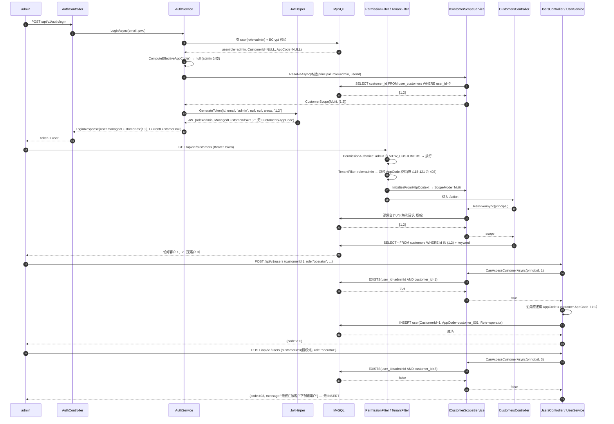
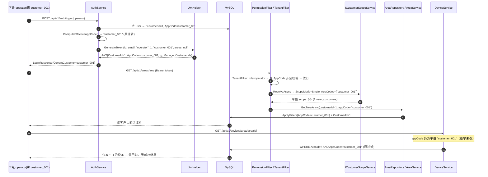
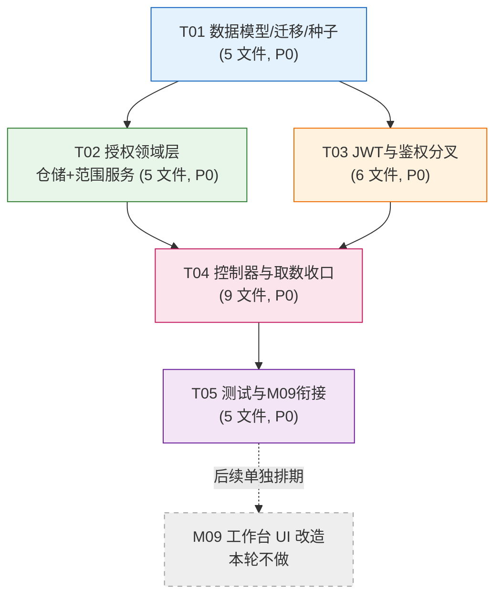

# 多租户授权模型改造 — 架构设计与任务分解

> 文档状态：**仅供用户评估，确认后才施工**。本轮不写任何业务代码、不执行 git 写操作、不启停服务、不执行 `dotnet run`。
> 架构师：高见远（Bob）　|　上游：`multi-customer-auth-prd.md`（许清楚）
> 侦察基线：两路只读侦察 + 抽样复核；本文引用的行号均已回读源码核实。

---

## 0. 已拍板输入（不可变更，作为本文公理）

| # | 决策 | 本文落实方式 |
|---|---|---|
| D1 | 一个 admin 拥有一批授权客户（多对多语义） | 中间表 `user_customers`，唯一约束 `(user_id, customer_id)` |
| D2 | 超管可分配/调整，自己仍看全部 | `super_admin` 短路放行，客户视图全量不变 |
| D3 | admin 只能在授权客户内建下级户，越权 403 | 服务端显式集合校验，不依赖前端下拉、不依赖全局过滤器 |
| D4 | 下级仍绑单客户、只看关联信息，零回归 | 下级 claim / 取数路径逐字不改 |
| D5 | 本轮只做模型层与取数链路，UI 随后 | 任务 T05 只预留前端类型与数据契约，M09 不在本轮 |
| D6 | **同一客户可授权给多个 admin**（多对多） | 中间表无 `customer_id` 唯一约束，只约束组合唯一 |
| D7 | **admin 的 CustomerId/AppCode 留空**；JWT 不带单值 claim | admin 走 `ManagedCustomerIds` 集合分支；下级单值不变 |
| D8 | **授权存储方案由架构师论证选定** | 本文 §5.1 选定中间表，并给出完整论证 |
| D9 | **admin 建户时不自动扩大授权集合** | 分配 API 与建户 API 单向：只有超管能改集合 |

---

## 1. 实现方案总览

### 1.1 一句话思路

**把"用户↔客户"从 `users` 表上的单值列，升级为"超管维护的 `user_customers` 授权中间表 + admin 每次请求按需解析集合 + 下级仍走原单值 claim"的三层模型；所有越权判定在业务层显式完成，全局过滤器只作辅助。**

### 1.2 架构原则

| 原则 | 含义 | 落地位置 |
|---|---|---|
| **P-A 多对多授权** | admin↔客户为 N:N，超管独占集合写权限 | `user_customers` + `AdminCustomerGrantsController` |
| **P-B 下级零回归** | `operator/user`（及 `customer_admin`）的 claim、DTO、取数过滤逐字不变 | `JwtHelper` 加可选参数而非改签名；`AuthService` 按角色分叉 |
| **P-C 越权收口** | 每个"按客户取数/建户"入口都必须过 `ICustomerScopeService`，单一事实来源 | `CustomersController` / `UsersController` / `AreasController` / `DevicesController` |
| **P-D 显式过滤不依赖全局过滤器** | `AppDbContext` 全局过滤器在超管/空 AppCode/启动期冻结时均不生效，admin 留空 AppCode 后必然被跳过 | 业务层 `Where(c => managedIds.Contains(c.Id))` |
| **P-E DB 为准、JWT 为快照** | admin 授权集合每次请求从 DB 读，`ManagedCustomerIds` claim 仅作信号与展示，不作授权依据 | §5.2 |
| **P-F 1:1 不变** | `Customer.AppCode` 唯一索引保持；集合内元素仍是 `customer_id`，AppCode 由客户反查得出 | 不改 `ConfigureCustomers` |

### 1.3 分层视图

```
超管 ──分配──▶ [user_customers 中间表] ◀──每次请求读取── [ICustomerScopeService]
                       │                                        │
                       │                          ┌─────────────┼─────────────┐
                    admin(集合)               客户列表         建户校验        区域/设备取数
                                                 
下级(单值) ──▶ 原 CustomerId/AppCode claim ──▶ 原 ApplyFilters 路径（零改动）
```

---

## 2. 改动文件清单

> 绝对路径均为 `H:/IoTPlatform/...`。"新增"用 🆕 标记。

### 2.1 数据库与实体（5 个）

| 绝对路径 | 改什么 | 为什么 |
|---|---|---|
| `Models/UserCustomer.cs` 🆕 | 新实体：`Id/UserId/CustomerId/CreatedAt/UpdatedAt/GrantedByUserId/Source`，**不实现 `IHasAppCode`** | 承载 admin↔客户 N:N；不进全局过滤器，避免 userId 上下文缺失导致误过滤 |
| `Data/AppDbContext.cs` | 新增 `DbSet<UserCustomer> UserCustomers`；`OnModelCreating` 增 `ConfigureUserCustomers`（PK、组合唯一索引、CustomerId 索引、双 FK、审计列默认值）；`ConfigureCustomers` 不动 | 中间表建模；保持 `Customer.AppCode` 唯一约束不变 |
| `Migrations/2026xxxx_AddUserCustomers.cs` 🆕（+ `.Designer.cs`） | `Up()`：建表 + 回填存量 admin 绑定 + 清空 admin 单值列；`Down()`：尽力回滚 | 迁移安全（PRD 铁律 8）；需幂等、可重复执行 |
| `Data/SeedData/SeedUsers.cs` | `manager`（Id=2, role=admin）的 `CustomerId=1`/`AppCode="customer_001"` 清空；新增幂等 seed：为所有 role=admin 的用户回填其原绑定客户到 `user_customers` | 保证刷新种子后行为与迁移库一致，避免"种子库有越权面、迁移库没有"的分裂 |
| `scripts/create-database-idempotent.sql` | 追加 `CREATE TABLE IF NOT EXISTS user_customers ...` 与 seed 回填段 | 全量建库脚本（任务 #54 产物）需与新模型同步，否则新环境缺表 |

### 2.2 后端服务与控制器（11 个）

| 绝对路径 | 改什么 | 为什么 |
|---|---|---|
| `Data/Repositories/Interfaces/IUserCustomerRepository.cs` 🆕 | `GetCustomerIdsAsync(userId)`、`GetCustomerIdsAsync(IEnumerable<long> userIds)`、`SyncAsync(userId, IEnumerable<long> customerIds, long? grantedBy)`、`GetAdminIdsByCustomerIdAsync(customerId)`、`ExistsAsync(userId, customerId)` | 按 admin 查（高频）+ 按客户反查（回显/删除前置/审计）两个方向都要索引 |
| `Data/Repositories/Implementations/UserCustomerRepository.cs` 🆕 | 实现；`SyncAsync` 用单事务"删差集 + 插并集"，重复键跳过 | 集合操作原子性；避免重复授权 |
| `Services/ICustomerScopeService.cs` 🆕 | 新服务接口：`ResolveAsync(ClaimsPrincipal)`、`CanAccessCustomerAsync(ClaimsPrincipal, long)`、`GetAppCodesAsync(ClaimsPrincipal)` | 越权判定的**唯一入口**；被所有控制器复用 |
| `Services/CustomerScopeService.cs` 🆕 | 实现三种 ScopeMode：`All`（超管）/ `Multi`（admin，DB 读集合）/ `Single`（下级，读 claim）。提供 `CustomerScope` 值对象 | P-C / P-D / P-E 的载体 |
| `Configuration/CustomerScopeConstants.cs` 🆕 | `ClaimManagedCustomerIds = "ManagedCustomerIds"`、`DefaultMaxManagedCustomers = 50` 等常量 | 消除 claim 名魔法字符串漂移（JwtHelper / ScopeService / 前端三处共用） |
| `Controllers/AdminCustomerGrantsController.cs` 🆕 | `PUT /api/v1/users/{userId}/managed-customers`（全量替换）、`GET ...`（回显）；仅超管，含 `MaxManagedCustomers` 上限校验 | M02；即时生效由"DB 为准"保证 |
| `Controllers/CustomersController.cs` | 拆分 `IsAdminLike()` → `IsSuperAdmin()` + `IsTenantAdmin()`；`GetCustomers` / `GetAccessibleCustomers` / `GetCustomer` / `UpdateCustomer` / `DeleteCustomer`  Five 处改为三分支；`CreateCustomer` 保持超管独占 | M03；收口现状 `IsAdminLike()` 把 admin 当超管的越权面 |
| `Controllers/UsersController.cs` | `CreateUser` 注入 `ICustomerScopeService`，对 `request.CustomerId` 做 `CanAccessCustomerAsync` 校验，越权返回 `Code=403` | M04；服务端强校验，不靠前端 |
| `Services/UserService.cs` | `CreateUserAsync` 增可选 `long? actingUserId` / `ClaimsPrincipal` 参数（重载，保留原签名给内部调用）；校验失败抛 `ForbiddenException`；**AppCode 派生逻辑 `customer?.AppCode` 逐字不变** | M04 + M05；下级建户零回归 |
| `Controllers/AreasController.cs` | 列表/树/子级/详情入口在取 `appCode` 后，改由 `ICustomerScopeService.GetAppCodesAsync()` 提供集合；超管仍 null、下级仍单值 | M07 模型层；区域按客户集合取数 |
| `Services/AreaService.cs` | `GetAreasAsync` / `GetAreaTreeAsync` 增 `IReadOnlyCollection<long>? customerIds` 重载；复用 `AreaRepository.GetTreeAsync(customerId, appCode)`，多客户场景用 `Contains(customerIds)` 一次性过滤（避免 N+1） | M07；`GetTreeAsync` 已具备按客户取树能力，向上暴露 |
| `Data/Repositories/Interfaces/IAreaRepository.cs` + `Implementations/AreaRepository.cs` | 增 `GetTreeAsync(IEnumerable<long> customerIds, string? appCode = null)` 重载；原 `(long?, string?)` 签名保留 | 零回归下级；一次 SQL 取多客户树 |
| `Controllers/DevicesController.cs` | `GetDevicesByArea(long areaId)` 先用 `ICustomerScopeService` 校验 `areaId → CustomerId` 是否在授权集合内，再取该客户的 `AppCode` 传给原 `DeviceService` | M07；**不改 `DeviceService` 签名**，下级路径零回归 |
| `Program.cs` | DI 注册 `IUserCustomerRepository` / `ICustomerScopeService`；保持 `AddScoped<ITenantContextAccessor, ScopedTenantContextAccessor>()`（`:50`）不变 | 依赖装配；不改启动期 `Migrate()`（`:433-441`）逻辑 |

### 2.3 JWT 与鉴权（5 个）

| 绝对路径 | 改什么 | 为什么 |
|---|---|---|
| `Infrastructure/JWT/JwtHelper.cs` | `GenerateToken` 增**可选尾参** `string? managedCustomerIds = null`；非空时追加 `new Claim("ManagedCustomerIds", 值)`；原 6 参调用点零改动；增 `GetManagedCustomerIdsFromToken` | claim 快照；不破坏下级与超管现有签发链路 |
| `Services/AuthService.cs` | `LoginAsync` / `GetCurrentUserAsync`：admin 分支读集合、签发 `ManagedCustomerIds`、不签发单 `CustomerId`/`AppCode`、`CurrentCustomer=null`；下级/超管分支逐字保留；`BuildUserDto` 增三分支；`SwitchCustomerAsync` 仅超管不变 | D7；身份解析分叉；`ComputeEffectiveAppCode` 对 admin 直接返回 null |
| `DTOs/Responses/UserDto.cs`（或 `AuthService` 内联 DTO 定义处） | 增 `List<long>? ManagedCustomerIds`；保留原 `CustomerId`/`AppCode` 字段 | 给 UI 阶段（M09）提供数据契约；本轮不下发 UI 改造 |
| `Filters/PermissionFilter.cs` | `TenantFilterAttribute.OnActionExecuting`（`:115-121`）三分支：超管跳过；admin 跳过 AppCode 校验但要求集合非空；下级原校验不动 | admin AppCode 留空后原逻辑会 403，必须开叉 |
| `Infrastructure/Tenant/ITenantContext.cs` + `TenantContextAccessor.cs` | 增 `IReadOnlyList<long> ManagedCustomerIds`、`CustomerScopeMode ScopeMode`；两个 Accessor 实现都解析新 claim；`SetTenant` 增可选参数（重载） | 租户上下文承载集合；Scoped 注册已确认，无跨请求泄漏 |

### 2.4 前端用户管理（2 个，仅类型/数据契约预留，不含 UI 改造）

| 绝对路径 | 改什么 | 为什么 |
|---|---|---|
| `Web/src/types/index.ts`（`User` 接口所在文件） | `User` 增可选 `managedCustomerIds?: number[]`（消费者在 M09） | 仅补类型，不改页面行为 |
| `Web/src/app/contexts/AuthContext.tsx` | **本轮不改逻辑**，仅在注释中标注 `deriveTenantContext`（`:110-113`）对 admin 返回 null 是预期行为，M09 需改为消费 `managedCustomerIds` | 防止后续工程师误把 admin 的 null 当 bug；风险登记见 §9 |

> 说明：`DashboardPage.tsx:613-616`、`UserManagementPage.tsx:465-479` 的 UI 改造属于 M09，**本轮明确不做**。

### 2.5 测试（4 个）

| 绝对路径 | 改什么 | 为什么 |
|---|---|---|
| `tests/IoTPlatform.AnSheng.Tests/CustomerScopeServiceTests.cs` 🆕 | ScopeMode 三分支、集合解析、越权判定的单元测试 | 核心逻辑可独立验证 |
| `tests/IoTPlatform.AnSheng.Tests/UserCustomerGrantTests.cs` 🆕 | 分配 API 幂等性、上限、非超管 403、多对多、反查 | M01/M02 验收 |
| `tests/IoTPlatform.AnSheng.Tests/MultiCustomerIsolationTests.cs` 🆕 | 集成测试：两 admin 批次隔离、越权建户、下级零回归、变更即时生效 | G1/G2/G3 验收 |
| `tests/IoTPlatform.AnSheng.Tests/SeedAndMigrationTests.cs` 🆕 | 种子与迁移回填一致性（manager 单值已清空且集合含 customer 1） | 零行为漂移 |

### 2.6 汇总

- **改动文件总数：27 个**（新增 12，修改 15）。
- **新增 Migration：1 个**（`AddUserCustomers`；含 `.Designer.cs` 与快照更新，计为 1 个迁移单元）。
- **回填种子**：需要。迁移 `Up()` 与 `SeedUsers.cs` 双通道回填，保证"迁移库"与"种子库"同源。
- **兼容性**：`JwtHelper.GenerateToken` / `IAreaRepository.GetTreeAsync` / `AuthService` 内部方法均用**新增可选参数或重载**，现有调用点不改；下级与超管全链路零改动。

---

## 3. 核心数据结构与接口

### 3.1 新表 `user_customers`

| 列 | 类型 | 约束 | 说明 |
|---|---|---|---|
| `id` | BIGINT AUTO_INCREMENT | PK | 主键 |
| `user_id` | BIGINT | NOT NULL, FK→`users.id` ON DELETE CASCADE, 联合唯一 | 被授权的 admin |
| `customer_id` | BIGINT | NOT NULL, FK→`customers.id` ON DELETE RESTRICT, 联合唯一, **单列索引** | 授权客户；单列索引支撑"按客户反查 admin" |
| `granted_by_user_id` | BIGINT | NULL, FK→`users.id` ON DELETE SET NULL | 审计：授予人（M10 预留） |
| `source` | VARCHAR(20) | NOT NULL DEFAULT 'manual' | `manual` / `migration` / `seed`，便于区分回填与人工分配 |
| `created_at` | DATETIME(3) | NOT NULL DEFAULT CURRENT_TIMESTAMP(3) | 审计：授予时间 |
| `updated_at` | DATETIME(3) | NOT NULL DEFAULT CURRENT_TIMESTAMP(3) ON UPDATE | 审计：最后变更 |
| `revoked_at` | DATETIME(3) | NULL | **预留**给 M10 软撤销/审计；本轮撤销仍为物理删除，该列保持 NULL |

**索引与约束**

```sql
PRIMARY KEY (id)
UNIQUE KEY uk_user_customer (user_id, customer_id)   -- 防重复授权
KEY idx_customer_id (customer_id)                    -- 按客户反查 admin（分配回显 / 删除前置）
KEY idx_granted_by (granted_by_user_id)              -- M10 审计
CONSTRAINT fk_uc_user      FOREIGN KEY (user_id)             REFERENCES users(id)     ON DELETE CASCADE
CONSTRAINT fk_uc_customer  FOREIGN KEY (customer_id)         REFERENCES customers(id) ON DELETE RESTRICT
CONSTRAINT fk_uc_grantedby FOREIGN KEY (granted_by_user_id)  REFERENCES users(id)     ON DELETE SET NULL
```

> **为什么 `customer_id` 上不加唯一约束**：D6 明确同一客户可归多个 admin。`uk_user_customer` 只保证"同一 admin 不重复持有同一客户"。
> **为什么 `ON DELETE RESTRICT`**：`CustomersController.DeleteCustomer`（`:399-407`）当前只查 Devices/Users/Projects；需同步加一条 `user_customers.AnyAsync(uc => uc.CustomerId == id)` 前置校验，否则客户被删会留下悬空授权。
> **审计列现在就加**：表结构一次性定型，M10 启用审计时只需加 append-only 历史表 `user_customer_grant_logs`，不改主表。

### 3.2 关键接口签名（C# 风格）

```csharp
// ── 仓储 ─────────────────────────────────────────────────
public interface IUserCustomerRepository
{
    Task<IReadOnlyList<long>> GetCustomerIdsAsync(long userId, CancellationToken ct = default);
    Task<IReadOnlyDictionary<long, List<long>>> GetCustomerIdsAsync(IEnumerable<long> userIds, CancellationToken ct = default);
    Task<IReadOnlyList<long>> GetAdminIdsByCustomerIdAsync(long customerId, CancellationToken ct = default);
    Task<bool> ExistsAsync(long userId, long customerId, CancellationToken ct = default);
    Task SyncAsync(long userId, IReadOnlyCollection<long> customerIds, long? grantedByUserId, CancellationToken ct = default);
}

// ── 范围服务（越权判定唯一入口）────────────────────────────
public enum CustomerScopeMode { All, Multi, Single }

public sealed record CustomerScope(
    CustomerScopeMode Mode,
    IReadOnlyList<long> CustomerIds,
    IReadOnlyList<string> AppCodes);   // All/Single 时 AppCodes 可为 [当前 appCode] 或空

public interface ICustomerScopeService
{
    Task<CustomerScope> ResolveAsync(ClaimsPrincipal principal, CancellationToken ct = default);
    Task<bool> CanAccessCustomerAsync(ClaimsPrincipal principal, long customerId, CancellationToken ct = default);
    Task<IReadOnlyList<string>> GetAppCodesAsync(ClaimsPrincipal principal, CancellationToken ct = default);
}

// ── 分配 API（仅超管）──────────────────────────────────────
// PUT /api/v1/users/{userId}/managed-customers
public sealed record AssignManagedCustomersRequest(long[] CustomerIds);
public sealed record ManagedCustomerGrantDto(long UserId, long[] CustomerIds, DateTime UpdatedAt);

// GET /api/v1/users/{userId}/managed-customers → ApiResponse<ManagedCustomerGrantDto>

// ── JWT（新增可选尾参，原调用点零改动）──────────────────────
string GenerateToken(long userId, string email, string role,
    long? customerId = null, string? appCode = null, string? allowedAreaIds = null,
    string? managedCustomerIds = null);   // 🆕

// ── 区域取数（新增重载，原签名保留）──────────────────────────
Task<IEnumerable<Area>> GetTreeAsync(IEnumerable<long> customerIds, string? appCode = null);
Task<IEnumerable<Area>> GetTreeAsync(long? customerId = null, string? appCode = null); // 原样保留
```

### 3.3 类图（Mermaid classDiagram）

```mermaid
classDiagram
    %% ===== 数据实体 =====
    class User {
        +long Id
        +string Username
        +string Email
        +string Role
        +bool IsSuperAdmin
        +long? CustomerId  %% admin 留空；下级保留
        +string? AppCode   %% admin 留空；下级保留
        +string? AllowedAreaIds
    }
    class Customer {
        +long Id
        +string Code
        +string AppCode  %% 唯一索引，1:1 不变
        +string Name
    }
    class UserCustomer {
        +long Id
        +long UserId
        +long CustomerId
        +long? GrantedByUserId
        +string Source
        +DateTime CreatedAt
        +DateTime UpdatedAt
        +DateTime? RevokedAt
    }

    %% ===== 仓储与范围服务 =====
    class IUserCustomerRepository {
        <<interface>>
        +GetCustomerIdsAsync(long userId) Task~IReadOnlyList~long~~
        +GetAdminIdsByCustomerIdAsync(long customerId) Task~IReadOnlyList~long~~
        +ExistsAsync(long userId, long customerId) Task~bool~
        +SyncAsync(long userId, IReadOnlyCollection~long~ ids, long? grantedBy) Task
    }
    class UserCustomerRepository {
        -AppDbContext _db
        +SyncAsync() Task  %% 单事务：删差集 + 插并集
    }
    class CustomerScopeMode {
        <<enumeration>>
        All
        Multi
        Single
    }
    class CustomerScope {
        <<record>>
        +CustomerScopeMode Mode
        +IReadOnlyList~long~ CustomerIds
        +IReadOnlyList~string~ AppCodes
    }
    class ICustomerScopeService {
        <<interface>>
        +ResolveAsync(ClaimsPrincipal p) Task~CustomerScope~
        +CanAccessCustomerAsync(ClaimsPrincipal p, long customerId) Task~bool~
        +GetAppCodesAsync(ClaimsPrincipal p) Task~IReadOnlyList~string~~
    }
    class CustomerScopeService {
        -IUserCustomerRepository _grants
        -ICustomerRepository _customers
        +ResolveAsync() Task~CustomerScope~  %% All: 全量 / Multi: 读DB / Single: 读claim
    }

    %% ===== JWT 与鉴权 =====
    class JwtHelper {
        -IConfiguration _configuration
        +GenerateToken(... , string? managedCustomerIds) string
        +GetManagedCustomerIdsFromToken(string token) List~long~
    }
    class TenantFilterAttribute {
        +OnActionExecuting(ActionExecutingContext c) void  %% 三分支
    }
    class ITenantContext {
        <<interface>>
        +string AppCode
        +long? CustomerId
        +IReadOnlyList~long~ ManagedCustomerIds
        +CustomerScopeMode ScopeMode
        +SetTenant(...) void
    }
    class ScopedTenantContextAccessor {
        +Current ITenantContext
        +InitializeFromHttpContext(HttpContext h) void
    }

    %% ===== 服务与控制器 =====
    class AuthService {
        -JwtHelper _jwtHelper
        +LoginAsync(LoginRequest r) Task~LoginResponse~
        +GetCurrentUserAsync(long id) Task~LoginResponse~
        -BuildUserDto(User u, string? appCode, Customer? c, List~long~? areas) UserDto
    }
    class AdminCustomerGrantsController {
        -IUserCustomerRepository _grants
        -ICustomerScopeService _scope
        +Assign(long userId, AssignManagedCustomersRequest r) Task  %% 仅超管
        +Get(long userId) Task  %% 回显
    }
    class CustomersController {
        -ICustomerScopeService _scope
        +GetCustomers() Task  %% All / Multi / Single 三分支
        +GetAccessibleCustomers() Task
        +UpdateCustomer(long id) Task
    }
    class UsersController {
        -ICustomerScopeService _scope
        -IUserService _users
        +CreateUser(CreateUserRequest r) Task  %% 越权 403
    }
    class AreaService {
        +GetAreasAsync(... IReadOnlyCollection~long~? customerIds) Task
        +GetAreaTreeAsync(... IReadOnlyCollection~long~? customerIds) Task
    }
    class DevicesController {
        +GetDevicesByArea(long areaId) Task  %% 先校验 area 归属集合
    }

    %% ===== 关系 =====
    User "1" -- "*" UserCustomer : 被授权 (UserId)
    Customer "1" -- "*" UserCustomer : 被授予 (CustomerId)
    User "1" -- "0..1" Customer : 下级单值绑定 (admin 为空)
    IUserCustomerRepository <|.. UserCustomerRepository : 实现
    ICustomerScopeService <|.. CustomerScopeService : 实现
    CustomerScopeService --> IUserCustomerRepository : 读集合(DB权威)
    CustomerScopeService --> CustomerScope : 产出
    CustomerScopeService --> CustomerScopeMode : 判定
    AuthService --> JwtHelper : 签发 claim
    AuthService --> ICustomerScopeService : admin 分支取集合
    TenantFilterAttribute --> ITenantContext : 初始化
    ScopedTenantContextAccessor ..|> ITenantContext : 实现
    AdminCustomerGrantsController --> IUserCustomerRepository : 全量同步
    CustomersController --> ICustomerScopeService : 显式过滤
    UsersController --> ICustomerScopeService : 建户校验
    AreaService --> ICustomerScopeService : 集合取树
    DevicesController --> ICustomerScopeService : area 归属校验
```



---

## 4. 时序图

### 4.1 图一：超管分配 / 调整 admin 授权客户（M01+M02）

```mermaid
sequenceDiagram
    autonumber
    participant SA as 超管 super_admin
    participant GC as AdminCustomerGrantsController
    participant PS as PermissionAuthorizeAttribute
    participant SS as ICustomerScopeService
    participant UR as IUserCustomerRepository
    participant DB as MySQL(user_customers)
    participant AD as admin(持旧 token)

    SA->>GC: PUT /api/v1/users/{id}/managed-customers {customerIds:[1,2,4]}
    GC->>PS: 鉴权
    PS-->>GC: Roles.IsSuperAdmin → 短路放行(不查DB)
    GC->>GC: 校验目标 user.Role == admin；ids 非空且 ≤ MaxManagedCustomers(50)
    GC->>DB: 校验 customerIds 全部存在(SELECT id IN ...)
    DB-->>GC: 存在
    GC->>UR: SyncAsync(adminId, [1,2,4], grantedBy=超管Id)
    UR->>DB: BEGIN; DELETE 差集(3); INSERT 并集(4); COMMIT
    DB-->>UR: 3 行变更
    UR-->>GC: OK
    GC-->>SA: {code:200, data:{userId, customerIds:[1,2,4]}}

    Note over GC,DB: claim 不刷新；但授权事实以 DB 为准 → 下次请求即时生效

    AD->>SS: 任意请求(携带旧 token, claim 仍是 [1,2])
    SS->>UR: GetCustomerIdsAsync(adminId from NameIdentifier)
    UR->>DB: SELECT customer_id WHERE user_id=? (走 uk_user_customer)
    DB-->>UR: [1,2,4]
    UR-->>SS: [1,2,4]
    SS-->>AD: CustomerScope(Multi, [1,2,4]) → 新客户 4 可见
```

### 4.2 图二：admin 登录 → JWT → 请求鉴权 → 取客户列表 → 建下级户



### 4.3 图三：下级用户登录 → 单 claim → 取数零回归



---

## 5. 关键决策详述

### 5.1 决策一：授权存储方案 → **选定中间表 `user_customers`**

**结论：采用中间表，不采用 `users.ManagedCustomerIds` 逗号串。**

按 PRD 第六章五个权衡维度逐项论证：

| 维度 | 中间表 `user_customers` ✅ | `users.ManagedCustomerIds` 逗号串 ❌ |
|---|---|---|
| **查询方式/频率** | 按 admin 查：联合索引 `(user_id, customer_id)` 前缀命中，O(log n)；按客户反查 admin：`idx_customer_id` 命中。两个方向都是一次索引查找 | 两方向均需 `LIKE '%,x,%'` 全表扫描或应用侧拆分；`LIKE` 前缀通配符无法用索引；逗号边界（`1` vs `10`/`11`）必须写 `,1,` 规范化，易错 |
| **客户数上限** | 每行一条，无上限；上限由业务 API 参数约束（建议 50）。JWT claim 长度另由参数控制 | `VARCHAR` 长度硬约束；随客户数增长 JWT 膨胀（每个 ID ~6 字节），且需处理截断；与现有 `AllowedAreaIds` 同类脆弱点，不应复制 |
| **审计需求（M10）** | 天然具备 `created_at / granted_by_user_id / updated_at / revoked_at / source`；后续加 append-only `user_customer_grant_logs` 不改主表 | 逗号串无逐条审计载体；要审计只能整串快照 + 文本 diff，无法回答"谁在何时授予了客户 X" |
| **迁移成本 / 表宽度** | 一次性新增实体 + DbSet + 1 个 Migration；`users` 表宽度不变（反而要清空两个旧列） | 改动看似小（加一列），但要写拆分/去重/空值/规范化逻辑，且把脏数据固化进宽表；长期维护成本更高 |
| **隔离与完整性** | 数据库级 `UNIQUE(user_id, customer_id)` 防重复授予；FK 保证引用完整；越权判定可写成参数化 `EXISTS/JOIN`，EF Core 可翻译 | 无 DB 级完整性；重复项、`"1,,2"`、空格、非数字都需应用侧兜底；SQL 关联查询要把字符串拆开，难以在 EF 中高效翻译 |
| **多对多（D6）** | 同一 `customer_id` 可出现在不同 `user_id` 下，天然支持 | 也能表达，但"按客户反查哪些 admin"退化成全表扫描，而分配页回显/删除前置校验恰恰高频 |

**为什么特别不选逗号串**：现有 `AllowedAreaIds` 已是逗号串先例，但它承载的是"区域内白名单"（只读、低频、不反查、无审计）；把同样的设计复制到"授权关系"这一安全边界上，会把**授权判定**建立在字符串匹配上，与铁律 5"全局过滤器不能当唯一防线"的精神（显式、可索引、可审计的过滤）相悖。授权是安全边界，必须选范式化、可约束、可审计的存储。

**代价与缓解**：多一个实体、一个仓储、一个迁移；一次性成本，且被 YAGNI 之外的 M10 审计需求正向摊薄。

### 5.2 决策二：admin JWT 承载集合的方式

**结论**：
- **claim 命名**：`ManagedCustomerIds`（与现有 `AllowedAreaIds` 命名风格一致，见 `JwtHelper.cs:66-69`）。常量集中在 `Configuration/CustomerScopeConstants.cs`，避免魔法字符串三处漂移。
- **格式**：逗号分隔的 `long` 客户 ID，如 `"1,2,4"`。不带 AppCode 串，AppCode 由 `customers` 表按 ID 反查（AppCode↔Customer 1:1 不变，铁律 4），保证 claim 唯一事实只有一种 ID。
- **大小**：默认上限 `MaxManagedCustomersPerAdmin = 50`（配置项），分配 API 与迁移双重约束；超出拒绝分配并提示。按 50 × 平均 6 字节 ≈ 300 字节，JWT 体积可控。
- **admin 不带单值 claim**：决策 D7 明确要求—admin 的 JWT **不签发** `CustomerId` / `AppCode`；签发路径在 `AuthService` 里对 `role == admin` 硬编码 `null, null`，`ComputeEffectiveAppCode` 对 admin 直接返回 null（与超管同形但语义不同：超管=All，admin=Multi）。

**是否每次从 DB 读以避免 token 陈旧？→ 是。**

- `CustomerScopeService.ResolveAsync` 对 admin 分支**每次请求**执行 `SELECT customer_id FROM user_customers WHERE user_id = ?`（联合索引前缀命中，单表、无 JOIN、无 N+1）。
- JWT 中的 `ManagedCustomerIds` **仅作三件事**：① 告诉前端"这是集合型 admin"；② 让只持有 `ClaimsPrincipal` 的中间件能判定 ScopeMode 而无需查库；③ 租户上下文 `TenantContext.ManagedCustomerIds` 的填充来源。**它不作为授权依据**——任何 `CanAccessCustomerAsync` / `GetAppCodesAsync` 都必须走 DB。
- 好处：分配变更"即时生效"天然成立，与 token 有效期（默认 1440 分钟）无关；无需引入 token 黑名单/吊销机制（当前代码也没有）。

**"即时生效"与 token 有效期的矛盾怎么处理？**

| 方案 | 评价 | 本轮选择 |
|---|---|---|
| 变更时强制刷新 token / 加版本号 claim 比对 | 需要 token 吊销或版本校验，当前无基础设施；前端要处理 401 重登 | ❌ |
| 短 TTL 缓存（如 30s）+ 变更主动失效 | 性能优化，但引入缓存一致性新故障点 | ⏸ 可选优化（P2），非本轮 |
| **每次请求读 DB（权威）** | 语义最简单、即时生效、无缓存失效问题；一次索引查询成本可接受 | ✅ **本轮采用** |

> 明确写入共享知识：**"claim 是快照，DB 是权威"**。任何新代码若直接用 claim 做授权判定，视为违反设计。

### 5.3 决策三：admin 单值留空后的三处分叉逻辑

| 位置 | 现状 | 改造后 |
|---|---|---|
| `PermissionFilter.cs:115-121`（`TenantFilterAttribute`） | 非超管必须 `AppCode` claim 非空，否则 403。admin 留空后会被拒 | 三分支：<br>① `super_admin` → 直接 `base.OnActionExecuting` 放行（原 :109-113 不动）；<br>② `admin` → **跳过 AppCode 校验**，改由 `TenantContextAccessor` 从 `ManagedCustomerIds` 填充 scope；若集合为空 → 403 "该管理员未获授权任何客户"；<br>③ 其他角色 → 原校验逐字不动 |
| `Infrastructure/Tenant/TenantContextAccessor.cs:49-78` / `:119-143` | 只解析 `AppCode`/`CustomerId`/`Role`；`AppCode` 空则 `Reset()` | 两个 Accessor 都增：解析 `ManagedCustomerIds` → `IReadOnlyList<long>`；按角色置 `ScopeMode`（admin→Multi、超管→All、其他→Single）。**admin 的 AppCode 为空不再触发 Reset**（否则 scope 丢失）。DI 已是 `Scoped`（`Program.cs:50`），无跨请求泄漏 |
| `AuthService.BuildUserDto`（`:282-302`） | `CustomerId = customerIdOverride ?? customer?.Id ?? user.CustomerId`，`AppCode = effectiveAppCode` | 三分支：<br>① 超管：`CustomerId=null, AppCode=null`（原样）；<br>② **admin：强制 `CustomerId=null, AppCode=null, CurrentCustomer=null`，新增 `ManagedCustomerIds=集合`**——即使库里残留旧单值也不采信（防御）；<br>③ 下级：表达式逐字不动 |
| `AuthService.LoginAsync` / `GetCurrentUserAsync` | 按 `CustomerId` → `AppCode` 反查客户，算 deviceCount、CurrentCustomer | admin 分支跳过反查与 deviceCount 聚合（无单客户），改由 scope 服务取集合；下级分支完全不动。登录日志 `appCode` 对 admin 传 null（与超管一致，不伪造租户） |
| `AuthService.SwitchCustomerAsync`（`:208-258`） | 仅超管可切换客户 | **完全不动**。admin 不参与"切换租户"语义；后续 M09 UI 阶段若需聚焦某客户，用 URL 参数 + 集合内校验实现，不改 token |

### 5.4 决策四：越权收口（CustomersController / GetAccessibleCustomers / 普通角色）

**`IsAdminLike()` 的处理**：删除该方法的"admin 等同超管"语义，拆为两个判据：

```csharp
private bool IsSuperAdmin() =>
    Roles.IsSuperAdmin(User.FindFirst(ClaimTypes.Role)?.Value);
private bool IsTenantAdmin() =>
    User.FindFirst(ClaimTypes.Role)?.Value == Roles.ADMIN;
```

**五处入口的三分支改造**：

| 入口（行号） | 超管 | admin | 普通角色 |
|---|---|---|---|
| `GetCustomers`（`:55-63`） | 不加 Where，全量（不变） | `Where(c => managedIds.Contains(c.Id))`；空集合 → 空列表 | 原 `Where(c => c.AppCode == appCode)`（不变） |
| `GetAccessibleCustomers`（`:111-126`） | 全量（不变） | 同上，按集合过滤 | 原单 AppCode 过滤（不变） |
| `GetCustomer(id)`（`:175-180`） | 放行（不变） | `id ∉ managedIds` → `403 "无权访问该客户"` | 原 AppCode 校验（不变） |
| `UpdateCustomer`（`:327-332`） | 放行（不变） | 同上 403 | 不变 |
| `DeleteCustomer`（`:391-396`） | 放行（不变） | 同上 403；**追加** `user_customers` 引用校验 | 不变 |
| `CreateCustomer`（`:222-227`） | 唯一可创建者（不变） | 已被顶部硬校验挡住 403 | 403 |

**`GetAccessibleCustomers` 对 admin 的语义**：返回**授权客户集合**（而不是"可切换的全部客户"）。下游工作台 UI（M09）据此渲染 admin 的客户列表；本轮 API 契约先行。

**普通角色 403 的处理**：`CustomersController` 类级 `[PermissionAuthorize(Permissions.VIEW_CUSTOMERS)]` 保持。`operator/user` 的权限表（见 `RoleConfig.cs:72-180`）均**不含** `VIEW_CUSTOMERS`，因此 `PermissionAuthorizeAttribute.OnAuthorizationAsync`（`:52-58`）直接返回 `ApiResponse.Forbidden("权限不足")`（HTTP 200 + `Code=403`），**不会**进入控制器的客户过滤逻辑。这一行为零改动，也符合"下级只看关联信息"的约束。

> 边界说明：`RoleConfig.GetAdminPermissions()` 从 `Permissions.All` 移除 API 配置与 `CREATE_CUSTOMERS`，**仍含 `VIEW_CUSTOMERS`**，所以 admin 能进客户列表接口，必须靠集合过滤兜住——这正是本次要收口的核心缺陷。

### 5.5 决策五：取数链路适配（区域 / 设备 / 过滤器边界）

**区域（`AreaRepository.GetTreeAsync` 的能力向上暴露）**

- 现状：`AreaRepository.GetTreeAsync(long? customerId, string? appCode)`（`:16-32`）已经能"按 customerId + appCode 取树"，只是 `AreaService.GetAreasAsync`（`:35-38`）只传单个 `appCode`。
- 改造：新增 `GetTreeAsync(IEnumerable<long> customerIds, string? appCode)` 重载，内部 `query.Where(a => a.CustomerId.HasValue && customerIds.Contains(a.CustomerId.Value))` + 原有 `ApplyFilters`，**一次 SQL 取多客户树，避免 N+1**；`AreaService` 增 `customerIds` 参数重载。
- 控制器（`AreasController.cs:38/59/80/100`）用 `ICustomerScopeService.GetAppCodesAsync()` + scope 的 `CustomerIds` 决定传单值还是集合：超管→null（全量）、admin→集合、下级→单值（原路径）。

**设备（`GET /devices/area/{areaId}` 与 `DeviceService` 单 appCode 过滤）**

- 现状：`DevicesController.GetDevicesByArea`（`:108-116`）从 claim 取**单个** `appCode` 传给 `DeviceService.GetDevicesByAreaAsync`（`:770-786`），后者 `Where(d => d.AppCode == appCode)`。
- 改造（**最小侵入、零回归**）：**不改 `DeviceService` 签名**。在 `DevicesController` 增加一道前置校验：
  1. 由 `areaId` 反查 `Areas.CustomerId`（一次点查）；
  2. `ICustomerScopeService.CanAccessCustomerAsync(principal, customerId)`：超管直接 true；admin 查集合；下级比对自身单 claim；
  3. 校验通过后，用该客户 `AppCode` 作为 `appCode` 参数调用**原** `DeviceService.GetDevicesByAreaAsync`；下级拿到的仍是其自身 AppCode，行为逐字不变。
- 若将来需要"跨多客户设备聚合列表"，再在 `DeviceService` 增 `GetDevicesByAppCodesAsync` 重载（本轮不做，避免扩大回归面）。

**`Repository.ApplyFilters` 与 `AppDbContext` 全局过滤器的边界**

- `Repository.ApplyFilters`（`Repository.cs:168`）是**单 AppCode** 的仓储级过滤，保留给下级路径；不为 admin 改它（admin 没有 AppCode）。
- `AppDbContext.ConfigureGlobalQueryFilters`（`:171-204`）在 `isSuperAdmin` 或 `appCode` 为空时 **直接 return 不装过滤器**，且过滤器表达式在模型创建时捕获 `appCode` 常量。叠加 `Program.cs:433-441` 启动期解析 DbContext 执行 `Migrate()` 会冻结模型——**admin 因 AppCode 留空，全局过滤器必然缺席**。
- 因此铁律 5 的落地方式是：
  - **所有 admin 可达的查询路径，必须在业务层显式 `Contains(managedIds)` / `EXISTS`**（由 `ICustomerScopeService` 统一提供）；
  - **不把 `user_customers` 加入全局过滤器**（它没有 `AppCode`，且需要 `userId` 上下文，强加会引入难以排查的误过滤）；
  - 全局过滤器保持原样，作为下级的辅助纵深，不参与 admin 隔离的正确性证明。

### 5.6 决策六：存量数据回填（零行为漂移）

**现状事实**：种子 `manager`（Id=2, role=admin）绑定 `CustomerId=1` + `AppCode="customer_001"`（`SeedUsers.cs:74-92`）；存量库可能只有 `AppCode` 而 `CustomerId=NULL`（`AuthService.cs:75-107` 有专门兜底）。

**迁移 `Up()` 逻辑要点**（幂等，可重复执行）：

```sql
-- 1. 建表（IF NOT EXISTS；列/索引/外键见 §3.1）
CREATE TABLE IF NOT EXISTS user_customers ( ... );

-- 2. 回填：CustomerId 优先，AppCode 兜底；仅 role='admin'
INSERT INTO user_customers
    (user_id, customer_id, granted_by_user_id, source, created_at, updated_at)
SELECT u.Id, c.Id, NULL, 'migration', NOW(3), NOW(3)
FROM users u
JOIN customers c
  ON (u.CustomerId IS NOT NULL AND u.CustomerId = c.Id)
  OR (u.CustomerId IS NULL AND u.AppCode IS NOT NULL AND u.AppCode = c.AppCode)
WHERE u.Role = 'admin'
  AND (u.CustomerId IS NOT NULL OR u.AppCode IS NOT NULL)
  AND NOT EXISTS (SELECT 1 FROM user_customers uc
                  WHERE uc.user_id = u.Id AND uc.customer_id = c.Id);

-- 3. 清空 admin 单值字段（不动 super_admin、不动下级）
UPDATE users SET CustomerId = NULL, AppCode = NULL, UpdatedAt = NOW(3)
WHERE Role = 'admin';
```

**种子侧**：`SeedUsers.cs` 中 manager 的两个字段置 null；新增幂等 seed 段（先查 `user_customers` 不存在再插），`source='seed'`。

**`Down()` 策略**：`DROP TABLE user_customers`；尽力把每个 admin 的**最小 customer_id** 回填到 `users.CustomerId/AppCode`（尽力而为，多客户场景无法完全还原）。需在迁移注释中明确：完整回滚依赖数据库备份。

**零漂移验证**：QA 用 manager 账号登录后，客户列表仍恰好返回 customer_001（原来因为"看全部"可能返回多个——这是本轮**预期的行为收口**，需在用户评估时确认，见 §9）；下级账号逐项比对改造前后响应。

> ⚠️ 注意：存量 admin 原本"看全部客户"是缺陷（PRD 铁律 3），回填后只看原绑定客户。**这是预期的安全收口，不是回归**；但对习惯了越权视图的运维会有感知，需在评估时明确告知。

### 5.7 决策七：审计列预留

- 主表已含 `CreatedAt / UpdatedAt / GrantedByUserId / Source / RevokedAt`，M10 无需改主表结构。
- 本轮撤销授权 = **物理删除行**（保持唯一索引简单、MySQL 无部分索引的限制）；`RevokedAt` 保持 NULL 作为结构预留。
- M10 启动时新增 append-only `user_customer_grant_logs`（`user_id / customer_id / action / granted_by / changed_at`）记录分配/撤销事件，由 `SyncAsync` 写主表的同时写日志。本轮**不实现**日志写入，但 `SyncAsync` 签名已带 `grantedByUserId`，未来接入零改签名。

---

## 6. 任务列表

> 采用 **5 个主任务（符合架构交付上限）/ 11 个可验收子项**（满足 8–12 项粒度要求）。主任务按"模型层先行、UI 随后"排序；**M09 工作台 UI 不在本轮**。

### T01 — 项目基础设施：数据模型、迁移与种子（P0）

**源文件**：`Models/UserCustomer.cs`（新）、`Data/AppDbContext.cs`、`Migrations/*_AddUserCustomers.cs`（新）、`Data/SeedData/SeedUsers.cs`、`scripts/create-database-idempotent.sql`、`Configuration/CustomerScopeConstants.cs`（新）

| 子项 | 内容 | 验收标准 | 依赖 |
|---|---|---|---|
| T01.1 | 新实体 + DbSet + `ConfigureUserCustomers`（组合唯一索引、CustomerId 索引、双 FK、审计列）；**不改** `ConfigureCustomers` | `dotnet ef migrations add` 生成的快照中 `Customer.AppCode` 仍唯一；`user_customers` 无单列 `customer_id` 唯一约束 | — |
| T01.2 | Migration `AddUserCustomers`：`Up()` 建表 + 回填 + 清空 admin 单值；`Down()` 尽力回滚 | 在含 manager 的库上执行后：manager 的 `CustomerId/AppCode` 为 NULL 且 `user_customers` 有 (2,1)；重复执行不报重复键 | T01.1 |
| T01.3 | 种子同步 + 幂等建库脚本 + claim 常量文件 | 全新空库按脚本建库后，manager 授权集合为 [1]；常量被后续任务直接引用 | T01.1 |

### T02 — 授权领域层：仓储与范围服务（P0）

**源文件**：`Data/Repositories/Interfaces/IUserCustomerRepository.cs`（新）、`Data/Repositories/Implementations/UserCustomerRepository.cs`（新）、`Services/ICustomerScopeService.cs`（新）、`Services/CustomerScopeService.cs`（新）、`Program.cs`（DI）

| 子项 | 内容 | 验收标准 | 依赖 |
|---|---|---|---|
| T02.1 | 仓储实现：`GetCustomerIdsAsync`（双向）、`ExistsAsync`、`SyncAsync`（单事务删差集+插并集，幂等） | 并发/重复调用不产生重复行；按客户反查走 `idx_customer_id`（EXPLAIN 可见） | T01 |
| T02.2 | `CustomerScopeService` 三分支（All/Multi/Single）+ `CustomerScope` 值对象 + DI 注册 | 单测覆盖：超管返回全量标记、admin 读 DB 集合、下级读 claim 单值且不查 `user_customers` | T01 |

### T03 — JWT 与鉴权分叉（P0）

**源文件**：`Infrastructure/JWT/JwtHelper.cs`、`Services/AuthService.cs`、`DTOs/Responses/UserDto.cs`（或内联 DTO）、`Filters/PermissionFilter.cs`、`Infrastructure/Tenant/ITenantContext.cs`、`Infrastructure/Tenant/TenantContextAccessor.cs`

| 子项 | 内容 | 验收标准 | 依赖 |
|---|---|---|---|
| T03.1 | `GenerateToken` 增可选 `managedCustomerIds` 尾参 + claim 解析方法；`AuthService` 三分支签发与 `BuildUserDto`；`UserDto` 增字段 | admin token 解出 `ManagedCustomerIds` 且**无** `CustomerId`/`AppCode`；下级 token 与改造前**逐字段一致**；超管 token 不变 | T01（常量） |
| T03.2 | `TenantFilterAttribute` 三分支；两个 TenantContextAccessor 解析集合与 ScopeMode，admin 空 AppCode 不 Reset | admin 请求不再 403；下级空 AppCode 仍 403；`TenantContext.ScopeMode` 三值正确 | T01（常量），可与 T02 并行 |

### T04 — 控制器与取数链路收口（P0）

**源文件**：`Controllers/AdminCustomerGrantsController.cs`（新）、`Controllers/CustomersController.cs`、`Controllers/UsersController.cs`、`Services/UserService.cs`、`Controllers/AreasController.cs`、`Services/AreaService.cs`、`Data/Repositories/Interfaces/IAreaRepository.cs`、`Data/Repositories/Implementations/AreaRepository.cs`、`Controllers/DevicesController.cs`

| 子项 | 内容 | 验收标准 | 依赖 |
|---|---|---|---|
| T04.1 | 分配 API（PUT/GET，仅超管，上限校验，全量同步）+ `UsersController.CreateUser` 越权校验 + `UserService` 重载 | 非超管 403；越权建户 403 且无 INSERT；授权内建户成功且 `AppCode=customer.AppCode`；重复分配幂等 | T02, T03 |
| T04.2 | `CustomersController` 五处三分支 + `DeleteCustomer` 加 `user_customers` 前置；区域集合取树重载；设备 area 归属校验 | 两 admin 互不可见；超管全量；普通角色 403；admin 按多客户取到区域树与设备；下级取数逐字不变 | T02, T03 |

### T05 — 测试、QA 清单与 M09 衔接契约（P0）

**源文件**：`tests/.../CustomerScopeServiceTests.cs`（新）、`tests/.../UserCustomerGrantTests.cs`（新）、`tests/.../MultiCustomerIsolationTests.cs`（新）、`tests/.../SeedAndMigrationTests.cs`（新）、`Web/src/types/index.ts`（`User` 增可选字段）

| 子项 | 内容 | 验收标准 | 依赖 |
|---|---|---|---|
| T05.1 | 后端 4 组测试（单测 + 集成），覆盖 §8 清单 1–6 | 全绿；`dotnet build` 无警告增量 | T04 |
| T05.2 | 前端仅补 `User.managedCustomerIds?: number[]` 类型 + 一份 M09 衔接说明（不写 UI 代码） | 前端类型检查通过；`DashboardPage` / `UserManagementPage` **零 diff** | T04 |

**模型层交付后 M09 如何接**：M09 启动时，前端从 `LoginResponse.User.managedCustomerIds` 读取集合；`DashboardPage.tsx:613-616` 的 `visibleCustomers` 改为：超管→全部、admin→`managedCustomerIds` 对应客户、下级→原单 `customerId` 过滤；`AuthContext.deriveTenantContext`（`:110-113`）对 admin 不再返回 null 兜底而是走集合；`UserManagementPage.tsx:465-479` 的客户下拉对 admin 显示授权集合（单选，因为下级仍绑单客户）。**后端无需再改**，因为 `GetAccessibleCustomers` 已按集合返回。

### 6.1 任务依赖图（Mermaid）



> 依赖设计：T02 与 T03 都只依赖 T01，可**并行**开发；T04 汇合二者；关键路径 T01→T02/T03→T04→T05。

---

## 7. 依赖包与共享知识

### 7.1 依赖包

**无需新增任何 NuGet / npm 包。** 全部使用现有栈：
- 后端：.NET / EF Core + Pomelo MySQL（现有 Migration 机制）、`System.IdentityModel.Tokens.Jwt`（`JwtHelper` 现用）、`BCrypt.Net`（现用）、xUnit/NUnit 测试框架（现有 tests 项目）。
- 前端：Vite + React + MUI + Tailwind CSS（沿用），本轮仅类型声明改动。
- 若后续 M10 启用审计日志，仍无需新包（写同一 DbContext）。

### 7.2 跨文件约定（Engineer 必须遵守）

1. **claim 名**：授权集合固定为 `"ManagedCustomerIds"`，常量在 `Configuration/CustomerScopeConstants.cs`；**任何地方不得硬编码字符串**。
2. **admin 判定**：统一 `User.FindFirst(ClaimTypes.Role)?.Value == Roles.ADMIN`；超管统一 `Roles.IsSuperAdmin(...)`。`customer_admin` 本轮**不**纳入集合分支，仍走单客户（见 §9）。
3. **"admin-like" 概念作废**：`CustomersController.IsAdminLike()` 删除；新增代码不得再出现"admin 等同超管"的判据。
4. **claim 是快照、DB 是权威**：任何授权判定必须经 `ICustomerScopeService`（内部读 `user_customers`）；直接用 claim 判断"能否访问客户 X"视为设计违规。
5. **下级单值兼容**：`JwtHelper.GenerateToken` 新参数是**可选尾参**，旧的 6 参调用逐字不动；下级 token 必须仍含 `CustomerId` + `AppCode`，**不得**含 `ManagedCustomerIds`。
6. **403 语义**：全站 HTTP 200 + `ApiResponse.Code=403`（见 `Helpers/ApiResponse.cs`、`CreateCustomer` 现状），不要改成 HTTP 403 状态码，以免前端解析漂移。
7. **AppCode↔Customer 1:1 不变**：`Customer.AppCode` 唯一索引（`AppDbContext.cs:232-240`）不动；集合元素只用 `customer_id`，AppCode 一律由客户表反查；建户时 `AppCode = customer.AppCode`（`UserService.cs:169`）逐字保留。
8. **全局过滤器不算防线**：新查询路径不得依赖 `AppDbContext` 全局过滤器；admin 的 AppCode 为空，过滤器必然跳过。
9. **分配变更单向**：只有超管通过 `AdminCustomerGrantsController` 改集合；`UsersController.CreateUser` **绝不**顺带写 `user_customers`（D9）。
10. **上限**：`MaxManagedCustomersPerAdmin=50`，分配 API 与迁移都校验；超限返回 `Code=400` 并提示。
11. **回滚边界**：Migration `Down()` 为尽力回滚；正式回滚需 DB 备份。

---

## 8. 验证方案（QA 可执行清单）

> 前置：准备 3 个账号 — `super_admin`、`adminA`、`adminB`；4 个客户 — C1(id=1, `customer_001`)、C2(id=2)、C3(id=3)、C4(id=4)；1 个下级 — `operator1`（绑 C1）。
> 鉴权头统一 `Authorization: Bearer <token>`；本项目业务失败仍是 HTTP 200 + `Code`。

### 清单 1 — 两个 admin 不同批次互不可见（G1）

```bash
# 1a 超管分配：A→[1,2]，B→[3]
curl -X PUT -H "Authorization: Bearer $SUPER" -H "Content-Type: application/json" \
  -d '{"customerIds":[1,2]}' .../api/v1/users/10/managed-customers          # 期望 {code:200, data.customerIds:[1,2]}
curl -X PUT -H "Authorization: Bearer $SUPER" -H "Content-Type: application/json" \
  -d '{"customerIds":[3]}' .../api/v1/users/11/managed-customers            # 期望 {code:200, data.customerIds:[3]}

# 1b A 查客户列表
curl -H "Authorization: Bearer $ADMIN_A" .../api/v1/customers               # 期望 code=200, data.items 的 id 集合 == [1,2]
# 1c B 查客户列表
curl -H "Authorization: Bearer $ADMIN_B" .../api/v1/customers               # 期望 id 集合 == [3]，不含 1/2
# 1d A 直接指定授权外客户详情
curl -H "Authorization: Bearer $ADMIN_A" .../api/v1/customers/3             # 期望 code=403 "无权访问该客户"
# 1e accessible 端点同语义
curl -H "Authorization: Bearer $ADMIN_A" .../api/v1/customers/accessible    # 期望恰好 [1,2]
```

### 清单 2 — admin 越权建户 403（G2）

```bash
# 2a 授权内
curl -X POST -H "Authorization: Bearer $ADMIN_A" -H "Content-Type: application/json" \
 -d '{"email":"newoperator@x.com","password":"abc123","name":"新运维","role":"operator","customerId":1,"isActive":true}' \
 .../api/v1/users                                                            # 期望 code=200；DB 新增 user.AppCode=customer_001
# 2b 授权外
curl -X POST -H "Authorization: Bearer $ADMIN_A" -H "Content-Type: application/json" \
 -d '{"email":"bad@x.com","password":"abc123","name":"越权","role":"operator","customerId":3}' \
 .../api/v1/users                                                            # 期望 code=403；DB 无该邮箱记录
```

### 清单 3 — 下级零回归（G3）

```bash
# 3a 下级登录：token 解码必须含 CustomerId=1, AppCode=customer_001，且不含 ManagedCustomerIds
curl -X POST -d '{"email":"operator1@...","password":"..."}' .../api/v1/auth/login
# 3b 客户列表仍只有 C1
curl -H "Authorization: Bearer $OPERATOR" .../api/v1/customers                   # 期望 code=403（无 VIEW_CUSTOMERS 权限）或按现有行为仅 C1
# 3c 区域树仍仅 C1
curl -H "Authorization: Bearer $OPERATOR" .../api/v1/areas/tree                  # 期望与改造前响应逐字段一致
# 3d 设备仍按单 AppCode 过滤
curl -H "Authorization: Bearer $OPERATOR" .../api/v1/devices/area/{areaId}       # 期望与改造前一致，无 C2/C3 设备
# 3e manager（存量 admin）登录后见其授权的三家客户（回填正确）
curl -X POST -d '{"email":"manager@haidilao.com","password":"admin123"}' .../api/v1/auth/login
curl -H "Authorization: Bearer $MANAGER" .../api/v1/customers                # 期望 id == [1,2,3]
```

### 清单 4 — 同一客户多 admin 可见（D6）

```bash
curl -X PUT -H "Authorization: Bearer $SUPER" -d '{"customerIds":[1]}' .../api/v1/users/11/managed-customers
curl -H "Authorization: Bearer $ADMIN_A" .../api/v1/customers                # 期望仍含 1
curl -H "Authorization: Bearer $ADMIN_B" .../api/v1/customers                # 期望恰好 [1]
# 反查：DB SELECT user_id FROM user_customers WHERE customer_id=1 → 含 10 和 11
```

### 清单 5 — 分配变更即时生效（P-E）

```bash
# 5a 先拿 A 的旧 token（claim 中 ManagedCustomerIds="1,2"）
# 5b 超管给 A 追加 C4（不要求 A 重新登录）
curl -X PUT -H "Authorization: Bearer $SUPER" -d '{"customerIds":[1,2,4]}' .../api/v1/users/10/managed-customers
# 5c 用【旧 token】再查
curl -H "Authorization: Bearer $ADMIN_A_OLD" .../api/v1/customers            # 期望 id == [1,2,4]（含 4）→ 证明 DB 为准
# 5d 超管移除 C4
curl -X PUT -H "Authorization: Bearer $SUPER" -d '{"customerIds":[1,2]}' .../api/v1/users/10/managed-customers
curl -H "Authorization: Bearer $ADMIN_A_OLD" .../api/v1/customers/4          # 期望 code=403（立竿见影）
```

### 清单 6 — 全局过滤器关闭/冻结时仍隔离（铁律 5）

```bash
# 6a 解码 A 的 token：确认无 AppCode claim → AppDbContext 全局过滤器必然跳过
# 6b 以空租户上下文启动（或复用启动期冻结模型）后，重复清单 1b
curl -H "Authorization: Bearer $ADMIN_A" .../api/v1/customers                # 期望仍只有 [1,2]
# 6c A 直接构造 areaId 属于 C3 的请求
curl -H "Authorization: Bearer $ADMIN_A" .../api/v1/devices/area/{C3_AREA_ID}# 期望空列表或 403，不得返回 C3 设备
```

### 清单 7 — 分配 API 权限与边界

```bash
curl -X PUT -H "Authorization: Bearer $ADMIN_A" -d '{"customerIds":[3]}' .../api/v1/users/11/managed-customers
# 期望 code=403（非超管）
curl -X PUT -H "Authorization: Bearer $SUPER" -d '{"customerIds":[]}' .../api/v1/users/11/managed-customers
# 期望 code=400（集合非空校验）
curl -X PUT -H "Authorization: Bearer $SUPER" -d '{"customerIds":[1,2,3,...51个]}' .../api/v1/users/11/managed-customers
# 期望 code=400（超上限 50）
```

---

## 9. 风险与待明确事项

### 9.1 真实风险与缓解

| # | 风险 | 等级 | 缓解措施 |
|---|---|---|---|
| R1 | **token 陈旧**：用户信赖 claim 做判定会导致越权 | 高 | 设计层强制"DB 为准、claim 为快照"（§5.2）；共享知识第 4 条；QA 清单 5 专门验证 |
| R2 | **数据迁移**：存量 admin 单值被清空，多客户无法完整还原 | 高 | 回填 SQL 用 `CustomerId` 优先 + `AppCode` 兜底；`Down()` 尽力还原主客户；**施工前必须做 DB 备份** |
| R3 | **现有 admin 越权暴露面收口**：admin 从"看全部"变为"看授权批次"，运维可能感知为功能缺失 | 高 | 这是**预期安全收口**（PRD 铁律 3）；用户评估时需明确确认；上线公告说明并给出超管分配操作路径 |
| R4 | **全局过滤器冻结**：`Program.cs:433-441` 启动期解析 DbContext 冻结模型，admin AppCode 为空必然无过滤 | 高 | 所有 admin 路径显式 `Contains(managedIds)`；QA 清单 6 验证；禁止把中间表加入全局过滤器 |
| R5 | **前端 `AuthContext.deriveTenantContext` 单客户兜底失效**：admin 无 `appCode`/`customerId` 时返回 null，`DashboardPage.tsx:613-616` 会把 `visibleCustomers` 过滤成空 | 中 | 本轮**只登记不改**；模型层通过 `User.managedCustomerIds` 提供新契约；M09 必须同步改造这三处，否则 admin 工作台首块空白 |
| R6 | **`AllowedAreaIds` 跨客户缺口**：admin 的区域白名单（种子 `"1,2,3,15"`）是全局列表，新增授权客户若含新区域 ID 不在白名单，则 `DeviceService` 会返回空设备 | 中 | 本轮保持 `AllowedAreaIds` 零改动（下级零回归）；**裁决**：分配 API 不自动扩区域白名单，由超管单独维护；QA 需在分配新客户时同步检查区域可见性 |
| R7 | **admin 登录日志无 AppCode**：与超管一致传 null，按 AppCode 筛选日志时看不到 admin 登录 | 低 | 裁决：接受（不伪造租户归属）；若需查看用 userId 维度 |
| R8 | **claim 体积膨胀**：客户数上限失控导致 JWT 过大 | 低 | `MaxManagedCustomersPerAdmin=50` 双重校验（分配 API + 迁移） |
| R9 | **`customer_admin` 角色边界**：该角色复用 admin 权限集（含 `VIEW_CUSTOMERS`），但本轮不进集合分支，仍按单客户 | 中 | 裁决：本轮**不动** `customer_admin`（避免超出授权范围的行为变更）；其 `GetCustomers` 仍按单 AppCode 过滤，行为与改造前一致。若用户要求其也支持多客户，需另开需求 |

### 9.2 仍需用户拍板的问题

**本轮无阻塞性待确认项** —— PRD 第六章 4 个待确认已全部闭环：
- #1 存储方案 → §5.1 选定中间表（含五维论证）；
- #2 同一客户多 admin → 已拍板允许多对多，中间表无 `customer_id` 唯一约束；
- #3 admin 单值字段 → 已拍板留空，JWT 不带单 claim，三处分叉见 §5.3；
- #4 建户自动扩权 → 已拍板不允许，`SyncAsync` 只有超管入口可调用。

**三项已在本文内做出裁决、供用户评估时复核（非阻塞）**：
1. `customer_admin` 本轮不纳入多客户分支（R9）；
2. 分配客户不自动扩展 `AllowedAreaIds`（R6）；
3. admin 登录日志 `appCode` 传 null（R7）。

> 若用户对上述三项有异议，改动都局限于单个分支判断，不影响整体架构。

---

## 附：交付物索引

| 文件 | 内容 |
|---|---|
| `.workbuddy/design/multi-customer-auth-design.md` | 本文（完整设计 + 任务分解） |
| `.workbuddy/design/multi-customer-auth-class.mermaid` | §3.3 类图独立文件 |
| `.workbuddy/design/multi-customer-auth-sequence-assign.mermaid` | §4.1 分配时序 |
| `.workbuddy/design/multi-customer-auth-sequence-admin.mermaid` | §4.2 admin 全流程时序 |
| `.workbuddy/design/multi-customer-auth-sequence-subordinate.mermaid` | §4.3 下级零回归时序 |
| `.workbuddy/design/multi-customer-auth-m09-handoff.md` | T05.3 产出：M09 工作台 UI 衔接说明（本轮不改 UI 逻辑） |
