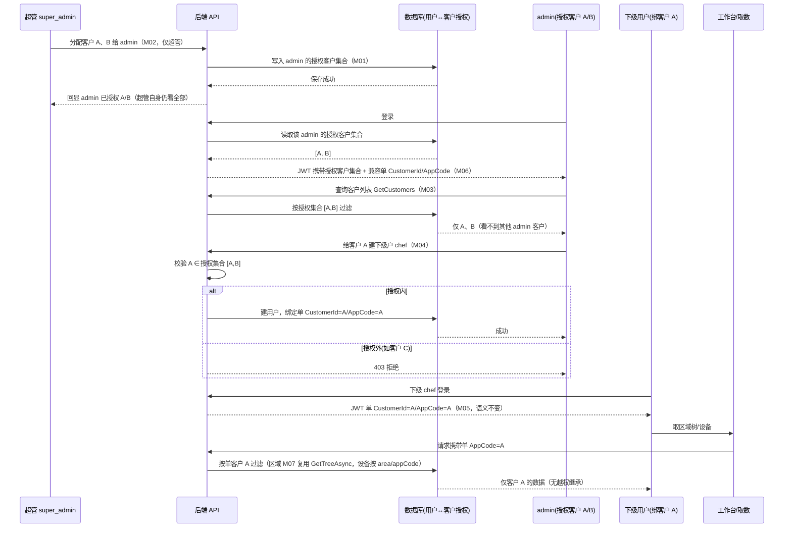

# 多租户授权模型改造 PRD

> 文档状态：仅供用户评估，本轮只做模型改造与取数链路，工作台 UI 随后单独做
> 产品经理：许清楚
> 说明：本文结论均落到可验收行为；引用的文件行号来自两路只读侦察（已抽样复核）。

## 一、项目信息

- **Language**：中文
- **Programming Language**：前端 Vite + React + MUI + Tailwind CSS；后端 C# / .NET（沿用现有栈）
- **Project Name**：`multi_customer_auth`
- **需求来源（用户原话）**：
  - 改造工作台：超级管理员第一块显示所有客户；租户管理员第一块显示所属的所有客户；普通账户第一块显示自己对应的客户。
  - 侦察发现代码不支持"一个 admin 管多个客户"后，用户拍板：
    > 「admin 给自己一批客户里面的某一个客户建立账户并且分配权限的话只能看对应关联的信息」
    > 「先做模型改造，UI 随后」

- **需求精确定义**：
  - 租户管理员（admin）拥有一批**授权客户**（多个；不同 admin 管不同批次，互不可见）。
  - 超管（super_admin）可把客户分配给某个 admin；超管仍看全部客户。
  - admin 只能在**自己授权的客户范围内**给某个客户创建下级账户（operator/chef/staff/user）并分配权限。
  - 下级用户仍绑定**单个客户**，只看/操作自己关联客户的信息（这一层语义不变，与当前模型一致）。
  - 本轮**只做模型改造与取数链路**，工作台 UI 改造随后单独做。

## 二、产品定义

### 产品目标

**一句话**：把"用户↔客户"从单值关系升级为"admin 拥有多客户授权批次、下级仍单客户"的分层模型，并打通按授权客户取数的链路，为工作台 UI 改造提供数据基础。

| # | 可度量目标 | 验收口径 |
|---|---|---|
| G1 | **授权隔离**：admin 只能看到自己被授权的客户 | 两个 admin 分别授权不同客户批次，A 查询客户列表/建户下拉只得到 A 的批次、看不到 B 的；越权查询被拒或返回空，覆盖率 100% |
| G2 | **建户边界**：admin 只能在授权客户内建下级户 | admin 对授权外客户调用创建用户接口一律被拒（`Code=403`），无用户入库；对授权内客户建户成功，且下级自动绑定该单客户 |
| G3 | **向下兼容**：下级单客户语义与现有取数不变 | 现有 operator/chef/staff/user 登录后仍只看到自己关联客户的数据；现有单 CustomerId/AppCode 的下级用户无需迁移即可正常登录、鉴权、取数 |

### 用户故事

**角色 A：超级管理员（super_admin）**

- **US-1**：作为超管，我希望把若干客户分配给某个 admin，以便分权管理不同客户批次。
  - 验收标准：超管可对任一 admin 增/减授权客户（分配是集合操作，可多选），保存后回显一致。
  - 验收标准：超管自身客户视图仍为**全部客户**，不受分配动作影响。
  - 验收标准：同一客户可分配给多个 admin 或仅一个（多对多语义由架构确定，见"待确认问题"），但任一分配变更立即影响对应 admin 的可见范围（下次请求生效）。

**角色 B：租户管理员（admin）**

- **US-2**：作为 admin，我希望登录后第一块只看到我被授权的那批客户，以便聚焦自己的管理范围。
  - 验收标准：拥有 N 个授权客户的 admin，客户列表接口返回**恰好这 N 个**（不多不少），且不包含其他 admin 的客户。
  - 验收标准：**收口当前越权缺陷**——现状 `CustomersController.cs:55-63` 对 admin-like 不加 `Where(AppCode==...)`，导致 admin 拿到系统全部客户；改造后必须按授权集合过滤。
  - 验收标准：admin 未被授权的客户，即便直接构造请求指定其 AppCode/CustomerId，也取不到数据。
- **US-3**：作为 admin，我希望在授权客户范围内给某个客户建下级账户并分配权限，下级只看该客户信息。
  - 验收标准：admin 从自己的授权客户中选中一个，创建 operator/chef/staff/user，用户自动绑定该客户的单 CustomerId/AppCode（与当前 `UserService.cs:148-169` 从单 CustomerId 派生 AppCode 的语义一致）。
  - 验收标准：admin 对**授权外**客户建户 → 被拒（`Code=403`），无用户入库；对授权内客户建户 → 成功。
  - 验收标准：admin 只能分配自己权限允许的角色范围，不能授予超出自身的权限（沿用现有权限体系）。

**角色 C：下级用户（operator/chef/staff/user）**

- **US-4**：作为下级用户，我仍只绑定一个客户，只看自己关联客户的信息，不受本次改造影响。
  - 验收标准：现有单 CustomerId/AppCode 的下级账号登录后，客户、区域、设备、告警等取数仍限定在**本客户**范围内，行为与改造前一致。
  - 验收标准：下级账号的客户分配仍是单选（`UserManagementPage.tsx:468-477` 的单选下拉语义不变）；本次"多客户"能力只对 admin 生效，不下沉到下级。
  - 验收标准：下级账号的客户列表/区域树/设备列表不因 admin 授权模型变化而扩大可见范围（无越权继承）。

## 三、需求池

| ID | 需求 | 优先级 | 验收标准 |
|---|---|---|---|
| M01 | **客户-管理员授权关系建模**：新增 admin↔客户的多客户授权关系存储（方案见"待确认问题"，由架构师定：users 加列逗号串 `ManagedCustomerIds` 或新建中间表 `user_customers`）；AppCode↔Customer 1:1 不变 | P0 | 一个 admin 可关联 N 个客户；关系可增删改查；既有单客户用户数据结构不受破坏；无 migrations 冲突 |
| M02 | **超管分配客户 API**：提供超管专用的"给指定 admin 分配/调整授权客户"接口，含鉴权（仅 super_admin） | P0 | 超管可批量设置某 admin 的授权客户集合；非超管调用返回 403；分配结果可查询回显；变更即时生效 |
| M03 | **admin 客户列表收口**：`CustomersController.GetCustomers`（`:55-63`）与 `GetAccessibleCustomers`（`:111-126`）对 admin 改为按授权客户集合过滤，不再返回全量 | P0 | admin 拿到恰好自己授权的 N 个客户；其他 admin 的客户和未授权客户不可见；超管仍全量；普通角色仍按单客户过滤 |
| M04 | **admin 建户范围校验**：admin 创建下级用户时，校验目标 CustomerId 是否在授权集合内；创建请求随带客户范围信息，服务端强校验（不只前端限制） | P0 | 授权外客户建户返回 403 且无用户入库；授权内成功并绑定单 CustomerId/AppCode；越权构造请求同样被拒 |
| M05 | **下级单客户不变**：下级用户的数据模型、JWT claim、取数过滤保持单 CustomerId/AppCode，不继承 admin 的多客户能力 | P0 | 现有下级账号登录/鉴权/取数行为零回归；客户分配仍单选；无越权继承 |
| M06 | **JWT / 过滤链路支持多客户**：JWT 与租户上下文增加承载"授权客户集合"的通道（如新增 claim，保留单 CustomerId/AppCode 兼容）；`PermissionFilter.cs:115-121` 等鉴权点按 admin 的授权集合校验 | P0 | admin 登录后请求携带可解析的授权客户集合；跨越授权范围的请求被拒；下级用户仍按单 AppCode 校验，行为不变 |
| M07 | **取数链路适配（模型层）**：区域 `AreaService.cs:35-38` 现按单 AppCode 过滤，需支持按授权客户集合取数（可复用 `AreaRepository.GetTreeAsync(customerId, appCode)` 已具备的按客户取树能力 `:16-23`）；设备按 `DevicesController.cs:108-116` 的 area 维度与 `DeviceService.cs:770-786` 的过滤适配 | P0 | admin 可按授权客户取到对应区域树与设备；下级按单客户取数不变；不越权 |
| M08 | **全局过滤器不作为唯一防线**：`AppDbContext.cs:171-204` 在超管/空 AppCode 时不过滤，且模型缓存有冻结隐患（`Program.cs:433-441` 启动期解析 DbContext）；所有授权判定须在业务层显式按授权集合过滤 | P0 | 即便全局过滤器未生效/被冻结，越权客户数据仍取不到（有显式过滤兜底） |
| M09 | **工作台 UI 改造**：第一块按角色展示（超管全部 / admin 授权批次 / 下级单客户），`DashboardPage.tsx:613-616` 现按单 customerId 收敛需改；用户管理页客户下拉 admin 场景改为授权范围内多选/单选 | P1 | 本轮**只列不做**，UI 随后单独排期 |
| M10 | **审计与运维**：授权分配变更审计日志、客户数上限约束与提示 | P2 | 本轮不做；如中间表方案则天然可加审计列，留待后续 |
| M11 | **授权批量导入/模板**：从表格批量给 admin 分配客户 | P2 | 本轮不做 |

## 四、关键数据流

## 五、边界与约束（铁律）

1. **下级用户仍单客户**：多客户授权只对 admin 生效；operator/chef/staff/user 仍绑定单个 CustomerId/AppCode，只看/操作关联客户信息，客户分配保持单选（当前 `CreateUserRequest.cs:28` 单 CustomerId、`SeedUsers.cs:74-92` 与 `UserManagementPage.tsx:468-477` 语义不变）。
2. **admin 不能给授权外客户建户**：建户时服务端强校验目标客户 ∈ admin 授权集合，越权返回 403 且不入库；不能只靠前端下拉限制。
3. **必须收口 admin 越权缺陷**：现状 `CustomersController.cs:31-35` 的 `IsAdminLike()` 含 admin，`:55-63`、`:111-126` 因此让 admin 拿到系统全部客户；本轮必须改为按授权客户集合过滤。前端 `DashboardPage.tsx:613-616` 现把 admin 砍回单 customerId 只是表象掩盖，模型改造后要能正确展示授权批次（UI 随后做）。
4. **AppCode 与 Customer 1:1 不变**：`Customer.AppCode` 唯一索引（`AppDbContext.cs:232-240`、`Initial.cs:1307-1311`）保持；不因多客户授权而改变客户与 AppCode 的对应关系。
5. **全局过滤器不能当唯一防线**：`AppDbContext.cs:171-204` 在超管/空 AppCode 时不过滤，且模型缓存有冻结隐患（`Program.cs:433-441` 启动期解析 DbContext）；鉴权与取数必须在业务层显式按授权集合过滤，过滤器仅作辅助。
6. **JWT 兼容**：新增"授权客户集合"承载需保留现有单 CustomerId/AppCode claim（`JwtHelper.cs:47-69`），确保下级用户与现有链路零回归；`PermissionFilter.cs:115-121` 的租户校验要区分 admin（按集合）与下级（按单 AppCode）。
7. **本轮范围**：只做模型改造与取数链路（M01–M08），工作台 UI（M09）与审计/批量（M10–M11）本轮不实现，仅列入需求池。
8. **迁移安全**：新增授权关系（加列或中间表）需可幂等迁移，不影响既有用户数据；无 migrations 冲突（全仓现有 migrations 无任何 user_customers/admin_customers 中间表）。

## 六、待确认问题

1. **授权关系存储方案（架构决策，留给架构师定）**：`users` 加列逗号串 `ManagedCustomerIds`（类比现有 `AllowedAreaIds`，`JwtHelper.cs:66-69` 用逗号串）vs 新建中间表 `user_customers`（用户↔客户多对多）。权衡维度：
   - **查询频率/方式**：按 admin 查授权客户、按客户反查 admin 的频率，中间表索引查询更高效，逗号串需 LIKE/拆分。
   - **客户数上限**：admin 授权客户数量级——少量（个位数~几十）逗号串够用；大量或不确定则中间表更稳。
   - **审计需求**：若未来要记录分配变更历史（M10），中间表加列/独立审计表更自然。
   - **迁移成本/users 表宽度**：加列改动小、兼容现有实体；中间表需新实体+迁移+种子，但范式更干净。
   - 建议：若客户批次规模可控且短期无审计硬需求，逗号串最快；但考虑"不同 admin 管不同批次、互不可见"的隔离要求与未来审计，中间表更可持续——由架构师结合上述维度拍板。
2. **同一客户可否授权给多个 admin**：本 PRD 默认允许多对多（一个客户可被多个 admin 管理），需确认是否要求互斥（一个客户只能归一个 admin）。若互斥，M01 唯一性约束与 M02 分配逻辑需加排他校验。
3. **admin 的 CustomerId/AppCode 单值字段在新模型下如何填**：admin 自身可能不再对应单一客户。确认 admin 的 `CustomerId`/`AppCode`（`User.cs:24-25`）是留空、还是保留一个"主客户"默认值——影响 JWT claim 兼容与 `PermissionFilter` 判定逻辑。
4. **admin 建户时是否自动把新客户加入自己的授权集合**：若 admin 为授权内客户 A 建下级户，A 本就在集合中，无影响；但若允许 admin 在建户时"顺带授权新客户"，等同于放宽建户边界，本 PRD 按不允许处理，请确认。
