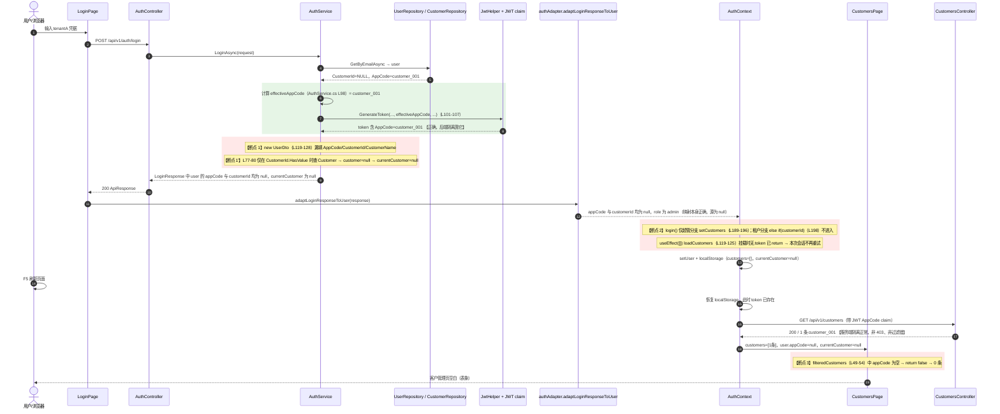
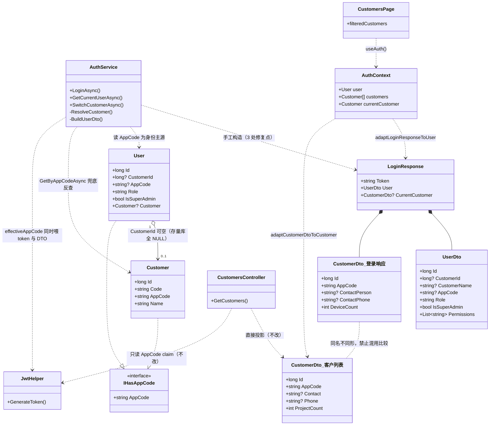
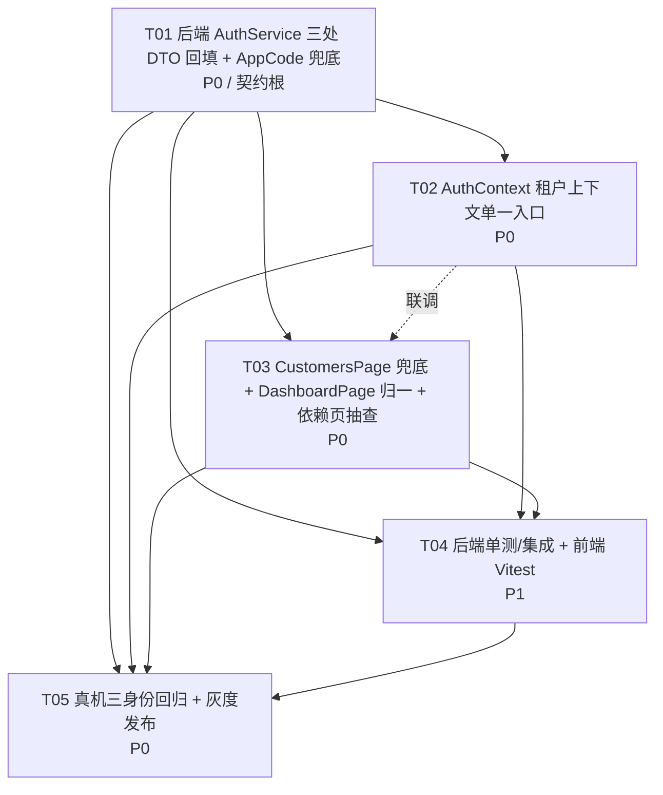

# 客户管理页租户无数据 —— 租户上下文断链修复方案

| 项 | 内容 |
|---|---|
| 文档类型 | 详细修复方案（只做设计，暂不改代码） |
| 作者 | 平台架构师 高见远 |
| 版本 | v1.0（供评估 / 待拍板） |
| 适用范围 | IoTPlatform 后端 `.NET 8` + 前端 `Web/`（Vite + React 18） |
| 结论速览 | **方案自洽，可实施**；有 4 个需用户拍板的产品决策点（见第 9 节） |
| 约束 | 不改 `CustomersController` 隔离逻辑、不改 JWT claim 结构、不改任何库表结构、不引入新第三方包、不写业务代码 |

> 本文**采信**主理人已完成的 Staging :5000 真机侦察与只读 SELECT 结论，不重复排查。
> 全文只回答三件事：**怎么改、影响面多大、怎么验**。
> 本文所有行号均以当前工作区源码为准，已逐文件核对；行号在工程师实际改动后会偏移，改动时以函数名为锚。

---

## 0. 本次设计新增确认的关键事实（只读核对结果）

以下 6 条是本次方案设计阶段新查证、且**直接改变了改法**的事实，先列出以免工程师按旧认知实施：

| # | 事实 | 出处 | 对方案的影响 |
|---|---|---|---|
| F1 | `ICustomerRepository.GetByAppCodeAsync(string)` **已存在且已实现**（`FirstOrDefaultAsync(c => c.AppCode == appCode)`） | `Data/Repositories/Interfaces/ICustomerRepository.cs:22`、`Implementations/CustomerRepository.cs:22-26` | **无需新增仓储方法、无需 migration、无需写库**。原"若不支持则设计最小新增"的分支作废，改为直接复用 |
| F2 | `UserDto`（`long? CustomerId` / `string? AppCode` / `string? CustomerName`）字段齐全，缺失纯粹是 `new UserDto` 手工赋值漏填 | `DTOs/Responses/UserResponse.cs:6-22` | 不需要改 DTO 定义，只改赋值 |
| F3 | 存在**两个同名不同形**的 `CustomerDto`：登录响应用 `ContactPerson/ContactPhone/ContactEmail`（`DTOs/Responses/LoginResponse.cs:16-30`），客户列表用 `Contact/Phone`（`Controllers/CustomersController.cs:348-361`） | 同上 | `LoginResponse.CurrentCustomer` 兜底必须走 `adaptCustomerDtoToCustomer`（`authAdapter.ts:277`），**不能**直接把列表项与登录响应项混用比较 |
| F4 | `authApi.login()` 返回**原始后端 JSON**，`adaptLoginResponse` 虽被 import 但从未调用 | `services/api/authApi.ts:15,36-45` | 实际链路是 `adaptLoginResponseToUser`（`authAdapter.ts:259-272`）。`id/customerId` 运行时是 **number**，而 TS 类型声明为 `string`（类型在撒谎），所有比较需 `String()` 归一 |
| F5 | 前端 `AuthContext.switchCustomer` 调的是 `customerApi.getCustomer`，**从不调用** `/auth/switch-customer`；`authApi.switchCurrentCustomer` 全项目无调用点 | `AuthContext.tsx:237-255`、`authApi.ts:74-83`、全量 grep | `SwitchCustomerAsync` 第三处 `new UserDto` 是"仅 API 可达"路径，仍须修复（契约一致性），但**不影响任何 UI 回归**，需单独用 API 用例验证 |
| F6 | `authApi.login` 在返回前已 `tokenManager.setToken()`（`authApi.ts:40-42`），请求拦截器从 `localStorage` 取 token | `httpClient.ts:32-45` | 因此 `login()` 内**紧接着**调 `customerApi.getCustomers()` 一定带得上 token，这是修复 P0-B 的时序前提 |

另外：`RoleConfig.GetAdminPermissions()` = 超管全量减去 2 个 API 配置权限（`Configuration/RoleConfig.cs:142-149`），即 **tenantA（role=admin）默认拥有 `CREATE/UPDATE/DELETE_CUSTOMERS`**；`GetUserPermissions()` 静态表**不含 `VIEW_CUSTOMERS`**（见 `Configuration/RoleConfig.cs`），但真机租户普通用户拿到 200，说明 `view_customers` 来自 DB `Role.Permissions`（`GetEffectivePermissionsAsync` 刚改过，见第 7 节③）。

---

## 1. 问题重述与影响面分级

### 1.1 分级结论

| 层级 | 定性 | 范围 |
|---|---|---|
| **L0 表象** | 客户管理页空白 | `CustomersPage.tsx` 1 个文件 |
| **L1 根因** | 登录响应体租户字段缺失 + 前端上下文未在登录时建立 | `AuthService.cs` × 3 处、`AuthContext.tsx` × 3 处、`CustomersPage.tsx` × 1 处 |
| **L2 系统性连带** | `currentCustomer` 恒 null 导致**十几个页面/上下文的租户归属与数据加载整体失效** | 20+ 文件，见 1.2 表 |

> 后端隔离与权限**已验证正常**（三身份分别 3 / 1 / 1 条，均 200），因此本方案**不碰隔离层**，只修"服务端已经算对、但没传给前端 / 前端没接住 / 前端又砍了一刀"的衔接链。

### 1.2 完整影响面清单（逐文件、逐行号）

#### A 组：依赖 `currentCustomer?.appCode` / `currentCustomer?.id` —— L2 系统性受损（**本次一并被修复，无需逐页改代码**）

| 文件:行号 | 表达式 | 当前受损表现 | 修复后预期 |
|---|---|---|---|
| `Web/src/app/contexts/DeviceContext.tsx:102` | `currentCustomer ? d.appCode === currentCustomer.appCode : false` | 租户设备被全量过滤 → **设备页 0 台** | 正常显示本租户设备 |
| `Web/src/app/contexts/DeviceContext.tsx:117` | `if (currentCustomer?.appCode \|\| user?.role === 'super_admin') loadDevices()` | 租户**根本不发设备请求** | 登录后立即加载 |
| `Web/src/app/contexts/AreaContext.tsx:131` | `if (!currentCustomer?.appCode && user?.role !== 'super_admin') return []` | 区域列表恒空 | 正常返回本租户区域 |
| `Web/src/app/contexts/AreaContext.tsx:142` | `area.appCode === currentCustomer?.appCode` | 全 `false` | 正常匹配 |
| `Web/src/app/contexts/AreaContext.tsx:187` | `if (currentCustomer?.appCode \|\| super_admin)` | 租户**不加载区域/区域树** | 登录后加载 |
| `Web/src/app/pages/ArchivesPage.tsx:129` | `currentCustomer ? archive.appCode === currentCustomer.appCode : false` | 档案列表 0 条 | 正常显示 |
| `Web/src/app/pages/ArchivesPage.tsx:790` | `appCode={currentCustomer?.appCode \|\| ''}` | 新建档案 `appCode=''` → 落库到错误租户或被拒 | 写入本租户 appCode |
| `Web/src/app/pages/MonitoringPage.tsx:184-185` | `if (!currentCustomer \|\| areas.length===0) return []` | 实时监控空白 | 正常显示 |
| `Web/src/app/pages/DevicesPage.tsx:67-69` | `if (!currentCustomer) return []; getAreasByCustomerId(currentCustomer.id)` | 设备页区域树空、无法按区域选设备 | 正常 |
| `Web/src/app/pages/DevicesPage.tsx:140-141` | `appCode: currentCustomer?.appCode \|\| device.appCode` | 命令下发/新建退化用 `device.appCode` | 明确使用本租户 appCode |
| `Web/src/app/pages/DevicesPage.tsx:496-510` | `if (currentCustomer?.id && show) getProjects(currentCustomer.id, …)` | 项目下拉不加载 | 正常加载 |
| `Web/src/app/pages/DataCollectionPage.tsx:298,311,368,391` | `… \|\| currentCustomer?.appCode` | 协议/规则创建与管理请求 `appCode=undefined` | 正确携带本租户 appCode |
| `Web/src/app/pages/DataTransformPageNew.tsx:206,248,370` | `currentCustomer?.appCode` | 转换任务 `appCode=undefined` | 正确携带 |
| `Web/src/app/pages/AnShengManagementPage.tsx:223` | `getProjects(currentCustomer?.id ? String(...) : undefined)` | 项目下拉取未过滤集合 | 只列本租户项目 |
| `Web/src/app/pages/AnShengManagementPage.tsx:262` | `appCode: currentCustomer?.appCode \|\| undefined` | 安盛设备绑定缺租户标识 | 正确携带 |
| `Web/src/app/pages/DashboardPage.tsx:615` | `customers.filter(c => c.id === (user?.customerId ?? currentCustomer?.id))` | 两值皆 null → **客户数/项目数统计恒 0** | 统计 1 个客户 |
| `Web/src/app/pages/WorkOrderPage.tsx:525` | `reporter: currentCustomer?.name \|\| '系统'` | 工单上报人显示"系统" | 显示租户名称 |
| `Web/src/app/pages/UserManagementPage.tsx:57,308` | `currentCustomer` / `customerId: user.customerId` | 用户归属字段 null | 正确归属 |
| `Web/src/app/components/Header.tsx:62-95` | `user?.role === 'super_admin' && currentCustomer` | 仅超管切换器；租户无影响 | **不变**（零回归） |
| `Web/src/app/pages/DashboardPage.tsx:692-723` | 同上 | 仅超管 | **不变** |
| `Web/src/app/pages/AirQualityPage.tsx:171`、`EnvironmentMonitoringPage.tsx:217`、`AnalyticsPage.tsx:124,201` | 仅解构 / `void` 抑制 | 无实质使用 | **不变**（无回归） |

#### B 组：依赖 `user.appCode` —— 全项目仅 1 处直接消费

| 文件:行号 | 表达式 | 当前受损表现 | 修复后预期 |
|---|---|---|---|
| `Web/src/app/pages/CustomersPage.tsx:52` | `if (user?.appCode) return customer.appCode === user.appCode; return false;` | **appCode 为空 → 全部砍光（P0-C，直接表象）** | 显示 1 条本租户客户 |
| `services/adapters/authAdapter.ts:79,122,266`、`userAdapter.ts:119,310`、`auth.types.ts:22` | 映射/透传 | 源为 null → 映射出 null（非适配器缺陷） | 映射出真实 `customer_00x` |
| `services/adapters/authAdapter.ts:242` | `checkUserPermission` 比较 `customerId` | 该函数在 AuthContext 主链路**未被调用** | 无变化 |

> **这一条直接回答第 7 节①**：全项目**没有任何页面用 `!user.appCode` 当作"超管"或"放行"的代理判断**；`user.appCode` 的唯一直接消费者就是 `CustomersPage:52`。因此回填 `user.appCode` 对其它页面的语义影响为**零**，对本页为**正向**。真正的大面积影响来自 `currentCustomer`，本方案通过"在 AuthContext 一次性把 `currentCustomer` 建对"来修复，**不需要逐页改代码**。

#### C 组：依赖 `user.customerId`

| 文件:行号 | 表达式 | 当前受损表现 | 修复后预期 |
|---|---|---|---|
| `Web/src/app/contexts/AuthContext.tsx:157` | `if (parsedUser.customerId)`（恢复分支） | 存量库为 null → 分支不进入 → `currentCustomer` 不恢复 | 分支删除，改为 AppCode/列表驱动 |
| `Web/src/app/contexts/AuthContext.tsx:198` | `else if (adaptedUser.customerId)`（登录租户分支） | 分支不进入 → **不加载 `customers`、不设 `currentCustomer`（P0-B）** | 分支删除，改为无条件加载 |
| `Web/src/app/pages/DashboardPage.tsx:615` | `user?.customerId ?? currentCustomer?.id` | 两者皆 null → 0 条 | 命中本租户 |
| `Web/src/app/pages/UserManagementPage.tsx:308`、`userAdapter.ts:119,310` | 透传 | null | 有值 |
| `Web/src/app/services/adapters/authAdapter.ts:265` | `customerId: loginResponse.user.customerId` | null | 有值（后端回填） |

---

## 2. 根因分析（含 3 处断点时序图）

### 2.1 断点链（压缩表述，不重复侦察结论）

| 断点 | 位置 | 性质 | 一句话 |
|---|---|---|---|
| **① 响应体漏填** | `Services/AuthService.cs:119-128`（另 `:182-191`、`:250-258` 同源） | 后端 | `:98` 的 `effectiveAppCode` 只进了 JWT claim，没进 `UserDto`；`user.appCode/customerId/customerName` 全 null |
| **①' 客户反查失效** | `Services/AuthService.cs:77-80`、`:197` | 后端 | `CustomerId` 全 NULL → `customer=null` → `LoginResponse.CurrentCustomer=null`、`DeviceCount=0`；十余页面因此失去租户锚点 |
| **② 登录时不建上下文** | `Web/src/app/contexts/AuthContext.tsx:119-144`、`:172-217`、`:147-170` | 前端 | `useEffect([])` 挂载时 token 尚不存在；`login()` 只在超管分支加载列表；租户分支被 `customerId` 卡死 → 全新登录 `customers=[]`、`currentCustomer=null`（刷新反而正常，故现象诡异） |
| **③ 页面二次砍光** | `Web/src/app/pages/CustomersPage.tsx:49-54` | 前端 | `appCode` 为空时 `return false`，即使数组有数据也不显示 |

> 注意：`Services/UserService.cs:75-94` 的用户列表 DTO 是**完整填充**的，说明缺陷边界严格限定在 `AuthService` 登录链路三处手工 `new UserDto`；`adaptLoginResponseToUser`（`authAdapter.ts:265-266`）本身映射正确，源为 null 才映射出 null。

### 2.2 根因时序图（登录 → JWT → 响应体 → adapter → AuthContext → 页面过滤）



> 独立文件：`docs/customer-tenant-context/sequence-diagram.mermaid`

### 2.3 数据契约关系（说明为何必须小心两个 CustomerDto）



> 独立文件：`docs/customer-tenant-context/class-diagram.mermaid`

---

## 3. 修复方案（逐文件、逐函数、含关键代码片段）

### 3.0 兼容原则（写进代码注释，作为全方案契约）

> **P-1 身份主源**：租户身份的唯一事实来源是 `AppCode`（`users.AppCode` ↔ `customers.AppCode`，存量库全有值）。`CustomerId` 只作为**新库/刷新种子后的快速路径与兼容兜底**，绝不作为身份判定的主键或唯一入口。
> **P-2 单一计算**：`effectiveAppCode` 只计算一次，**同时**用于 JWT claim 与 `UserDto.AppCode`，杜绝二者再次漂移。
> **P-3 超管不变量**：登录态下超管 `appCode = null`（`user.IsSuperAdmin` 短路），`CurrentCustomer = null`，语义**逐字不变**。
> **P-4 服务端隔离为准**：前端过滤只做"防御性二次校验"，不负责授权；正常路径下 `AuthContext` 必须保证租户 `user.appCode` 非空。
> **P-5 零写库**：不改表结构、不刷数据、不执行任何 UPDATE/INSERT；两套数据形态都在代码层兼容。

### 3.1 后端：`Services/AuthService.cs`（P0，唯一必改的 .cs 文件）

#### 3.1.1 `LoginAsync`（:58-162）

**改动 1 —— 把「按 CustomerId 查」改为「CustomerId 优先 + AppCode 兜底」，并把 `effectiveAppCode` 提前到客户解析之后、UserDto 之前（:75-107）**

```csharp
// :75 起替换原 75-80，并把原 :98-100 的表达式移到此处（语义逐字保留）
Customer? customer = null;
if (user.CustomerId.HasValue)                                   // 新库 / 刷新种子后
{
    customer = await _customerRepository.GetByIdAsync(user.CustomerId.Value);
}

// 原 :98-100 语义不变：超管恒 null；租户优先 user.AppCode，其次 customer?.AppCode
var effectiveAppCode = user.IsSuperAdmin
    ? null
    : (!string.IsNullOrEmpty(user.AppCode) ? user.AppCode : customer?.AppCode);

// 【新增兜底】存量库 CustomerId 全 NULL → 用 AppCode 反查 Customer（F1：方法已存在，无需新增）
if (customer == null && !user.IsSuperAdmin && !string.IsNullOrEmpty(effectiveAppCode))
{
    customer = await _customerRepository.GetByAppCodeAsync(effectiveAppCode);
}

// :83-87 deviceCount 保持原位，依赖上面的 customer，现可正确算出本租户设备数
// :101-107 GenerateToken(...) 改为使用上移后的 effectiveAppCode（值不变 → JWT 零变更）
```

**改动 2 —— 回填 `UserDto`（:119-128）**

```csharp
var userDto = new UserDto
{
    Id             = user.Id,
    Name           = user.FullName,
    Email          = user.Email,
    Role           = user.Role,
    CustomerId     = customer?.Id ?? user.CustomerId,   // 存量库也回填真实 id（供 DashboardPage:615）
    CustomerName   = customer?.Name,
    AppCode        = effectiveAppCode,                   // ★超管 null；租户 customer_001 / customer_002
    Avatar         = user.Avatar,
    AllowedAreaIds = allowedAreaIds,
    IsActive       = user.IsActive,                      // 补齐（原为默认 false，无消费方，低风险）
    IsSuperAdmin   = user.IsSuperAdmin,
    CreatedAt      = user.CreatedAt,
    UpdatedAt      = user.UpdatedAt
};
userDto.Permissions = await _permissionService.GetEffectivePermissionsAsync(user.Role); // :131 不动
```

`currentCustomer`（:134-151）**逻辑不动**，仅因 `customer` 已被兜底解析到而自然有值；`deviceCount` 同理。

#### 3.1.2 `GetCurrentUserAsync`（:167-221，服务 `GET /auth/me`）

`UserRepository.GetUserDetailsAsync`（`Implementations/UserRepository.cs:70-76`）用 `Include(u => u.Customer)`，存量库 `CustomerId=NULL` → `user.Customer` 亦为 null，故 `:197` 的分支同样失效，必须一并兜底：

```csharp
var user = await _userRepository.GetUserDetailsAsync(userId);   // :169 不动（appCode=null → 不过滤）
if (user == null) return null;

var effectiveAppCode = user.IsSuperAdmin
    ? null
    : (!string.IsNullOrEmpty(user.AppCode) ? user.AppCode : user.Customer?.AppCode);

Customer? customer = user.Customer;
if (customer == null && !user.IsSuperAdmin && !string.IsNullOrEmpty(effectiveAppCode))
{
    customer = await _customerRepository.GetByAppCodeAsync(effectiveAppCode);
}

// :182-191 → 与 LoginAsync 使用同一组字段
var userDto = new UserDto { /* 同 3.1.1 改动 2；Name 统一为 user.FullName，见风险 R6 */ };
userDto.Permissions = await _permissionService.GetEffectivePermissionsAsync(user.Role); // :194 不动

// :196-214 中的 user.Customer 全部替换为上面的局部变量 customer
```

#### 3.1.3 `SwitchCustomerAsync`（:226-293，仅 `POST /auth/switch-customer` 可达）

```csharp
// :250-258 → 与新签发的 token（:279-285 传入 customerId / customer.AppCode）保持字段一致
var userDto = new UserDto
{
    Id             = user.Id,
    Name           = user.FullName,
    Email          = user.Email,
    Role           = user.Role,
    CustomerId     = customerId,          // 与 token :283 对齐
    CustomerName   = customer.Name,
    AppCode        = customer.AppCode,    // 与 token :284 对齐（"以租户视角查看"的显式例外，见 4.3）
    Avatar         = user.Avatar,
    AllowedAreaIds = allowedAreaIds,
    IsActive       = user.IsActive,
    IsSuperAdmin   = user.IsSuperAdmin,
    CreatedAt      = user.CreatedAt,
    UpdatedAt      = user.UpdatedAt
};
userDto.Permissions = await _permissionService.GetEffectivePermissionsAsync(user.Role); // :262 不动
```
> `Role` 仍是超管自身角色，权限解析不变（现有注释 `:260-261` 已说明）。**此处不改 token、不改权限、不改 `CurrentCustomer` 结构**。

#### 3.1.4 建议顺带（同一文件内，零外部影响，防再次漂移）

把三处重复的字段组装抽成两个私有 helper（放在 `RecordLoginLogAsync`（:298）之前）：

```csharp
private static string? ComputeEffectiveAppCode(User user, Customer? byId) =>
    user.IsSuperAdmin ? null : (!string.IsNullOrEmpty(user.AppCode) ? user.AppCode : byId?.AppCode);

private static UserDto BuildUserDto(User user, string? effectiveAppCode,
                                    Customer? customer, List<long>? allowedAreaIds) => new() { /* 3.1.1 改动 2 */ };

private static CustomerDto BuildCustomerDto(Customer c, int deviceCount) => new() { /* 现 :137-150 */ };
```
**不引入 AutoMapper**：`DTOs/Profiles/MappingProfile.cs:44-57` 的 `CreateMap<User, UserDto>()` 依赖 `src.Customer` 导航（存量库为 null → `CustomerName` 仍丢），且 `AppCode` 需要"超管置 null"的业务特例，无法用 `MapFrom` 表达；手工构造 + 私有 helper 改动面最小、可测性最好。

### 3.2 前端：`Web/src/app/contexts/AuthContext.tsx`（P0，核心）

**目标**：把"租户上下文"收敛为**一个入口**，任何路径（全新登录 / F5 / 关闭重开 / 旧版本 localStorage 升级）都得到同样的 `customers + currentCustomer + user.appCode`。

#### 3.2.1 新增两个模块级纯函数（放在 `AuthProvider` 外，避免 `useCallback` 依赖链）

```ts
// 服务端已按 JWT AppCode 隔离：非超管拿到的列表即其所属客户，是权威数据源
// 优先级：appCode 匹配 → customerId 匹配（String 归一，见 F4） → 单条收敛态
const deriveTenantContext = (u: User | null, list: Customer[]): Customer | null => {
  if (!u || u.role === 'super_admin' || list.length === 0) return null;
  const byAppCode = u.appCode ? list.find(c => c.appCode === u.appCode) : undefined;
  if (byAppCode) return byAppCode;
  const byId = u.customerId != null
    ? list.find(c => String(c.id) === String(u.customerId)) : undefined;
  if (byId) return byId;
  return list.length === 1 ? list[0] : null;   // 隔离后单条 ⇒ 即本租户
};

// 兼容"修复前已登录"的存量会话：localStorage.user.appCode 为 null 时自愈，无需强制重新登录
const patchTenantUser = (u: User, cc: Customer | null): User => {
  if (!cc) return u;
  if (u.appCode && u.customerId != null) return u;   // 已是完整态，避免无谓 setState / localStorage 写入
  return {
    ...u,
    appCode: u.appCode ?? cc.appCode,
    customerId: u.customerId ?? (cc.id as unknown as string),   // 运行时为 number，见 F4；不做 String() 以免与 c.id 类型失配
  };
};
```

#### 3.2.2 `AuthProvider` 内：单一 `loadCustomers` + `applyCustomers`

```ts
const applyCustomers = (list: Customer[], u: User | null) => {
  setCustomers(list);
  if (!u || u.role === 'super_admin') return;   // ★超管：只更新列表，租户上下文语义原样保留
  const cc = deriveTenantContext(u, list);
  setCurrentCustomer(cc);
  if (cc) {
    localStorage.setItem('currentCustomer', JSON.stringify(cc));
    const patched = patchTenantUser(u, cc);
    if (patched !== u) {
      setUser(patched);
      localStorage.setItem('user', JSON.stringify(patched));
    }
  } else {
    localStorage.removeItem('currentCustomer');
  }
};

const loadCustomers = async (u: User | null): Promise<Customer[]> => {
  if (!localStorage.getItem('token')) return [];        // 保留原有 token 门控，但改为可按登录态重入
  try {
    setLoading(true);
    const res = await customerApi.getCustomers(1, 100);
    if (res.data.code !== 200) { setError('加载客户列表失败'); return []; }
    const list = res.data.data.items.map(adaptCustomerDtoToCustomer);
    applyCustomers(list, u);
    return list;
  } catch (err) {
    console.error('Failed to load customers:', err);
    setError('加载客户列表失败');
    return [];
  } finally {
    setLoading(false);
  }
};
```
> 原 `:119-144` 的 `useEffect([])` 内联实现删除，改为上述可按 `u` 重入的函数；`refreshCustomers`（`:383-397`）改为 `await loadCustomers(user)`，保证手动刷新后 `currentCustomer` 同步。

#### 3.2.3 合并两个挂载 `useEffect`（原 :119-144 + :147-170）

```ts
useEffect(() => {
  const storedUser = localStorage.getItem('user');
  const storedToken = localStorage.getItem('token');
  if (!storedUser || !storedToken) return;
  try {
    const parsedUser: User = JSON.parse(storedUser);
    setUser(parsedUser);
    // 首屏快速填充（仅租户）；超管不恢复，保持 App.tsx:46 的选择租户门控不变
    const storedCustomer = localStorage.getItem('currentCustomer');
    if (storedCustomer && parsedUser.role !== 'super_admin') {
      setCurrentCustomer(JSON.parse(storedCustomer));
    }
    void loadCustomers(parsedUser);   // 服务端列表为准：覆盖旧值 + 自愈 appCode/currentCustomer
  } catch (err) {
    console.error('Failed to parse stored user:', err);
    localStorage.removeItem('user');
    localStorage.removeItem('token');
    localStorage.removeItem('currentCustomer');
  }
}, []);
```

#### 3.2.4 `login()`（:172-217）：租户与超管**都**加载客户列表

```ts
const response = await authApi.login({ email, password });   // 内部已 setToken（F6）
if (!response) throw new Error('登录失败');

const adaptedUser = adaptLoginResponseToUser(response);
localStorage.setItem('user', JSON.stringify(adaptedUser));
localStorage.setItem('token', response.token);
setUser(adaptedUser);

if (adaptedUser.role === 'super_admin') {
  setCurrentCustomer(null);
  localStorage.removeItem('currentCustomer');               // 原 :189-191 语义保留
}

const list = await loadCustomers(adaptedUser);               // ★原本只在超管分支执行，现无条件执行

// 兜底：列表为空（网络/权限异常）时，用后端 LoginResponse.CurrentCustomer（F3 → 走同一适配器）
if (list.length === 0 && adaptedUser.role !== 'super_admin' && response.currentCustomer) {
  const cc = adaptCustomerDtoToCustomer(response.currentCustomer);
  setCurrentCustomer(cc);
  localStorage.setItem('currentCustomer', JSON.stringify(cc));
  const patched = patchTenantUser(adaptedUser, cc);
  if (patched !== adaptedUser) {
    setUser(patched);
    localStorage.setItem('user', JSON.stringify(patched));
  }
}
```
**删除**原 `:198-206` 的 `else if (adaptedUser.customerId)` 分支（它既不可达、又是"用 CustomerId 当身份主键"的错误范式）。`logout()`（:219-235）与 `switchCustomer()`（:237-255）**保持不动**（后者仅超管使用，见 4.2）。

### 3.3 前端：`Web/src/app/pages/CustomersPage.tsx:49-54`（P0，一行级兜底）

```ts
const filteredCustomers = customers
  .filter(customer => {
    if (user?.role === 'super_admin') return true;                    // ① 超管短路（零回归）
    if (user?.appCode) return customer.appCode === user.appCode;        // ② 正常路径：防御性二次校验
    // ③ 兼容兜底：AuthContext 已从隔离列表反推 appCode，此分支仅在收敛前的首帧短暂出现。
    //    服务端按 JWT claim 隔离后最多 1 条；若返回多条说明 claim 缺失，拒绝展示以防越权。
    return customers.length <= 1;
  })
  .filter(/* 搜索条件 :55-58 不动 */);
```

> **为何不是无脑 `return true`**：`CustomersController.cs:42-49` 在 `AppCode` claim 为空时**不追加过滤**（`if (!string.IsNullOrEmpty(appCode))`）。虽然登录签发的租户 token 必然带 claim（真机已验证），但"前端无条件放行 + 后端空 claim 不过滤"组合会形成越权展示窗口。`customers.length <= 1` 把兜底限制在"已隔离"的可证伪状态内，是纵深防御，不影响正常路径（正常路径走 ②）。

### 3.4 前端：`Web/src/app/pages/DashboardPage.tsx:615`（P1，类型安全微调）

```ts
: customers.filter(c => String(c.id) === String(user?.customerId ?? currentCustomer?.id));
```
理由见 F4：`c.id` 运行时是 number、`User.customerId` 声明为 string。原 `===` 在当前链路恰好都是 number 才成立，回填后一旦出现 string 即失配；归一后两条数据形态都稳定。

### 3.5 明确「不改」清单及理由

| 不改对象 | 理由 |
|---|---|
| `Controllers/CustomersController.cs:17,42-49,65-78` | 真机三身份 3/1/1 条且全 200，**隔离与投影已正确**；过滤依据是 JWT `AppCode` claim，与响应体 `UserDto` 完全解耦。改它既无必要，又会引入"超管被过滤"和"存量 token 行为变化"的新回归面。空 claim 不过滤的硬化另立 P2 单（见 R4） |
| JWT claim 结构（`Infrastructure/JWT/JwtHelper.cs:56-64`、`AuthService.cs:101-107,279-285`） | `effectiveAppCode` 本就正确签发。若给超管补 `AppCode=system`，`Repository.ApplyFilters`（`Implementations/Repository.cs:168-186`）与 `CustomersController:47` 会把超管过滤成只看 `AppCode=system` 的数据（真实数据均为 `customer_00x`），**反而看不到全部**——`AuthService.cs:95-97` 已明文记录该陷阱。`TenantFilterAttribute`（`Filters/PermissionFilter.cs:87-130`）也依赖"无 claim = 超管"这一约定。且改 claim 会使存量 token 语义漂移 |
| `ICustomerRepository` / `CustomerRepository` | F1：按 AppCode 查询能力已具备，零新增 |
| 数据库 / Migration / SeedUsers | P-5 零写库；`CustomerId` 全 NULL 由代码兜底兼容，将来刷新种子有值也兼容（第 5 节） |
| `adaptLoginResponseToUser`（`authAdapter.ts:259-272`） | 映射本身正确，源补上后自动生效；改动反而扩大面 |
| `AuthContext.switchCustomer` / `TenantSelectionPage` / `Header` | 超管专属路径，见第 4 节零回归论证 |
| `PermissionService` / `PermissionFilter` / `Roles` | 权限子系统与本缺陷正交，见第 7 节③ |

---

## 4. 超管零回归论证

### 4.1 不变量（逐字不变）

超管 `admin@system.com`：`user.IsSuperAdmin=true` → `effectiveAppCode = null` → `UserDto.AppCode = null`、`CustomerId = null`、`CustomerName = null`、`CurrentCustomer = null`、JWT **无 `AppCode` claim**、`GET /customers` 返回 3 条、`App.tsx:46` 进入 `TenantSelectionPage`。
本方案对超管响应体的**唯一新增**是 `IsActive/CreatedAt/UpdatedAt`（纯追加，`AuthContext` 不消费，`adaptLoginResponseToUser` 只读 `isActive`）。

### 4.2 前端所有 `role === 'super_admin'` 短路点（逐一核对，均不受影响）

| 位置 | 短路语义 | 本方案影响 |
|---|---|---|
| `App.tsx:41-48` | `if (!user) LoginPage`；`if (role==='super_admin' && !currentCustomer) TenantSelectionPage` | `currentCustomer` 仍为 null → 门控不变；`customers` 仍加载 3 条 → 选择页列表不变 |
| `AuthContext.tsx:189-196` | 超管登录 `setCurrentCustomer(null)` + 加载全部客户 | **显式保留**；`applyCustomers` 对超管提前 return，不改租户上下文 |
| `AuthContext.tsx:157/198` | 被删除的两个 `customerId` 分支 | 超管本就不进入，删除无影响 |
| `AuthContext.tsx:364-371` `hasPermission` | `super_admin` 直接 `true` | `permissions`/`role` 不变 |
| `CustomersPage.tsx:51` | `return true`（全部 3 条） | 第一条分支，先于新增兜底 |
| `AreaContext.tsx:131,137,153,187` | 非空判断放行 / 返回全部区域 / `accessibleAreaIds` 全量 | role 不变 → 全部保持 |
| `DeviceContext.tsx:117` | `|| user?.role === 'super_admin'` 触发加载 | 保持 |
| `DeviceContext.tsx:102` | 需 `currentCustomer` 才匹配 | `App.tsx:46` 强制超管先选租户，故进入业务页时必有 `currentCustomer`，与现状一致 |
| `DashboardPage.tsx:610,613-615,692-723` | `isSuperAdmin ? customers : filtered`、切换器 | 3.4 的 `String()` 归一仅作用于**非超管**分支；超管分支不变 |
| `Header.tsx:62-95` | `super_admin && currentCustomer` 显示切换器 | 不变 |
| `AlertCenterPage.tsx:80`、`WorkOrderPage.tsx:89`、`DevicesPage.tsx:37`、`DictionaryManagementPage.tsx:65`、`ProtocolManagementPage.tsx:466`、`SettingsPage.tsx:457,1224`、`UserManagementPage.tsx:462,883`、`Sidebar.tsx:110`、`config/permissions.ts:328` | 纯 role 判断 / 权限表 | `user.Role`、JWT `ClaimTypes.Role`、`Permissions` 三者均不变 |

### 4.3 后端所有超管短路点

| 位置 | 语义 | 影响 |
|---|---|---|
| `AuthService.cs:98-100` | `user.IsSuperAdmin ? null` | **原样保留**，是全部零回归的根 |
| `JwtHelper.cs:61-64` | `appCode` 为空则不写 claim | 不变 |
| `Repository.cs:168-186` | `!string.IsNullOrEmpty(appCode)` 才过滤 | 无 claim → 不过滤 → 看全部 |
| `CustomersController.cs:42-49` | `role != SUPER_ADMIN` 才过滤 | 不变 |
| `PermissionFilter.cs:36-41` | 超管短路放行，不查 DB | 不变 |
| `PermissionFilter.cs:108-113`（TenantFilter） | 超管不需要租户过滤 | 不变 |
| `PermissionService.cs:281-285` | `Roles.IsSuperAdmin(roleCode) → Permissions.All` | 入参 `user.Role` 不变 |
| `AuthController.cs:90` | `/auth/switch-customer` 仅超管 | 不变 |

### 4.4 一处需要明确的「显式例外」

`SwitchCustomerAsync` 的 `UserDto.AppCode = customer.AppCode`（3.1.3）看似违反"超管 appCode 恒 null"，实为**语义一致**：该接口本就是"超管以租户视角查看"，其 JWT 在 `:284` 早已写入 `AppCode=customer_x`。DTO 必须与自己签发的 token 对齐，否则前后端对同一会话的租户认知分裂。且 F5 已证实 **UI 从不调用该接口**，`CustomersPage:51` 的超管短路也优先于 appCode 判断，故 **UI 零回归**；仅需在验证阶段用 API 直接覆盖该端点。

> 另有一条**刻意保留的既有行为**：超管刷新页面后 `currentCustomer` 不恢复（原 `:157` 因 `customerId` 为 null 不进入），仍需重新选租户。本方案 3.2.3 用 `parsedUser.role !== 'super_admin'` 显式守住这一点，避免"顺手优化"引入回归；是否改变属产品决策（见 9-D）。

---

## 5. 存量数据兼容（两条路径 + 两个边界）

| 场景 | `users.CustomerId` | `users.AppCode` | 解析路径 | `UserDto.AppCode` | `UserDto.CustomerId` | `CurrentCustomer` | 前端结果 |
|---|---|---|---|---|---|---|---|
| **S1 存量库（Staging 现状）** | NULL | `customer_001` | `GetByIdAsync` 跳过 → **`GetByAppCodeAsync` 兜底命中** | `customer_001` | `1`（反查回填） | 有值，`DeviceCount` 正确 | 列表 1 条；`deriveTenantContext` 按 appCode 命中 |
| **S2 新库 / 刷新种子后** | `1` | `customer_001` | `GetByIdAsync` 命中，**不再查 AppCode** | `customer_001` | `1` | 有值 | 同上 |
| **S3 超管（两种库皆然）** | NULL | `system` | `IsSuperAdmin` → 两步都不查 | **null** | **null** | **null** | 3 条 + `TenantSelectionPage` |
| **S4 边界：CustomerId 有值但指向不存在客户** | `999` | `customer_002` | `GetByIdAsync` 返回 null → 回落 `GetByAppCodeAsync` | `customer_002` | `2` | 有值 | 正常 |
| **S5 边界：AppCode 与客户表无匹配** | NULL | 未登记值 | 两步皆空 | 仍回填该值（与 JWT 保持一致，P-2） | null | null | 列表 0 条 → `currentCustomer=null`，页面走 ③ 兜底（0 条），需日志告警（见 R2） |

要点：
- **无需数据回填、无需 migration、无需清库**；`SeedUsers.cs` 的 `CustomerId` 是否刷新都不影响正确性。
- `effectiveAppCode` 的表达式**逐字保留**（`user.AppCode ?? customer?.AppCode`），因此 JWT claim 值与修复前**完全相同**——这是"不改隔离逻辑"能成立的数学保证。
- `customer` 反查成功后，顺带修好 `deviceCount`（`AuthService.cs:83-87`）与 `CurrentCustomer.DeviceCount`；这是对存量库的正向附带收益。
- 前端 `deriveTenantContext` 三级优先（appCode → String(customerId) → 单条收敛）在 S1/S2/S3/S4 下全部收敛到同一条客户；`patchTenantUser` 让**修复前已登录的存量会话**在下次刷新时自愈，无需强制登出。

---

## 6. 验证用例

### 6.1 真机三身份主矩阵（Staging :5000 / 真实库，全程只读 + 前端只读操作）

| # | 身份 | 检查点 | 期望 |
|---|---|---|---|
| V1 | `admin@system.com` | 登录响应体 | `user.appCode=null`、`customerId=null`、`currentCustomer=null` |
| V2 | 同上 | JWT 解码 | **无 `AppCode` claim**、`ClaimTypes.Role=super_admin` |
| V3 | 同上 | `GET /api/v1/customers` | 200 / **3 条** |
| V4 | 同上 | 客户管理页 / 工作台 / 选择租户页 | 3 条；先出现 `TenantSelectionPage`；切换租户后各页正常；菜单权限全开 |
| V5 | `manager@haidilao.com` (admin) | 登录响应体 | `appCode=customer_001`、`customerId=1`、`customerName` 非空、`currentCustomer.appCode=customer_001` |
| V6 | 同上 | JWT 解码 | 含 `AppCode=customer_001`（与修复前一致） |
| V7 | 同上 | `GET /api/v1/customers` | 200 / **1 条 `customer_001`** |
| V8 | 同上 | **全新登录后不刷新**直接进客户管理页 | **1 条 `customer_001`**（P0 验收点） |
| V9 | `user1@haidilao.com` (user) | 同 V5-V8 | `customer_001` / `customerId=1` / 1 条 / 页面 1 条 |
| V10 | 三身份 | `user.permissions` | 与修复前**逐项相同**（证明 7-③ 无交互） |
| V11 | 三身份 | `GET /api/v1/auth/me` | `user.appCode/customerId/customerName/currentCustomer` 与登录响应一致 |
| V12 | 超管 token | `POST /api/v1/auth/switch-customer {"customerId":2}` | 200；`user.appCode=customer_002`、`customerId=2`；token 含 `AppCode=customer_002`；随后 `GET /customers` 行为不变（超管短路） |

### 6.2 刷新 / 会话场景（必须覆盖"诡异现象"）

| # | 场景 | 期望 |
|---|---|---|
| V13 | 全新登录 → 不刷新 → 逐个打开下列页面 | 客户管理页 1 条，且各依赖页均有数据（不再需要 F5） |
| V14 | 登录后 F5 | 与 V13 一致 |
| V15 | 关闭标签页 → 重开 → 直接进深链接 | 与 V13 一致 |
| V16 | **存量会话升级**：手工把 `localStorage.user` 改成 `appCode:null, customerId:null`（模拟修复前登录态），再 F5 | `loadCustomers` 返回 1 条 → `patchTenantUser` 自愈写回 `appCode/customerId`；页面与各依赖页正常；`localStorage.user` 被更新 |
| V17 | 超管登录 → 选租户 → F5 | 仍进入 `TenantSelectionPage`（刻意保留，见 4.4） |
| V18 | 登出 → 重新登录另一租户 | 无残留：`customers`/`currentCustomer`/`user` 全部切换为 `customer_002`，不出现串租户 |
| V19 | 断网 / `GET /customers` 返回非 200 | `currentCustomer` 被清空并提示"加载客户列表失败"，不展示脏数据 |

### 6.3 十几个依赖页面抽查清单

| 页面 | 抽查点 | 期望 |
|---|---|---|
| `CustomersPage` | 列表条数 / 搜索 / 详情弹窗项目 | 1 条、可搜索、项目列表加载 |
| `DashboardPage` | 客户数、项目数统计 | 1（原为 0） |
| `DevicesPage` | 设备列表、区域树、项目下拉、命令下发 appCode | 均有本租户数据 |
| `AreaManagementPage` / `AreaContext` | 区域列表 + 区域树 | 非空且仅本租户 |
| `MonitoringPage` | 实时监控曲线/区域 | 非空白 |
| `ArchivesPage` | 档案列表 + 新建档案 appCode | 非空、落库 appCode 正确 |
| `DataCollectionPage` | 协议/规则创建与管理请求体 `appCode` | 为 `customer_00x`，非 `undefined` |
| `DataTransformPageNew` | 任务请求体 `appCode` | 同上 |
| `AnShengManagementPage` | 项目下拉、设备绑定 appCode | 仅本租户、appCode 正确 |
| `WorkOrderPage` | 工单 reporter | 显示租户名而非"系统" |
| `UserManagementPage` | 用户归属 `customerId` | 有值 |
| `AirQualityPage` / `EnvironmentMonitoringPage` / `AnalyticsPage` / `AlertCenterPage` / `Header` / `Sidebar` | 无回归抽查 | 与修复前一致 |
| 超管全量抽查 | 以上每页 | 显示全租户数据，与修复前一致 |

### 6.4 自动化测试建议（不引入新包，复用现有栈）

后端现有：`tests/IoTPlatform.AnSheng.Tests`（xUnit 2.9.2 + EF InMemory）、`tests/IoTPlatform.IntegrationTests`（xUnit + `WebApplicationFactory` + Testcontainers.MySql + Respawn + FluentAssertions）。
前端现有：`vitest ^4.1.10`（`package.json:9`，已有 `ProtocolManagementPage.normalize.test.ts` 范例）。

| 层 | 用例 | 断言要点 |
|---|---|---|
| 后端单测 `AuthServiceTests` | 4 种数据形态：S1 `CustomerId=NULL`、S2 有值、S4 悬空值、S3 超管 | `LoginAsync` 返回 `UserDto.AppCode/CustomerId/CustomerName` 正确；`CurrentCustomer != null`（S1/S2/S4）；超管三者全 null；`GetByAppCodeAsync` 仅在需要时被调用（Moq `Verify`）；`Permissions` 与改动前快照一致 |
| 后端单测 | `GetCurrentUserAsync`（`user.Customer=null` 与有值两态） | 与 `LoginAsync` 结果字段一致 |
| 后端单测 | `SwitchCustomerAsync` | DTO 的 `AppCode/CustomerId` 与 `GenerateToken` 入参一致 |
| 集成测试 | `WebApplicationFactory` + 真实 MySQL 容器，植入 3 customers / 3 users（两组：`CustomerId` 全 NULL、全有值） | 三身份 `POST /auth/login` → 断言响应体字段 → 解码 JWT 断言 `AppCode` claim → 带 token `GET /customers` 断言 3/1/1 → `GET /auth/me` 一致性 → `POST /auth/switch-customer` |
| 前端单测（Vitest） | `deriveTenantContext` 纯函数 | super_admin→null；appCode 命中；customerId 命中（number/string 混用）；列表 0/1/多条；空列表 |
| 前端单测 | `CustomersPage` 过滤谓词（可抽成纯函数后测） | 超管→全放行；appCode 命中→仅 1 条；appCode 为空 + 1 条→放行；appCode 为空 + 3 条→**全部拒绝**（防越权） |
| 前端单测 | `AuthContext` 恢复分支（RTL / mock `customerApi`） | 旧 localStorage（`appCode:null`）→ 自愈写回；超管不恢复 `currentCustomer` |
| E2E（可选，Playwright 需新装，列为 P2） | 三身份 × (全新登录 / F5) × 客户管理页 | 截图对比 + 条数断言 |

---

## 7. 回归风险与待确认问题

### 7.1 三项必答

**① 回填 `user.appCode` 后，之前依赖「appCode 为空」的其它页面语义变化是否全是正向？**
**结论：是，且影响面比预期小得多。** 全量 grep 证实 `user.appCode` 的**唯一直接消费者**是 `CustomersPage.tsx:52`；其余十余处读的是 `currentCustomer?.appCode`（A 组），由 `AuthContext` 一次性建对而非逐页改动。没有任何代码把 `!user.appCode` 当作"超管/放行"的代理判断；`authAdapter.ts:242` 的 `checkUserPermission` 虽比较 `customerId`，但在 AuthContext 主链路无调用点。
**残留**：`user.appCode` 从 `null` 变为真实值后，若有前端埋点/日志把 `null` 当"未登录"标志，需人工确认（本次 grep 未发现）；建议 T05 上线后观察一轮前端错误日志。

**② 租户是否只应看到自己 1 条客户、是否需要只读？—— 需产品拍板（见 9-A / 9-B）**
现状：后端按 `AppCode` 过滤 → 租户恒 1 条（真机已证）。但 `RoleConfig.GetAdminPermissions()`（`:142-149`）几乎等同超管全量，**tenantA（admin）拥有 `CREATE/UPDATE/DELETE_CUSTOMERS`**，`CustomersPage.tsx:364,450,455` 会对其显示"添加/编辑/删除"按钮，且 `confirmDelete`（:107-116）是把客户 `status` 置 `inactive` 而非物理删除。也就是说租户管理员当前**可以改/停用自己的客户档案**，这不是本次缺陷引入的，但会在"客户管理页终于能看见了"之后第一次暴露给用户。必须确认是否收敛为只读。

**③ `Permissions` / `GetEffectivePermissionsAsync` 刚改过，确认无交互影响？**
**确认无交互**，依据：
- `PermissionService.cs:279-307` 的入参只有 `roleCode`，内部只读 `IRoleRepository.GetByCodeAsync(roleCode, null)` 与 DB `Role.Permissions` JSON，超管短路返回 `Permissions.All`；**完全不读 `User.AppCode` / `User.CustomerId` / `UserDto`**。
- `PermissionFilter.cs:65-80` 从 JWT `ClaimTypes.Role` 取 `roleCode`；本方案不改 `user.Role`、不改 JWT role claim、不改 `GenerateToken` 的 role 参数。
- `AuthService.cs:131/194/262` 三处调用入参仍是 `user.Role`，**一行不动**。
- 真机租户普通用户（user）能 200 通过 `[PermissionAuthorize(VIEW_CUSTOMERS)]`，而静态 `GetUserPermissions()` 不含 `view_customers` → 说明权限来自 DB `Role.Permissions`（提交 `6c760d1` 的效果）。本方案不触碰该表与该解析链。
- **验收动作**：V10 明确要求三身份 `user.permissions` 与修复前逐项相同；集成测试加一条权限数组快照断言。

### 7.2 其余风险

| ID | 风险 | 等级 | 缓解 |
|---|---|---|---|
| R1 | **适配层命名冲突**：`index.ts:97-98` 同时 `export *` 了 `authAdapter` 与 `customerAdapter`，二者都导出 `adaptCustomerFromBackend` / `adaptCustomerToBackend` / `validateCustomerStatus`（`customerAdapter.ts:26,45,82`），存在 TS2308 歧义的历史隐患 | 中 | 本次**不新增同名导出**；复用已有的 `adaptCustomerDtoToCustomer`（唯一）。若 `tsc` 报歧义，单独提技术债单，不在本方案内改 |
| R2 | 客户列表请求失败时，`applyCustomers` 会把 `currentCustomer` 清空，十余页面瞬间变空 | 中 | 保留旧 `currentCustomer` 作为首屏值，`catch` 分支只 `setError` 不清空（3.2.2 已按"返回 []"处理，`applyCustomers` 不被调用）；上线后加一条告警日志 |
| R3 | **两个 `CustomerDto` 字段不一致**（F3）导致 `LoginResponse.CurrentCustomer` 兜底项的 `contact` 映射正确、但列表项 `contact` 为 null（列表 DTO 是 `Contact`，适配器读 `contactPerson`） | 低 / 既有 | 属修复前既有的显示问题（客户列表"联系方式"列为空），**非本次引入**，列为技术债；本方案兜底路径不受影响 |
| R4 | `CustomersController.cs:42-49` 在 `AppCode` claim 为空时不追加过滤 → 理论上的越权窗口 | 低 / 既有 | 登录签发的租户 token 必带 claim（真机已证）；`CustomersPage` ③ 用 `customers.length<=1` 做纵深防御。建议**另立 P2 加固单**（空 claim 时返回空集或 403），本方案不扩大改动面（见 3.5） |
| R5 | `user.IsSuperAdmin`（DB bool，`AuthService.cs:98`）与前端 `user.role === 'super_admin'`（字符串）是两套判定；若将来某账号二者不一致，后端会签发 `AppCode=system` 而前端仍按超管短路 → 数据异常 | 低 | 当前 Staging 三身份一致（真机已证）。建议加一条启动期/集成断言，或后续统一为单一判定；列入 9-D |
| R6 | `GetCurrentUserAsync:185` 原用 `user.Name`，统一为 `user.FullName` 后 `/auth/me` 的 `name` 可能变化 | 低 | 与 `LoginAsync:122`、`UserService.cs:78` 对齐；T05 加一条 V11 名称一致性检查。若产品要求保持 `Name`，改为给 helper 传 `displayName` 参数 |
| R7 | 兜底反查多一次 `GetByAppCodeAsync` 查询；`deviceCount` 也会真正执行一次 `CountAsync`（存量库原为 0 次） | 低 | 每次登录最多 +2 次索引查询（`AppCode` 有唯一性约束保护），可忽略 |
| R8 | `GetByAppCodeAsync` 用 `FirstOrDefaultAsync`，若存在重复 AppCode 会取任意一条 | 低 | `AppCodeExistsAsync` 在创建时已校验唯一；加集成断言 |
| R9 | 前端 `Customer.id` 声明 `string` 但运行时为 `number`（F4），任何新增的 `===` 比较都可能静默失配 | 中 | 3.4 已归一；新增代码统一用 `String()`；代码评审 checklist 加一条 |

---

## 8. 实施任务分解（有序、含依赖、可直接派工）

**不新增任何第三方包**；复用 xUnit / EF InMemory / WebApplicationFactory / Testcontainers.MySql / Respawn / FluentAssertions / Vitest / axios / EF Core 8。
本方案是**既有系统的缺陷修复**，无新建项目基础设施；T01 承担"契约与公共层"角色，是后续所有任务的依赖根。

| ID | 任务 | 源文件（改动 / 核对） | 依赖 | 优先级 | 完成标准 |
|---|---|---|---|---|---|
| **T01** | 后端认证链路：租户字段回填 + AppCode 兜底反查 | **改** `Services/AuthService.cs`（3 处 DTO + 客户解析 + 可选 helper 抽取）；**核对不改** `DTOs/Responses/UserResponse.cs`、`DTOs/Responses/LoginResponse.cs`、`Data/Repositories/Interfaces/ICustomerRepository.cs`、`Data/Repositories/Implementations/CustomerRepository.cs`、`Services/UserService.cs`（对照基准）、`Controllers/AuthController.cs` | — | **P0** | 三处 DTO 字段一致；`effectiveAppCode` 单点计算且 JWT 值不变；`dotnet build` 通过；现有测试全绿 |
| **T02** | 前端租户上下文收敛：`AuthContext` 单一入口 | **改** `Web/src/app/contexts/AuthContext.tsx`（`loadCustomers`/`applyCustomers`/`deriveTenantContext`/`patchTenantUser`/合并 useEffect/`login`/`refreshCustomers`）；**核对不改** `Web/src/app/services/adapters/authAdapter.ts`、`Web/src/app/services/api/authApi.ts`、`Web/src/app/services/api/types/auth.types.ts`、`Web/src/app/services/api/httpClient.ts` | T01（仅响应体契约，可并行开发、联调时对齐） | **P0** | 全新登录 / F5 / 存量会话升级三条路径结果一致；超管分支逐字保留；`npm run build` 通过 |
| **T03** | 页面过滤兜底 + 依赖页面联动核对 | **改** `Web/src/app/pages/CustomersPage.tsx:49-54`、`Web/src/app/pages/DashboardPage.tsx:615`；**抽查** 1.2 节 A 组全部 20+ 文件（只核对、不改）、`Web/src/app/App.tsx:41-48`、`Web/src/app/components/Header.tsx:62-95` | T01（契约） | **P0** | 4 种过滤谓词用例通过；确认无需逐页改代码 |
| **T04** | 自动化测试补齐（后端 + 前端） | **新增** `tests/IoTPlatform.AnSheng.Tests/AuthServiceTenantContextTests.cs`、`tests/IoTPlatform.IntegrationTests/AuthTenantContextIntegrationTests.cs`、`Web/src/app/contexts/tenantContext.test.ts`、`Web/src/app/pages/CustomersPage.filter.test.ts` | T01, T02, T03 | **P1** | 6.4 表内全部用例通过；含 S1/S2/S4 三形态与权限快照断言 |
| **T05** | 真机回归、灰度与发布 | `docs/customer-tenant-context/`（更新验证结果附录）、Staging :5000 三身份；**不改业务代码**（除非回归失败回到 T01-T03） | T01, T02, T03, T04 | **P0** | 6.1-6.3 全部通过；超管零回归；观察一轮前端错误日志；输出回滚预案（前端可单独回滚，后端响应体为纯追加字段、向后兼容） |

### 8.1 任务依赖图



> 并行建议：T01（后端）与 T02/T03（前端）可由两人并行开发，用 6.1 的响应体契约做联调锚点；T04 在 T01-T03 完成后集中补；T05 必须串行收口。

### 8.2 共享约定（写给工程师）

- 响应统一 `ApiResponse<T> { code, data, message }`；`httpClient` 响应拦截器返回**完整 `AxiosResponse`**，故业务代码用 `response.data.code` / `response.data.data.items`（`AuthContext.tsx:130-133` 既有写法，不要"顺手改"）。
- 后端 JSON 为 camelCase；`authApi.login` 返回原始 `data.data`，**不经 `adaptLoginResponse`**。
- `id` / `customerId` 运行时是 **number**（TS 类型声明为 `string` 是既有误差）；新增比较一律 `String(a) === String(b)`。
- 租户身份字段命名：`appCode`（前端）/ `AppCode`（后端）；超管恒 `null`。
- 权限判定单一事实来源 = 后端 `user.permissions`（`GetEffectivePermissionsAsync`），前端 `hasPermission` 只读它；本方案不触碰。
- 所有新增后端代码必须保留 `AuthService.cs:91-97` 的超管注释，并在兜底处写明 P-1～P-5。
- **禁止**：改 `CustomersController` 过滤、改 `JwtHelper` / `GenerateToken` 参数、给超管签发 `AppCode` claim、写库/清库/刷种子、新增同名 adapter 导出。

---

## 9. 结论：方案自洽性 & 待用户拍板的产品决策点

### 9.1 自洽性评估：**自洽，可实施**

| 校验项 | 结论 |
|---|---|
| 根因与改动是否一一对应 | ✅ 4 个断点分别由 3.1.1 / 3.1.2 / 3.1.3 / 3.2 / 3.3 覆盖，无遗漏、无多余 |
| 是否引入新的不一致 | ✅ `effectiveAppCode` 单点计算并**同时**喂给 JWT 与 `UserDto`（P-2），从结构上杜绝"token 对、响应体错"复发 |
| 是否动隔离层 | ✅ `CustomersController` / `Repository.ApplyFilters` / `TenantFilter` / JWT claim 全部不动；真机 3/1/1 的行为由不变的 claim 保证 |
| 超管是否零回归 | ✅ 4.1-4.4 逐一核对 20+ 短路点；超管响应体只追加 3 个无消费方字段 |
| 两套数据形态是否都覆盖 | ✅ S1 存量（CustomerId 全 NULL）走 `GetByAppCodeAsync`，S2 新库走 `GetByIdAsync`，S4 异常兜底；零写库 |
| 前端是否真的修好"全新登录" | ✅ `login()` 内 `setToken` 已完成（F6），无条件 `loadCustomers` 时序成立；挂载 effect 合并后 F5 路径同源 |
| 存量会话是否需要强制登出 | ✅ 3.2.1 `patchTenantUser` 静默自愈，无需运营动作 |
| 十余页面是否要逐页改 | ✅ 不需要；全部由 `currentCustomer` 一处建对后自动恢复（1.2 A 组） |
| 是否与刚改过的权限子系统冲突 | ✅ 正交，且 V10 + 快照断言兜底（7-③） |
| 工程可行性 | ✅ `GetByAppCodeAsync` 已存在；无新包、无 migration、无 DTO 定义变更；5 个任务、依赖清晰、可并行 |
| 回滚性 | ✅ 后端为纯追加字段，前端可独立回滚；修复前会话也不会因回滚报错 |

**唯一需要额外谨慎的是 3.3 的兜底**：`appCode` 为空时不能无条件 `return true`（会与 `CustomersController:42-49` 的空 claim 行为叠加成越权窗口），故采用 `customers.length <= 1` 的可证伪兜底；正常路径由 `AuthContext` 保证 `user.appCode` 非空，走精确匹配。

### 9.2 需要用户拍板的 4 个产品决策点

| ID | 决策点 | 现状 | 建议 | 阻塞性 |
|---|---|---|---|---|
| **9-A** | **租户在客户管理页是否应为只读？** | tenantA（admin）按 `RoleConfig:142-149` 拥有 `CREATE/UPDATE/DELETE_CUSTOMERS`，页面会显示"添加/编辑/删除"，删除实为置 `inactive`（`CustomersPage.tsx:107-116`）。页面修好后这些按钮将第一次对租户可见 | **建议收敛为只读**（租户只看自己档案，不允许新建/停用客户）；若产品要求保留编辑，需明确"租户改自己客户资料"是合规业务 | ⚠️ **上线前拍板**（不改代码也能上线，但会改变用户可见能力，建议同批决策） |
| **9-B** | **租户是否只应看到自己 1 条客户？** | 后端按 `AppCode` 过滤，恒 1 条 | 建议维持 1 条。若未来支持"一个用户管多客户"，需同步调整 `deriveTenantContext` 的 `list.length===1` 兜底与 3.3 的 `<=1` 判据 | 低（架构已预留扩展点，需产品确认路线图） |
| **9-C** | **存量会话处理方式** | 本方案静默自愈（不强制登出） | 建议采用；若合规要求"修复后必须重新登录以刷新令牌/审计"，则改为版本号守卫清 `localStorage`，需追加一小段前端代码 | 低 |
| **9-D** | **超管刷新后是否仍要重新选租户？** + `IsSuperAdmin` 与 `role` 双判定是否统一 | 本方案刻意保留"刷新后重选"（4.4）；`IsSuperAdmin`(bool) 与 `role==='super_admin'`(string) 是两套判定（R5） | 建议本次**只保留不改**，把"超管记住已选租户"和"统一超管判定"并入后续技术债/权限统一专项 | 低（属范围控制决策） |

> 另有 2 个**技术侧建议单独立项**（非产品决策）：R1 适配器重复导出歧义、R4 `CustomersController` 空 claim 不过滤的硬化。二者均**不纳入本次修复**，以免扩大回归面。

---

**文档结束。本文仅为设计与评估材料，未修改任何 `.cs` / `.ts` / `.tsx` 业务代码，未执行任何 git 写命令。**
