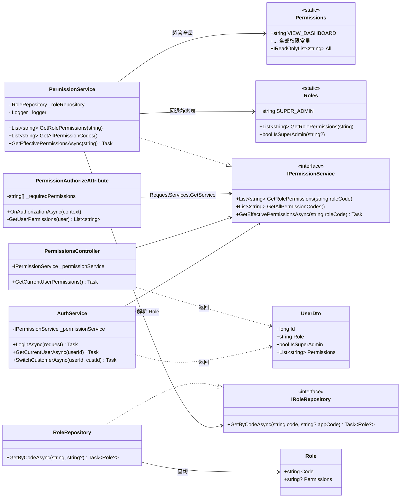
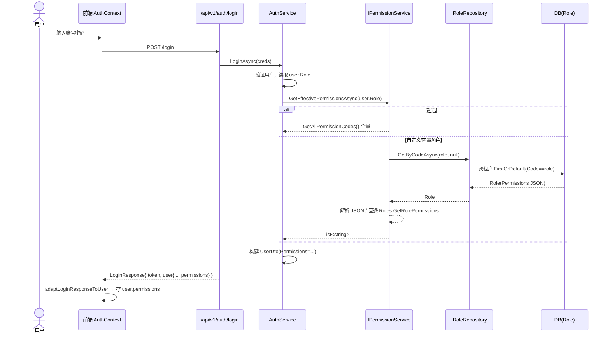
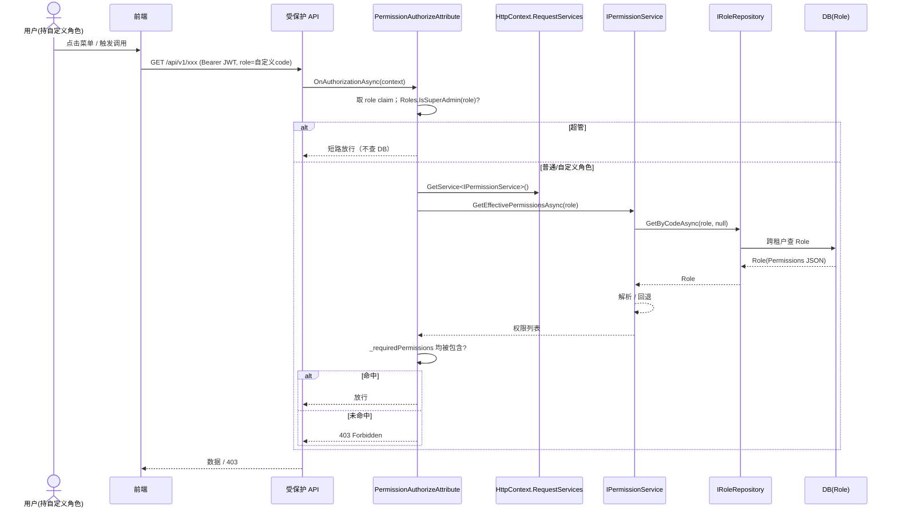
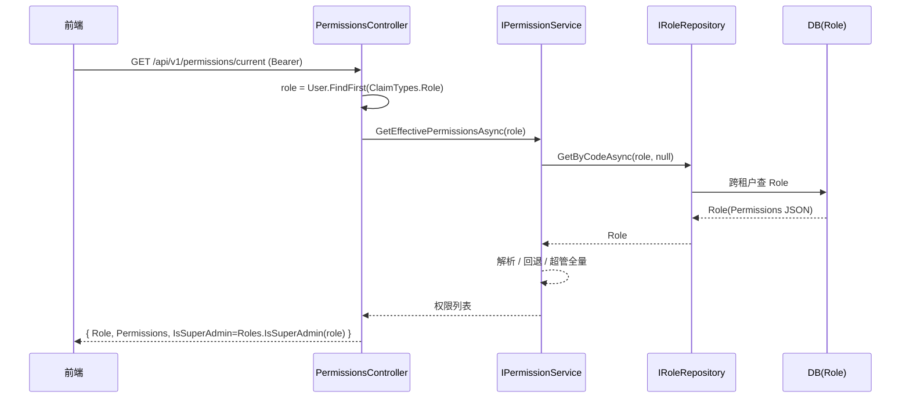
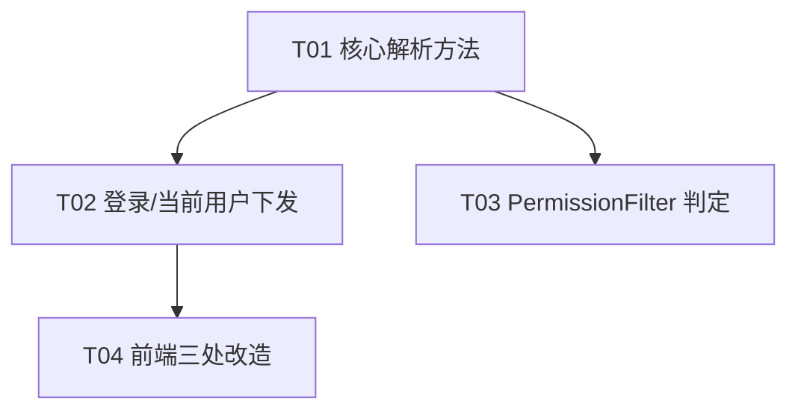

# 架构设计 + 任务分解：权限判定单一事实来源统一为 DB `Role.Permissions`

> 设计者：高见远（后端/前端架构师）｜基于 PRD（许清楚确认）+ 已核实代码事实
> 范围：仅设计，**不修改任何代码、不执行 git**。

---

## 0. 关键事实订正（先读，避免按错误路径设计）

| 项 | 核实结论 |
|----|----------|
| `IPermissionService` 位置 | 接口与实现**同在 `Services/PermissionService.cs`**（行 8–34 为接口，行 39+ 为实现）。**不存在** `Services/Interfaces/IPermissionService.cs` 独立文件。新增方法请直接加在该文件。 |
| 超管"全量"来源 | `PermissionService.GetAllPermissionCodes()`（行 61–154）已枚举 `Permissions.*` 全部常量 → 超管全量可直接复用，**无需另造常量集合**。 |
| 超管判定信号 | 统一为 `role == Roles.SUPER_ADMIN`。`PermissionsController:39`、`PermissionFilter:37`、`AuthService:222` 均用此判定。 |
| PermissionFilter 形态 | `PermissionAuthorizeAttribute : AuthorizeAttribute, IAuthorizationFilter`（**同步**）。`GetUserPermissions(ClaimsPrincipal)`（行 63–73）同步、返回 `List<string>`。改走异步解析需处理 同步↔异步。 |
| Attribute 取 DI | `TenantFilterAttribute:87` 范本：`httpContext.RequestServices.GetService<ITenantContextAccessor>()`。PermissionFilter 必须沿用此方式取 `IPermissionService`（不能构造注入）。 |
| `UserDto` 现状 | `DTOs/Responses/UserResponse.cs` 已有 `IsSuperAdmin`，缺 `Permissions`。`UserDetailDto : UserDto` 自动继承。 |
| 跨租户解析能力 | `RoleRepository.GetByCodeAsync(string code, string? appCode = null)` 已支持 `appCode` 为空 → 不过滤 → 跨租户命中（依赖 `Role.Code` 全局唯一索引）。 |
| DI 注册 | `IPermissionService`、`IRoleRepository` 均已在 `Program.cs` 注册，无需新增注册。 |

---

## 1. 实现方案 + 框架选型

- **技术栈**：沿用 **.NET 8 + React 18**，**不引入任何新依赖**（无新增 NuGet / npm 包，详见第 6 节）。
- **核心策略 —— 单一事实来源 = DB `Role.Permissions`**：
  所有"某角色拥有哪些权限"的判定，统一收敛到一个解析入口 `IPermissionService.GetEffectivePermissionsAsync(roleCode)`，其**回退链**为：
  1. **超管短路** → 返回全量（`Permissions.All` / `GetAllPermissionCodes()`）；
  2. **否则跨租户解析** → `IRoleRepository.GetByCodeAsync(code, null)` 取 `Role.Permissions`（JSON 数组）并解析；
  3. **DB 为空 / 解析失败** → 回退 `Roles.GetRolePermissions(code)`（内置角色返回静态表；未知 Code 返回空列表，**与现状一致 → 5 个内置角色零回归**）。
- **职责落点**：`PermissionFilter`、`PermissionsController`、`AuthService` 三处全部改为调用该唯一入口，不再各自直接调 `Roles.GetRolePermissions`。
- **不改 JWT**（`JwtHelper.GenerateToken` 仅发 role/AppCode 等）：权限只走**响应体**（登录响应 / `/permissions/current`）。前端判定不依赖 JWT 内权限 claim。
- **前端策略**：仅把"当前用户是否拥有某权限"的布尔判定从静态 `DEFAULT_ROLES` 切到服务端下发的 `user.permissions` 数组（`includes`）；菜单分组展示（`PERMISSION_GROUPS`）继续用静态矩阵，不变。

---

## 2. 文件列表（新增 / 修改标注）

| 改动 | 文件（相对仓库根 `/h/IoTPlatform`） | 说明 |
|------|--------------------------------------|------|
| 修改 | `Services/PermissionService.cs` | 接口（与实现同文件）新增 `GetEffectivePermissionsAsync`；实现注入 `IRoleRepository` + `ILogger<PermissionService>`；实现回退链。 |
| 修改 | `Configuration/RoleConfig.cs` | 新增 `Roles.IsSuperAdmin(string?)` 静态 helper（**建议**，统一超管判定信号）。 |
| 修改 | `Configuration/PermissionConfig.cs` | 在 `Permissions` 类新增 `All` 全量目录（**可选**；不加以 `GetAllPermissionCodes()` 代之亦可）。 |
| 修改 | `DTOs/Responses/UserResponse.cs` | `UserDto` 新增 `Permissions` 字段。 |
| 修改 | `Services/AuthService.cs` | 注入 `IPermissionService`；三处 `UserDto` 构建（Login / GetCurrentUser / SwitchCustomer）填充 `Permissions`。 |
| 修改 | `Controllers/PermissionsController.cs` | `GetCurrentUserPermissions` 改为 `async` 并改走 `GetEffectivePermissionsAsync`（保留/统一超管分支）。 |
| 修改 | `Filters/PermissionFilter.cs` | `PermissionAuthorizeAttribute` 解析改走 `IPermissionService.GetEffectivePermissionsAsync`（建议迁移 `IAsyncAuthorizationFilter` + `RequestServices` 取服务）；保留超管短路。 |
| 修改 | `Web/src/app/services/api/types/auth.types.ts` | `UserDto` 类型加 `permissions: string[]`。 |
| 修改 | `Web/src/app/services/api/types/user.types.ts` | `User` 类型加 `permissions: string[]`。 |
| 修改 | `Web/src/app/services/adapters/authAdapter.ts` | `adaptUserFromBackend`（:70-85）与 `adaptLoginResponseToUser`（:257-269）映射 `permissions`。 |
| 修改 | `Web/src/app/contexts/AuthContext.tsx` | `User` 接口（:14-23）加 `permissions`；`hasPermission` 改 `user.permissions.includes(perm)`（`Sidebar` 自动生效）。 |

> 无需新建 `Interfaces/` 文件；无需改动 `JwtHelper`、`RoleConfig` 的 `switch` 回退逻辑本身（仅新增 helper）。

---

## 3. 数据结构与接口（类图 / 接口签名）

### 3.1 `GetEffectivePermissionsAsync` 精确签名

```csharp
// 位于 Services/PermissionService.cs（IPermissionService 接口与 PermissionService 实现同文件）
/// <summary>
/// 统一解析某角色的有效权限（单一事实来源 = DB Role.Permissions）。
/// 解析顺序：超管→全量；否则跨租户取 Role.Permissions(JSON)解析；DB为空/解析失败→回退静态表。
/// </summary>
Task<List<string>> GetEffectivePermissionsAsync(string roleCode);
```

- **入参**：`roleCode` —— 来自 JWT 的 `ClaimTypes.Role` 值（即 `user.Role`）。
- **返回语义**：去重后的权限字符串列表。
  - 超管 → 系统全部已知权限（`GetAllPermissionCodes()` / `Permissions.All`）。
  - 自定义角色且 `Role.Permissions` 为非空合法 JSON → 解析出的数组。
  - 内置角色 → `Roles.GetRolePermissions(code)` 静态表（行为不变）。
  - 未知 Code / DB 权限为空 / JSON 非法 → 回退 `Roles.GetRolePermissions(code)`（未知 Code 返回 `new List<string>()`，与现状一致）。

### 3.2 解析伪代码（含 JSON 兜底、超管短路、内置回退）

```text
async GetEffectivePermissionsAsync(roleCode):
    // ① 超管短路：返回全量（单一事实来源的"全量例外"）
    if Roles.IsSuperAdmin(roleCode):
        return GetAllPermissionCodes()          // 等价于 Permissions.All

    // ② 跨租户按 Code 唯一定位自定义角色，解析 DB 的 Permissions JSON
    Role? role = await _roleRepository.GetByCodeAsync(roleCode, null)
    if role != null && !string.IsNullOrWhiteSpace(role.Permissions):
        try:
            List<string>? perms = JsonSerializer.Deserialize<List<string>>(role.Permissions)
            if perms != null && perms.Count > 0:
                return perms.Distinct().ToList()
        catch JsonException ex:
            _logger.LogWarning(ex, "角色 {RoleCode} 的 Permissions 不是合法 JSON，回退至静态表", roleCode)

    // ③ 回退：内置角色静态表；未知 Code 返回空列表（与现状一致，5 内置角色零回归）
    return Roles.GetRolePermissions(roleCode)
```

> 实现新增依赖：`private readonly IRoleRepository _roleRepository;` 与 `private readonly ILogger<PermissionService> _logger;`（当前 `PermissionService` 无构造器，需补构造器注入）。`System.Text.Json` 已随框架可用（`RoleRepository` 已用）。

### 3.3 `UserDto` 新增字段

```csharp
// DTOs/Responses/UserResponse.cs —— UserDto 新增：
public List<string> Permissions { get; set; } = new List<string>();
// UserDetailDto : UserDto 自动继承，无需改动
```

### 3.4 类图（另见 `class-diagram.mermaid`）



---

## 4. 程序调用流程（时序图）

### 图 A：登录响应携带 `permissions`（P1 登录路径）



### 图 B：受保护接口权限判定（P0 PermissionFilter 全链路）



### 图 C：`/api/v1/permissions/current`（P1，前端刷新权限用）



---

## 5. 任务列表（有序、含依赖、按实现顺序）

> 依赖图：`T01 → {T02, T03}`，`T02 → T04`。T02 与 T03 彼此独立、可并行。

| 任务 | 名称 | 源文件（来自第 2 节） | 依赖 | 优先级 | 完成定义（验证点） |
|------|------|----------------------|------|--------|--------------------|
| **T01** | 后端核心：统一权限解析方法 | `Services/PermissionService.cs`、`Configuration/RoleConfig.cs`（+`IsSuperAdmin`）、`Configuration/PermissionConfig.cs`（+`All`，可选） | 无 | P0 | 单测 `GetEffectivePermissionsAsync`：① mock `IRoleRepository` 超管→返全量；②自定义角色→返 DB JSON；③未知 Code→回退空（与现状一致）。 |
| **T02** | 后端接入：登录/当前用户权限下发 | `DTOs/Responses/UserResponse.cs`、`Services/AuthService.cs`、`Controllers/PermissionsController.cs` | T01 | P0/P1 | 集成测试：登录响应含 `permissions`；`/permissions/current` 对自定义角色返 DB 权限、超管返全量；5 内置角色返回与现状一致。 |
| **T03** | 后端接入：PermissionFilter 统一判定 | `Filters/PermissionFilter.cs` | T01 | P0 | 集成测试：自定义角色持 JWT 访问受保护接口命中 DB 权限；超管仍短路放行；内置角色行为不变；未授权返 403。 |
| **T04** | 前端：类型/适配器/判定三处改造 | `auth.types.ts`、`user.types.ts`、`authAdapter.ts`、`AuthContext.tsx` | T02 | P0/P1 | 登录后 `user.permissions` 正确；`hasPermission("x")` 基于下发数组；`Sidebar` 按真实权限显示；超管 `includes` 全量通过。 |

### 任务依赖图



---

## 6. 依赖包列表

**无新增依赖。**

- **.NET 8 NuGet**：`System.Text.Json`（随框架，`RoleRepository` 已用）、`Microsoft.Extensions.Logging`（框架内置）、`IRoleRepository` / `IPermissionService`（已在 `Program.cs` 注册，无需新增注册）。**无新增 NuGet 包。**
- **React 18 npm**：仅改既有 TS 文件，复用 `config/permissions.ts` 的 `PERMISSION_GROUPS` / `DEFAULT_ROLES`。**无新增 npm 包。**

---

## 7. 共享知识（跨文件约定）

1. **权限字符串常量集中**：全部权限常量在 `Configuration/PermissionConfig.cs` 的 `Permissions` 静态类；超管全量可直接用 `PermissionService.GetAllPermissionCodes()` 或新增的 `Permissions.All`。新增权限必须同步进 `All`，否则超管会"看不到"新权限（见第 8 节）。
2. **超管判定信号唯一**：`Roles.IsSuperAdmin(roleCode)`（`role == Roles.SUPER_ADMIN`）。**两处必须一致**：① `GetEffectivePermissionsAsync` 内部短路返全量；② `PermissionAuthorizeAttribute.OnAuthorization` 短路放行（现有 `:37`）。`PermissionsController` 的超管分支也应改用同一 helper。
3. **解析顺序铁律**（单一事实来源 = DB）：超管→全量 → 跨租户 `GetByCodeAsync(code, null)` 取 `Role.Permissions` JSON 解析 → DB 空/解析失败 → 回退 `Roles.GetRolePermissions(code)`（内置返静态表，未知 Code 返空，保持现状）。
4. **跨租户唯一性前提**：`GetByCodeAsync(code, null)` 的 `appCode` 为空即不过滤，依赖 `Role.Code` 全局唯一索引。务必保证 Code 全局唯一，否则可能命中错误租户角色。
5. **不改 JWT**：权限只走响应体（登录响应 / `/permissions/current`）。前端判定**不依赖** JWT 内权限 claim。
6. **前端职责边界**：`config/permissions.ts` 的 `PERMISSION_GROUPS` / `DEFAULT_ROLES` 继续用于**菜单分组展示**；仅"当前用户是否拥有某权限"的布尔判定切到 `user.permissions.includes(perm)`。
7. **Attribute 取服务范本**：`PermissionAuthorizeAttribute` 不能用构造注入，必须 `HttpContext.RequestServices.GetService<IPermissionService>()`（沿用 `TenantFilterAttribute:87`）。解析为异步 DB 调用，建议迁移至 `IAsyncAuthorizationFilter.OnAuthorizationAsync`；若保持 `IAuthorizationFilter` 同步，则需 `.GetAwaiter().GetResult()` 阻塞（最小改动备选，见第 9 节决策点 1）。

---

## 8. 待明确事项（PRD 3 问 → 架构注意点）

1. **自定义角色能否勾选"超管专属权限"？**
   `GetEffectivePermissionsAsync` 对自定义角色直接信任并解析 DB `Permissions` JSON。若运营管理后台误勾 `view_api_config` / `update_api_config` 等超管专属权限，会**真实生效**。
   *架构注意*：① 建议前端角色编辑 UI 用 `PERMISSION_GROUPS` 区分"超管独占"分组，并在保存（`UpdatePermissionsAsync`）处加服务端校验；② 本次仅做解析统一、不强制校验，但需在共享约定中明确"超管专属权限集合"定义位置（可在 `Permissions` 类新增 `SuperAdminOnly` 子集）。

2. **登录后权限缓存与刷新（对应 P2）**
   本次登录响应与 `/permissions/current` 均为**实时计算**，不缓存权限结果；但前端可能把 `user.permissions` 长期保存在 `AuthContext` 状态中。
   *架构注意*：① 权限以"服务端每次返回为准"，前端状态只是快照；② 角色被编辑后已登录用户需刷新——要么前端在 `/permissions/current` 提供轮询/手动刷新入口，要么 P2 实现"角色编辑后推送/失效已登录用户权限"。本次不实现，但 `AuthContext.hasPermission` 应只依赖 `user.permissions` 快照，刷新即重取。

3. **超管"全量"是否覆盖未来新增权限**
   超管返回的是 `GetAllPermissionCodes()` / `Permissions.All`（当前全部已知常量）。若后续新增权限常量却忘记加入 `All`，超管将"看不到"新权限。
   *架构注意*：`Permissions.All` 必须与 `Permissions.*` 常量保持同步。建议改为由集中数组/反射派生，避免人为遗漏。这是"单一事实来源"在超管场景的边界例外，需在约定中固化。

4. **工程注意（同步→异步迁移）**
   `PermissionFilter` 由同步 `IAuthorizationFilter` 改为异步时，需确认现有 `[PermissionAuthorize]` 标注的控制器/Action 对该接口切换无副作用（仅影响执行时机，不影响语义）；`AuthService` 注入 `IPermissionService`（Scoped）后在请求 Scope 内 `await` 解析无问题。

---

## 9. 自洽性评估与交付结论

**任务列表是否自洽**：✅ 自洽。
- 依赖无环、无悬空：`T01` 为根，`T02`/`T03` 仅依赖 `T01` 且**可并行**，`T04` 依赖 `T02` 的类型形状。
- 每个任务都有明确"完成定义"（单测/集成测试点），可独立提交与验证。
- 文件划分与第 2 节一一对应，无遗漏（核心方法、下发、判定、前端各一组）。

**能否直接交给工程师实现**：✅ 基本可以。需工程师拍板 **2 个决策点**：
1. **PermissionFilter 异步化方案**：推荐迁移 `IAsyncAuthorizationFilter.OnAuthorizationAsync`（无阻塞、性能优）；若求最小改动面，可保留 `IAuthorizationFilter` 同步 + `GetEffectivePermissionsAsync(...).GetAwaiter().GetResult()` 阻塞（ASP.NET Core 默认无同步上下文，通常安全，但会占用请求线程做 DB 调用）。
2. **辅助方法是否新增**：`Roles.IsSuperAdmin(...)` 与 `Permissions.All` 均为"建议但非必需"——不新增也能用（`role == Roles.SUPER_ADMIN` 与 `GetAllPermissionCodes()` 直接替代）。建议新增以统一信号、避免两处逻辑漂移。

**关于"每任务≥3 文件"通用约定的偏差说明**：`T03`（PermissionFilter）为单文件改动。这是 `Attribute` 内聚改动且独立可单测，故单列以保留 `T02`/`T03` 的并行度；若团队强制要求每任务≥3 文件，可将 `T03` 合并进 `T02` 成为"后端权限接入（下发+判定）"，但会损失并行性。其余任务均满足≥3 文件。

> 结论：本设计可直接作为工程师实现规格（含精确签名、回退伪代码、时序图、依赖顺序）。仅需就上述 2 个决策点确认后开工。
